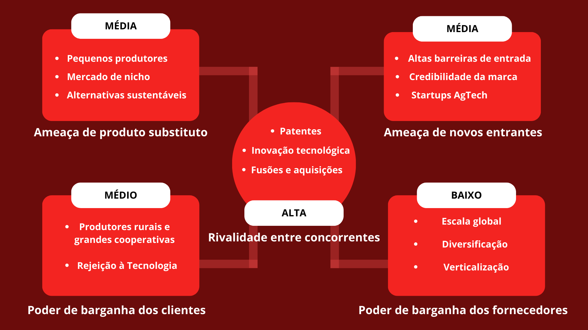
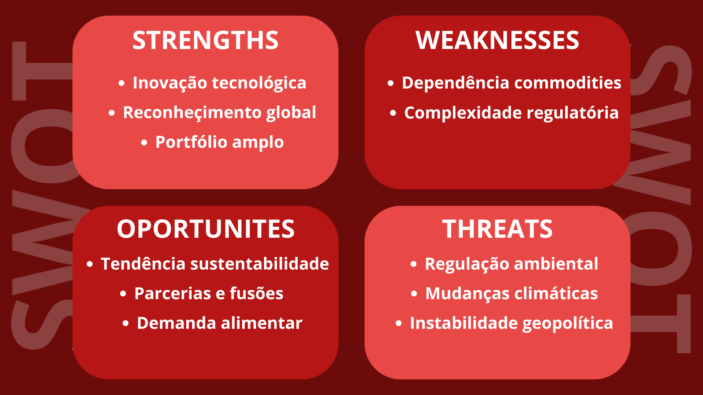
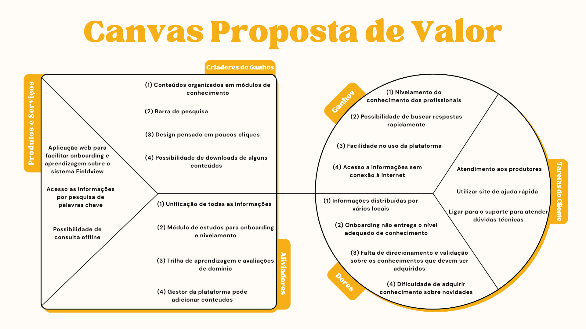
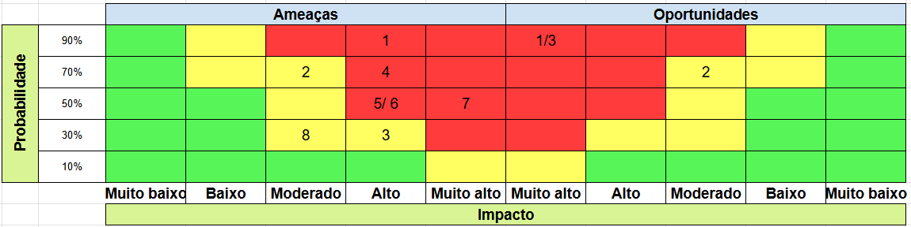
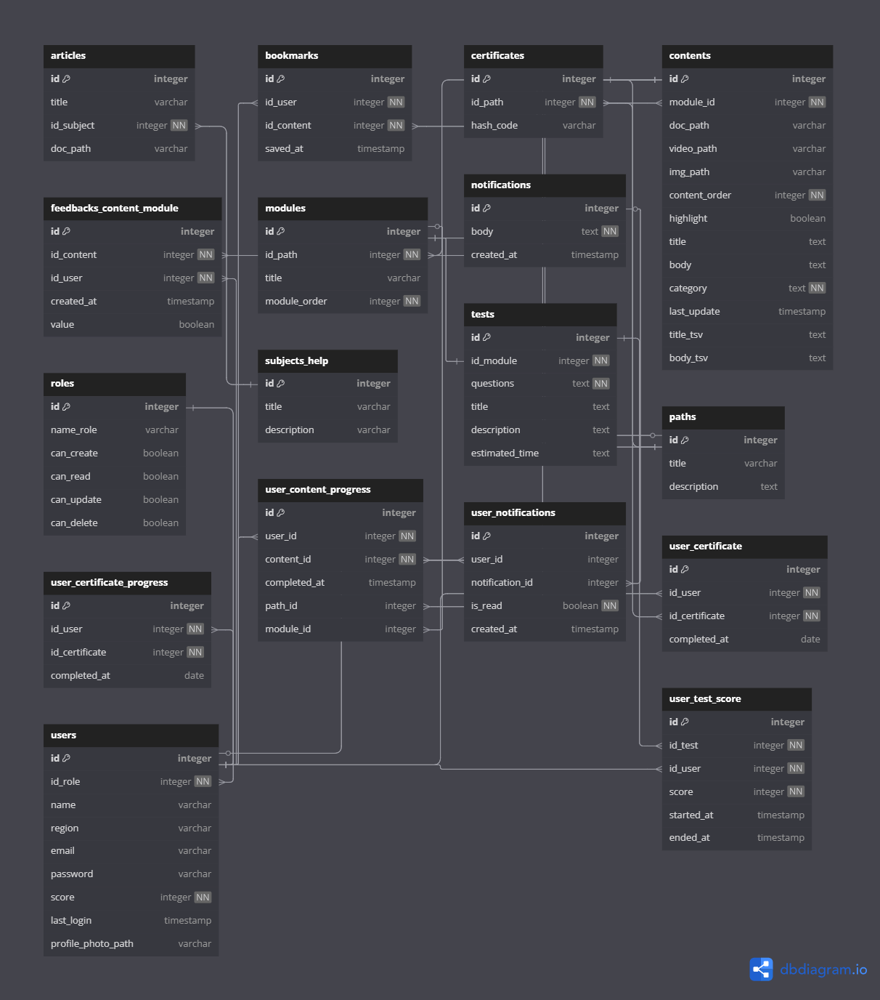

# WAD - Web Application Document - Módulo 2 - Inteli

**_Os trechos em itálico servem apenas como guia para o preenchimento da seção. Por esse motivo, não devem fazer parte da documentação final_**

## Nome do Grupo

#### Nomes dos integrantes do grupo
- <a href="https://www.linkedin.com/in/antoniodicillo/">Antonio Di Cillo</a>
- <a href="https://github.com/CaduQuaglia">Carlos Quaglia</a>
- <a href="https://www.linkedin.com/in/emanuelly-cantarelli-2a0480305/?utm_source=share&utm_campaign=share_via&utm_content=profile&utm_medium=ios_app">Emanuelly Dias</a> 
- <a href="https://www.linkedin.com/in/joao-agmont-b82228359/">Joao Agmont</a> 
- <a href="https://www.linkedin.com/in/luiz-hinuy-0995252b1/">Luiz Hinuy</a>
- <a href="https://www.linkedin.com/in/maria-arielly/">Maria Arielly</a> 
- <a href="https://www.linkedin.com/in/-rafael-cabral/">Rafael Cabral</a>

## Sumário

[1. Introdução](#c1)

[2. Visão Geral da Aplicação Web](#c2)

[3. Projeto Técnico da Aplicação Web](#c3)

[4. Desenvolvimento da Aplicação Web](#c4)

[5. Testes da Aplicação Web](#c5)

[6. Estudo de Mercado e Plano de Marketing](#c6)

[7. Conclusões e trabalhos futuros](#c7)

[8. Referências](c#8)

[Anexos](#c9)

<br>


# <a name="c1"></a>1. Introdução (sprints 1 a 5)

&nbsp;&nbsp;&nbsp;&nbsp; A divisão agrícola da Bayer AG <sup>[1](#c10)</sup>, consolida-se como líder global em soluções integradas para o agronegócio, com foco em sementes geneticamente modificadas, defensivos agrícolas e tecnologias digitais. Seu portfólio inclui o Climate FieldView <sup>[2](#c11)</sup>,  plataforma digital que ajuda a priorizar o monitoramento, identificar problemas de forma rápida e tomar medidas para proteger sua produtividade por meio de imagens de satélite de fácil utilização e de alta qualidade. <br>

&nbsp;&nbsp;&nbsp;&nbsp; A empresa investe fortemente em pesquisa e desenvolvimento, posicionando-se na vanguarda da agricultura 4.0. No entanto, existem problemáticas que comprometem sua eficácia, o primeiro problema que a equipe de PTDs enfrenta é o turnover acima de 30% ao ano. O **Turnover**, é a alta rotatividade de funcionários, acarreta em diversos impactos negativos, como aumento de custos com recrutamento e seleção, além da perda de conhecimento e experiência acumulada. A segunda problemática é a falta de treinamento estruturado que possa guiar o processo de desenvolvimento de habilidades e conhecimentos, dos novos contratados. Gerando resultados ineficazes, falta de progresso, contratempos no desempenho e segurança. <br>

&nbsp;&nbsp;&nbsp;&nbsp; Para solucionar esse desafio, foi desenvolvida uma plataforma web de capacitação técnica, que oferece trilhas de conhecimento em diferentes formatos aos PTDs antes de sua atuação em campo, acompanhando o progresso individual dos colaboradores, além de incorporar elementos de gamificação para engajamento.  Os principais aspectos de criação de valor da solução estão na melhoria da experiência do produtor rural, na redução de custos operacionais com suporte, na padronização do atendimento e na possibilidade de monitorar e aprimorar continuamente a qualificação dos PTDs, alinhando o produto às expectativas e necessidades reais do parceiro de negócios. A solução proposta pelo nosso projeto visa não apenas corrigir gaps de conhecimento, como criar um ciclo virtuoso de engajamento, certificação e acompanhamento contínuo, alinhando a operação de campo às ambições de inovação da Bayer.<sup>[3](#c17)</sum> <br>

# <a name="c2"></a>2. Visão Geral da Aplicação Web (sprint 1)

## 2.1. Escopo do Projeto (sprints 1 e 4)

### 2.1.1. Modelo de 5 Forças de Porter (sprint 1)
As forças de Porter analisam o nível de competitividade e atratividade de um setor por meio de cinco fatores: ameaça de novos entrantes, poder de barganha de fornecedores, poder de barganha de clientes, ameaça de produtos substitutos e rivalidade entre concorrentes. Desse modo a posição da Bayer no setor se dá da seguinte maneira: <br>

<div align = "center">

<sup>Figura 1: Forças de Porter do mercado da empresa Bayer.</sup><br>

<br>

<sub>Fonte: Material produzido pelos autores (2025).</sub><br>
</div>

#### Ameaça de novos entrantes: Média a baixa. <br>
O setor exige grandes investimentos em P&D, infraestrutura e cumprimento de regulações rigorosas, o que cria barreiras significativas. A Bayer ainda possui forte credibilidade entre os produtores, dificultando a entrada de novas marcas. Baseado em dados da revista Exame <sup>[4](#c12)</sup>, startups AgTech estão conseguindo espaço com soluções tecnológicas específicas, como agricultura de precisão e monitoramento por IA. <br>

#### Poder de barganha dos fornecedores: Baixo.<br>
A Bayer, sendo uma multinacional de grande porte, possui escala global que lhe confere vantagem nas negociações com fornecedores. Além disso, sua estratégia de diversificação de fornecedores em vários países e seu investimento em verticalização (produção própria de insumos) reduz sua dependência externa. <br>

#### Poder de barganha dos clientes: Médio. <br>
Produtores rurais e grandes cooperativas têm algum poder de negociação, principalmente em mercados onde a concorrência é intensa. Ainda assim, muitos clientes tradicionais mostram resistência inicial a novas tecnologias, como mostra a matéria da Distrito <sup>[5](#c13)</sup>. A Bayer busca mitigar isso oferecendo pacotes integrados e tecnologias patenteadas, dificultando a substituição por concorrentes. <br>

#### Ameaça de produtos substitutos: Média. <br>
Pequenos produtores e mercados de nicho estão buscando alternativas sustentáveis, como biopesticidas e métodos orgânicos de cultivo evidenciado por Compre Rural <sup>[6](#c14)</sup>. Embora essas opções estejam crescendo, os produtos da Bayer ainda oferecem maior escala, eficácia e previsibilidade, fatores decisivos para grandes produtores.<br>

#### Rivalidade entre concorrentes: Alta. <br>
A disputa no setor é intensa, envolvendo grandes empresas como Syngenta, Corteva e BASF. A competição se baseia principalmente em inovação tecnológica, desenvolvimento de patentes e capacidade de oferecer soluções digitais avançadas, fator esse evidenciado na Imagen Agropecuaria <sup>[7](#c15)</sup>. Estratégias como fusões e aquisições são comuns para fortalecer posições de mercado e expandir a base tecnológica.<br>

### 2.1.2. Análise SWOT da Instituição Parceira (sprint 1)

Ferramenta que analisa forças, fraquezas, oportunidades, ameaças.

A Bayer se destaca pela forte inovação tecnológica, marca global consolidada e capacidade financeira, o que a posiciona entre os líderes do agronegócio mundial. Seu portfólio integrado reforça a competitividade frente a rivais como Syngenta, Corteva e BASF. No entanto, enfrenta desafios de altos custos e maior pressão regulatória, que podem ser explorados por concorrentes. O crescimento da agricultura digital e da demanda por sustentabilidade abre oportunidades para reforçar sua liderança. A empresa busca equilibrar produtividade e responsabilidade ambiental para se diferenciar num mercado cada vez mais competitivo e sensível às questões sociais. <br>

<div align = "center">

<sup>Figura 2: Análise SWOT da Bayer.</sup><br>

<br>

<sub>Fonte: Material produzido pelos autores (2025).</sub><br>
</div>

### 2.1.3. Solução (sprints 1 a 5)

#### 1. Problema a ser resolvido:
A empresa Bayer oferece uma plataforma digital, Climate FieldView, que monitora a saúde dos campos e coleta informações de produções agrícolas. Atualmente há uma equipe de atendimento aos produtores, PTDs (Promotores Técnicos Digitais). Entretanto esses profissionais apresentam lacunas no conhecimento necessário para auxiliar os agricultores, ocasionando a alta rotatividade de promotores e a sobrecarga na equipe de suporte.

#### 2. Dados disponíveis: 
Com base nos dados disponibilizados pela empresa, análises internas da Bayer indicam alta rotatividade de PTDs, sobrecarga no suporte e dificuldades dos promotores em campo ao utilizar a plataforma digital Climate FieldView.

#### 3. Solução proposta:
A solução consiste em uma aplicação web com trilhas de capacitação personalizadas, iniciando com um módulo obrigatório de onboarding. Essas trilhas de aprendizado funcionarão como módulos, e poderão ser atualizadas e personalizadas pelo gestor. Além disso, um ponto principal da plataforma será a fácil busca a qualquer dúvida que possa surgir durante o atendimento no campo. <br>    

#### 4. Forma de utilização da solução:
A solução poderá ser utilizada tanto no formato mobile, quanto em um navegador web, além da possibilidade de acesso offline, garantindo acesso mesmo em locais com pouca conectividade, como áreas rurais.<br>

#### 5. Benefícios esperados
Espera-se que os PTDs atuem com maior autonomia e eficiência, reduzindo o número de chamados ao suporte e aumentando a satisfação dos produtores. Com isso, esses profissionais poderão otimizar seu tempo e focar o trabalho em objetivos mais específicos. <br>

#### 6. Critério de sucesso e como será avaliado
O sucesso da solução será avaliado a partir de feedbacks dos próprios PTDs, e também dos agricultores. Além de avaliações ao final de cada trilha do conhecimento, através de testes com questões, como forma de analisar a retenção de conteúdo.<br>

### 2.1.4. Value Proposition Canvas (sprint 1): 
O canva de proposta de valor é uma ferramenta para organizar os pontos principais de necessidades e expectativas do cliente e relacioná-los com o projeto que será entregue, garantindo que todos os pontos foram atendidos.

<div align = "center">

<sup>Figura 3: Canvas Proposta de Valor.</sup><br>

<br>

<sub>Fonte: Material produzido pelos autores (2025).</sub><br>
</div>

### Perfil do cliente
#### Tarefas do cliente
#### Atendimento aos produtores: 
PTDs comparecem presencialmente nas fazendas para solucionar problemas sobre o sistema fieldview
#### Utilizar site de ajuda rápida: 
Para responder dúvidas específicas os promotores utilizam o site já existente de ajuda rápida
#### Ligar para o suporte para atender dúvidas técnicas: 
Caso as informações que precisa não se encontrem no site de ajuda rápida o promotor recorre ao suporte técnico<br>

### Ganhos
#### (1) Nivelamento de conhecimento dos profissionais: 
Ferramenta para direcionar os conteúdos organizadamente
#### (2) Possibilidade de buscar respostas rapidamente: 
O PTD necessita de uma solução onde consiga pesquisar os conteúdos usando palavras chave
#### (3) Facilidade no uso da plataforma: 
O promotor deve acessar a página que deseja de forma intuitiva e com poucos cliques
#### (4) Acesso a informações sem conexão à internet: 
No cotidiano o PTD se move para lugares onde a conexão à internet é lenta ou inexistente, portanto necessita de opções offline<br>

### Dores
#### (1) Informações sobre o fieldview distribuídas por vários locais: 
Atualmente os guias e conhecimento sobre o fieldview estão distribuídos em pelo menos três plataformas diferentes e de forma desorganizada além de ser frequentemente passados por chat entre os PTDs
#### (2) Onboarding não entrega o nível adequado de conhecimento: 
O onboarding é possui apenas uma semana, o que é curto demais para que o novo profissional aprenda suficientemente sobre o sistema 
#### (3) Falta de direcionamento e validação sobre os conhecimentos que devem ser adquiridos: 
Não existe planejamento sobre o que deve ser aprendido em relação ao fieldview nem sistema para conferir o nível conhecimento dos PTDs
#### (4) Dificuldade de adquirir conhecimento sobre novidades: 
O fieldview é um sistema que constantemente recebe atualizações que incluem novas ferramentas e funcionalidades, porém não há forma eficiente para distribuir essas informações aos PTDs

### Proposta de valor
### Produtos e serviços
#### Aplicação web para facilitar onboarding e aprendizagem sobre o sistema fieldview: 
A solução digital consiste em um site onde o PTD acessa com seu login e pode seguir uma trilha de conhecimento
#### Acesso às informações por pesquisa de palavras-chave:
Com a barra de pesquisa o PDT pode com agilidade utilizar palavras-chave para encontrar conteúdos sobre o assunto desejado
#### Possibilidade de consulta offline: 
A solução contém partes baixáveis de forma que o promotor pode acessá-las mesmo sem conexão com a internet
### Criadores de ganhos
#### (1) Conteúdos organizados em módulos de conhecimento: 
O conteúdo é entregue seguindo um planejamento e categorização
#### (2) Barra de pesquisa: 
Ferramenta para pesquisa de conteúdo por digitação de palavra-chave
#### (3) Design para poucos cliques:
O design do site é feito de forma que o usuário consegue acessar o que deseja com o mínimo número de cliques
#### (4) Possibilidade de downloads de alguns conteúdos:
Alguns conteúdos da plataforma são disponíveis para baixar no dispositivo, para que o acesso sem conexão a internet ocorra
### Aliviam as dores
#### (1) Unificação de todas as informações:
A solução conta com todos os conteúdos e informações necessárias para a utilização do sistema Fieldview em um só lugar
#### (2) Módulo de estudos para onboarding e nivelamento:
Para direcionar o PTD, existem módulos de conhecimento que são entregues de forma planejada a fim de realizar o onboarding de um novo promotor e assim nivelar o conhecimento dos profissionais em campo
#### (3) Trilha de aprendizagem e avaliações de domínio:
Os módulos de conteúdo são categorizados e disponíveis de forma plenejada assim como personalizada de acordo com os resultados das avaliações
#### (4) Gestor da plataforma pode adicionar conteúdos:
Os funcionários com acesso especial para gerenciar a plataforma conseguem adicionar e remover conteúdos a qualquer momento

### 2.1.5. Matriz de Riscos do Projeto (sprint 1)

&nbsp;&nbsp;&nbsp;&nbsp; A matriz de riscos é uma ferramenta visual e analítica fundamental para a gestão de projetos, permitindo a identificação, análise e avaliação dos riscos que podem impactar objetivos organizacionais e projetos. A matriz de riscos consiste em uma representação gráfica que cruza dois eixos principais: a probabilidade de ocorrência de um risco e o impacto que esse risco pode causar. Essa abordagem possibilita classificar os riscos em diferentes níveis de criticidade, facilitando a priorização das ações de mitigação e o direcionamento eficiente de recursos para os riscos mais relevantes <sup>[8](#c16)</sup>. Dessa forma, a matriz de riscos foi utilizada em nosso projeto para identificar potenciais situações adversas que podem vir a afetar o andamento do trabalho, como também ações que estão sendo utilizadas para diminuir essa probabilidade de ocorrência. <br>

<div align = "center">

<sup>Figura 4: Matriz de Riscos do projeto.</sup><br>

<br>

<sub>Fonte: Material produzido pelos autores (2025). </sub><br>

<sup>Quadro 1: Riscos e planos de ação.</sup><br>

| \# | **Ameaça** | **Plano de Ação** |
|----|------------|-------------------|
| 1 | A construção de uma única plataforma Web pode não abranger todas as necessidades do projeto | Definir um escopo claro com o parceiro (Bayer) e considerar arquitetura modular para expansões futuras |
| 2 | Dificuldade em compreender todas as funcionalidades do FieldView | Realizar imersão guiada com especialistas da Bayer e consultar documentação oficial |
| 3 | Falta de foco e engajamento da equipe nos horários de trabalho | Implementar rotinas ágeis com dailies curtas, metas claras e check-ins semanais |
| 4 | Não conseguir contemplar todas as dores dos PTDs na solução inicial | Conduzir entrevistas com PTDs e priorizar as principais dores em MVPs iterativos |
| 5 | Limitações nas ferramentas digitais disponíveis para a construção web | Avaliar previamente os recursos disponíveis e negociar o uso de frameworks externos com o parceiro |
| 6 | Dificuldade em criar uma solução realmente útil para o PTD | Co-desenvolver a solução com feedback contínuo dos PTDs e validar protótipos com usuários reais |
| 7 | Complexidade técnica do problema dificultar o avanço da solução | Dividir o desafio em tarefas menores, com estudo dirigido e apoio de mentores/tutores técnicos |
| 8 | Instabilidade de conexão com internet durante o desenvolvimento | Garantir planos alternativos como locais com Wi-Fi estável, dados móveis extras ou trabalho offline sempre que possível |

<sub>Fonte: Material produzido pelos autores (2025). </sub><br>
</div>

&nbsp;&nbsp;&nbsp;&nbsp; Além disso, também foi feito o levantamento de potenciais oportunidades a serem conquistadas através da construção do projeto.<br>

<div align = "center">

<sup>Quadro 2: Oportunidades.</sup><br>
| \# | **Oportunidade** | **Plano de Ação** |
|----|------------------|-------------------|
| 1 | Desenvolver habilidades em outros eixos do conhecimento | Identificar e distribuir funções multidisciplinares entre os membros (gestão de produto, UX/UI, comunicação, dados) para estimular o aprendizado prático e colaborativo |
| 2 | Expandir nosso entendimento sobre conhecimentos agrários com o FieldView | Agendar sessões com especialistas da Bayer, explorar simulações da plataforma e documentar aprendizados em um repositório compartilhado |
| 3 | Desenvolver e aprofundar habilidades em tecnologias de construção Web | Dividir a equipe em squads com foco técnico, definir sprints para estudo prático de ferramentas web (frameworks, backend, autenticação) e aplicar diretamente na plataforma

<sub>
Fonte: Material produzido pelos autores (2025)
</sub>

</div>

## 2.2. Personas (sprint 1)
Personas são representações fictícias de usuários ideais. Elas ajudam a entender melhor o público-alvo do projeto, guiando decisões de design e funcionalidades para atender às necessidades, expectativas e dores dos usuários de forma mais eficaz. Dessa forma, foram construídas as seguintes personas para o projeto:<br>

<div align = "center">

<sup>Figura 5: Persona "Mariana Lima" (PTD).</sup><br>

<br>

<sub>Fonte: Material produzido pelos autores (2025). </sub><br>

<sup>Figura 6: Persona "Jorge Almeida" (Coordenador).</sup><br>

<br>

<sub>Fonte: Material produzido pelos autores (2025). </sub><br>
</div>

## 2.3. User Stories (sprints 1 a 5)
User Stories são descrições simples das funcionalidades do sistema escritas do ponto de vista do usuário final. Elas ajudam a definir o que o sistema deve fazer, focando nas necessidades e objetivos do usuário. Dessa forma, foram feitas as seguintes User Stories para o projeto:<br>

<div align = "center">

<sup>Quadro 3: US01.</sup><br>

Identificação | US01 (Prioritária)
--- | ---
Persona | Mariana Lima (PTD) 
User Story | “Como PTD, quero buscar rapidamente conteúdos técnicos (vídeos, manuais, infográficos), para resolver dúvidas no campo sem depender do suporte.”
Critério de aceite 1 | CR1: Mariana pode buscar por palavras-chave (ex: “sensor”, “drive”) e obter resultados relevantes em até 2 cliques.
Critério de aceite 2 | CR2: Os conteúdos são apresentados em formatos curtos (até 10 minutos) e com linguagem acessível.
Critério de aceite 3 | CR3: Mariana pode favoritar conteúdos para acesso posterior. (outra US) | 
Critérios INVEST | **Independente**: Não depende de outras funcionalidades como quizzes ou ranking. <br> **Negociável**: Os formatos de conteúdo e filtros podem ser ajustados conforme feedback.<br> **Valorosa**: Reduz o tempo de resolução de dúvidas e evita erros em campo.<br> **Estimável**: Esforço claro (busca, favoritos, sugestão).  <br> **Small**: Foco apenas em busca e exibição de conteúdo. <br> **Testável:** Simulação de buscas e acesso offline.


<sub>Fonte: Material produzido pelos autores (2025).</sub><br>

<sup>Quadro 4: US02.</sup><br>

Identificação| US02 (Prioritária)
--- | ---
Persona |Mariana Lima (PTD)
User Story | “Como PTD, quero receber recomendações de trilhas de aprendizagem baseadas nas minhas deficiências técnicas, para evoluir de forma direcionada.” 
Critério de aceite 1| CR1: Conteúdos são recomendados de acordo com lacunas identificadas no onboarding e desempenho em atividades anteriores na plataforma.
Critério de aceite 2 |CR2: O progresso e o desempenho em cada trilha são exibidos em porcentagem.
Critério de aceite 3 | CR3: Mariana recebe feedback imediato ao completar os módulos.
Critérios INVEST |  **Independente:** Não depende de gamificação ou certificação. <br> **Negociável:** Critérios do diagnóstico podem ser ajustados. <br> **Valorosa:** Foco no aprendizado eficiente. <br> **Estimável:** Diagnóstico e lógica de recomendação são claros.<br> **Small:** Apenas trilhas e feedback. <br> **Testável:** Teste com perfis simulados. 

<sub>Fonte: Material produzido pelos autores (2025).</sub><br>

<sup>Quadro 5: US03.</sup><br>

Identificação |US03 (Prioritária)
--- | --- 
Persona | Mariana Lima (PTD)
User Story | “Como PTD, quero receber um certificado ao concluir uma trilha e ser aprovada em uma avaliação, para comprovar minha capacitação.” 
Critério de aceite 1 | CR1: Certificado é gerado automaticamente após 80% de acerto em um quiz.
Critério de aceite 2 | CR2: Certificado inclui nome, trilha, data e habilidades validadas.
Critério de aceite 3 | CR3: Mariana pode baixar e compartilhar o certificado.
Critérios INVEST | **Independente:** Não depende de ranking ou notificações.<br> **Negociável:** Critérios de aprovação podem variar. <br> **Valorosa:** Comprova capacitação e valoriza o PTD. <br> **Estimável:** Quiz, emissão e histórico são claros. <br> **Small:** Foco em uma trilha por vez. <br> **Testável:** Simulação de aprovação/reprovação.


<sub>Fonte: Material produzido pelos autores (2025).</sub><br>

<sup>Quadro 6: US04.</sup><br>

Identificação|US04 
--- | ---
Persona | Mariana Lima (PTD)
User Story | “Como PTD, quero avaliar e comentar os conteúdos consumidos, para contribuir com a melhoria da plataforma.” 
Critério de aceite 1 | CR1: Mariana pode dar nota e comentar após cada conteúdo.
Critério de aceite 2 | CR2: Feedback é enviado automaticamente aos gestores.
Critério de aceite 3 | CR3: Mariana pode visualizar o histórico de avaliações feitas.
Critério de aceite 4 | CR4: Mariana pode reportar conteúdos desatualizados.


<sub>Fonte: Material produzido pelos autores (2025).</sub><br>

<sup>Quadro 7: US05.</sup><br>

US05 (Prioritária) | Identificação
--- | ---
Persona| Mariana Lima (PTD)
User Story | “Como PTD, quero baixar módulos e vídeos para acessar offline, para não ficar sem suporte em áreas sem internet.” 
Critério de aceite 1 | CR1: Mariana pode selecionar e baixar conteúdos.
Critério de aceite 2 | CR2: Conteúdo baixado é acessível sem conexão.
Critério de aceite 3 | CR3: O sistema indica conteúdos disponíveis offline.
Critério de aceite 4| CR4: Mariana pode remover conteúdos baixados.
Critérios INVEST| <br> **Independente:** Não depende de notificações ou ranking. | <br> **Negociável:** Pode ser implementado para tipos de conteúdo específicos. | <br> **Valorosa:** Garante acesso à capacitação no campo.| <br> **Estimável:** Download, cache e notificação são claros.| <br> **Small:** Foco em download e acesso offline.| <br> **Testável:** Simulação de acesso offline.


<sub>Fonte: Material produzido pelos autores (2025).</sub><br>

<sup>Quadro 8: US06.</sup><br>

Identificação| US06 (Prioritária)
--- | ---
Persona | Jorge Almeida (Coordenador)
User Story | “Como gestor, quero visualizar o progresso de cada PTD nas trilhas de capacitação, para identificar quem precisa de reciclagem.” 
Critério de aceite 1 | CR1: Jorge acessa relatórios individuais e coletivos de progresso.
Critério de aceite 2 | CR2: O sistema envia alertas sobre PTDs com baixo desempenho.
Critério de aceite 3 | CR3: Jorge pode visualizar o histórico de capacitação de cada PTD.
Critério de aceite 4 | CR4: Histórico de trilhas atribuídas fica registrado.
Critérios INVEST |  **Independente:** Não depende de gamificação ou notificações. <br> **Negociável:** Filtros e formatos de exportação podem ser ajustados. <br> **Valorosa:** Permite gestão proativa. <br> **Estimável:** Relatórios, filtros e exportação são claros. <br> **Small:** Relatórios apenas de progresso. <br> **Testável:** Geração e exportação de relatórios simulados.


<sub>Fonte: Material produzido pelos autores (2025).</sub><br>

<sup>Quadro 9: US07.</sup><br>

Identificação | US07
--- | ---
Persona | Jorge Almeida (Coordenador)
User Story | “Como gestor, quero atribuir trilhas de conhecimento a PTDs específicos, para personalizar a capacitação conforme a necessidade.” 
Critério de aceite 1 | CR1: Jorge seleciona trilhas e designa para PTDs.
Critério de aceite 2 | CR2:  PTDs recebem notificação da trilha atribuída.
Critério de aceite 3 | CR3: Histórico de trilhas atribuídas fica registrado.
Critério de aceite 4 | CR4: Jorge pode remover ou alterar trilhas atribuídas.


<sub>Fonte: Material produzido pelos autores (2025).</sub><br>

<sup>Quadro 10: US08.</sup><br>

Identificação | US08
--- | ---
Persona | Jorge Almeida (Coordenador)
User Story | “Como gestor, quero visualizar feedbacks e avaliações dos PTDs sobre os conteúdos, para aprimorar o material de capacitação.” 
Critério de aceite 1 | CR1: Jorge acessa painel com avaliações e comentários dos PTDs.
Critério de aceite 2 | CR2: Pode filtrar feedbacks por conteúdo, data ou nota.
Critério de aceite 3 | CR3: O sistema sugere conteúdos com mais reclamações para revisão.
Critério de aceite 4 | CR4: Jorge pode marcar feedbacks como resolvidos.
Critério de aceite 5 | CR5: Histórico de melhorias realizadas fica disponível.


<sub>Fonte: Material produzido pelos autores (2025).</sub><br>

<sup>Quadro 11: US09.</sup><br>

Identificação | US09
--- | ---
Persona | Jorge Almeida (Coordenador)
User Story | “Como gestor, quero receber alertas automáticos sobre PTDs com baixo desempenho em quizzes, para agir rapidamente.” 
Critério de aceite 1 | CR1: Jorge recebe notificação por e-mail/app quando um PTD falha 3 vezes.
Critério de aceite 2 | CR2: O sistema sugere módulos de reforço.
Critério de aceite 3 | CR3: O histórico de alertas fica disponível.
Critério de aceite 4 | CR4: Jorge pode enviar mensagens de orientação ao PTD.
Critério de aceite 5 | CR5: Alertas podem ser configurados conforme critério.


<sub>Fonte: Material produzido pelos autores (2025).</sub><br>

<sup>Quadro 12: US10.</sup><br>

Identificação | US10
--- | ---
Persona | Jorge Almeida (Coordenador)
User Story | “Como gestor, quero exportar relatórios de progresso e desempenho dos PTDs em formatos PDF e Excel, para compartilhar em reuniões.” 
Critério de aceite 1 | CR1: Jorge pode selecionar período e tipo de relatório.
Critério de aceite 2 | CR2: Relatórios são gerados em PDF ou Excel.
Critério de aceite 3 | CR3: Dados exportados incluem filtros aplicados.
Critério de aceite 4 | CR4: Relatórios podem ser enviados por e-mail.
Critério de aceite 5 | CR5: Histórico de relatórios exportados fica disponível.

<sub>Fonte: Material produzido pelos autores (2025).</sub><br>
</div>

# <a name="c3"></a>3. Projeto da Aplicação Web (sprints 1 a 4)

## 3.1. Arquitetura (sprints 3 e 4)

*Posicione aqui o diagrama de arquitetura da sua solução de aplicação web. Atualize sempre que necessário*

## 3.2. Wireframes (sprint 2)

*Posicione aqui as imagens do wireframe construído para sua solução e, opcionalmente, o link para acesso (mantenha o link sempre público para visualização)*

## 3.3. Guia de estilos (sprint 3)

*Descreva aqui orientações gerais para o leitor sobre como utilizar os componentes do guia de estilos de sua solução*

### 3.3.1 Cores

*Apresente aqui a paleta de cores, com seus códigos de aplicação e suas respectivas funções*

### 3.3.2 Tipografia

*Apresente aqui a tipografia da solução, com famílias de fontes e suas respectivas funções*

### 3.3.3 Iconografia e imagens 

*(esta subseção é opcional, caso não existam ícones e imagens, apague esta subseção)*

*posicione aqui imagens e textos contendo exemplos padronizados de ícones e imagens, com seus respectivos atributos de aplicação, utilizadas na solução*

## 3.4 Protótipo de alta fidelidade (sprint 3)

*posicione aqui algumas imagens demonstrativas de seu protótipo de alta fidelidade e o link para acesso ao protótipo completo (mantenha o link sempre público para visualização)*

## 3.5. Modelagem do banco de dados (sprints 2 e 4)

### 3.5.1. Modelo relacional (sprints 2 e 4)


&nbsp;&nbsp;&nbsp;&nbsp;  O banco de dados mostrado adere aos fundamentos da modelagem relacional, como explicado por Heuser[9], organizando a informação em tabelas que simbolizam entidades do campo educacional, tais como usuários, módulos, conteúdos, trilhas, certificados, avaliações e permissões. Cada tabela é formada por linhas (tuplas) e colunas (atributos), assegurando a integridade dos dados através de restrições como chaves primárias - que identificam cada registro de maneira exclusiva - e chaves estrangeiras, encarregadas de criar conexões entre as tabelas, como a conexão entre usuários e suas funções, conteúdos e módulos, ou certificados e trilhas. Esta metodologia possibilita a representação clara e organizada dos componentes do mundo real, simplificando a implementação, conservação e ampliação do sistema de informação. <br>

&nbsp;&nbsp;&nbsp;&nbsp;  No contexto da aplicação, tabelas como Users, module, content, path e certificate organizam o fluxo de aprendizagem, enquanto tabelas auxiliares como feedbacks_modulo, score_test, bookmarks e emphasis ampliam as funcionalidades ao permitir avaliações, acompanhamento de progresso, personalização e destaque de conteúdos. A tabela role_permissions define os diferentes perfis de acesso e suas permissões, promovendo segurança e flexibilidade na gestão do sistema. Assim, o modelo relacional adotado oferece uma base sólida para o desenvolvimento de uma plataforma educacional, garantindo integridade, clareza e escalabilidade. <br>

<div align = "center">

<sup>Figura 7: Diagrama Modelo Relacional.</sup><br>

<br>

<sub>Fonte: Material produzido pelos autores (2025). </sub><br>

</div>

____________________
&nbsp;&nbsp;&nbsp;&nbsp; A tabela Users é crucial para a experiência do utilizador, uma vez que guarda todas as informações pessoais e de acesso de cada indivíduo registrado na plataforma. Ela gerencia informações como nome, e-mail, senha, perfil (função ou cargo), região, pontuação, imagem de perfil, data do último acesso e conexão com certificados obtidos. <br>
Em termos práticos, essa tabela possibilita que cada usuário possua uma conta exclusiva, com um histórico individual de progresso, resultados e realizações. A atribuição do papel (id_role) estabelece as funções e permissões que o usuário terá no sistema (por exemplo: estudante, docente, gestor). Adicionalmente, a área de pontuação pode ser utilizada para a gamificação, incentivando o usuário a se envolver mais. O histórico do último acesso e a imagem do perfil enriquecem a experiência. Assim, a tabela Users garante o acesso individualizado, a segurança das informações e a personalização da navegação e dos recursos disponíveis para cada pessoa na plataforma. <br>

```sql
CREATE TABLE IF NOT EXISTS users (
  id SERIAL PRIMARY KEY,
  id_role INTEGER NOT NULL REFERENCES roles(id) ON DELETE CASCADE,
  name VARCHAR(255),
  region VARCHAR(255),
  email VARCHAR(255),
  password VARCHAR(255),
  score INTEGER NOT NULL,
  last_login TIMESTAMP,
  profile_photo_path VARCHAR(255)
);
```

#### Users
**Finalidade:** Armazena informações dos usuários cadastrados na plataforma.<br>
**Campos:**

1. id: Identificador único do usuário (chave primária).
2. id_role: Chave estrangeira para a entidade `role_permissions`
3. Name: Nome do usuário.
4. Region: Localidade do usuário.
5. Email: E-mail do usuário (único).
6. Password: Senha.
7. Score: Pontuação do usuário.
8. last_login: Data e hora do último acesso.
9. Profile_photo: Caminho ou URL da foto de perfil.
10. id_certificate: Chave estrangeira para a entidade `certificate`.
_____________________
&nbsp;&nbsp;&nbsp;&nbsp; A tabela role_permissions estabelece os diversos papéis (ou funções) que um usuário pode exercer na plataforma, tais como estudante, monitor, docente, coordenador ou administrador, e detalha quais permissões cada um desses papéis tem. Os campos can_create, can_read, can_update e can_delete indicam claramente se um papel tem permissão para criar, visualizar, alterar ou apagar dados no sistema. <br>

&nbsp;&nbsp;&nbsp;&nbsp;  Em termos práticos, essa tabela afeta diretamente o que cada usuário tem permissão ou não para realizar ao utilizar a plataforma. Por exemplo, um estudante só tem a capacidade de visualizar materiais, enquanto um administrador tem a capacidade de criar e modificar módulos, usuários e materiais. Isso assegura proteção, organização e customização do acesso, adequando a experiência do usuário ao seu perfil e prevenindo ações não autorizadas. <br>

```sql
CREATE TABLE IF NOT EXISTS roles (
  id SERIAL PRIMARY KEY,
  name_role VARCHAR(50),
  can_create BOOLEAN,
  can_read BOOLEAN,
  can_update BOOLEAN,
  can_delete BOOLEAN
);
```

#### Role_permissions
**Finalidade:** Define os diferentes papéis (roles) do sistema, como PTD, gestor ou administrador, e as permissões associadas a cada um.  <br>

**Campos:**
1. id: Identificador único do papel (chave primária).
2. nome_role: Nome do papel.
3. can_create, can_read, can_update, can_delete: Permissões booleanas que determinam o que cada papel pode fazer no sistema.
_____________________

&nbsp;&nbsp;&nbsp;&nbsp; A tabela User_content_progress é fundamental para a experiência do usuário em plataformas de e-learning, pois registra o progresso individual de cada pessoa em cada conteúdo e módulo do curso. Sempre que o usuário acessa ou conclui um conteúdo, essa tabela armazena se aquele material já foi finalizado (is_completed), vinculando sempre o usuário, o módulo e o conteúdo específico. Isso permite um acompanhamento personalizado, onde o usuário pode visualizar facilmente quais conteúdos já estudou e quais ainda faltam, permitindo um aprendizado no seu próprio ritmo e de acordo com suas necessidades. Além disso, caso precise interromper os estudos, ele pode retornar exatamente de onde parou, sem perder tempo procurando o que já foi feito.

```sql
CREATE TABLE IF NOT EXISTS user_content_progress (
  id SERIAL PRIMARY KEY,
  user_id INTEGER NOT NULL REFERENCES users(id) ON DELETE CASCADE,
  module_id INTEGER NOT NULL REFERENCES module(id) ON DELETE CASCADE,
  content_id INTEGER NOT NULL REFERENCES content(id) ON DELETE CASCADE,
  completed_at TIMESTAMP
);

```
#### User_content_progress
**Finalidade:** Registra o progresso do usuário em cada conteúdo e módulo. <br>
**Campos:**
1. id: Identificador único do progresso (chave primária).
2. user_id: Chave estrangeira para Users.
3. module_id: Chave estrangeira para module.
4. content_id: Chave estrangeira para content.
5. is_completed: Indica se o usuário concluiu o conteúdo (booleano).

_________________

&nbsp;&nbsp;&nbsp;&nbsp; A tabela content é crucial para a experiência do utilizador, uma vez que guarda todos os recursos de estudo (vídeos, textos, PDFs e imagens) associados a cada módulo da plataforma. Ela estrutura o material em uma sequência lógica (order), estabelece datas limite para acesso (due_time) e possibilita realçar materiais relevantes (id_emphasis).
Em termos práticos, isso implica que o usuário pode facilmente localizar todos os recursos necessários para progredir em sua jornada de aprendizado, sabendo exatamente o que precisa ser estudado em cada fase. O acesso a diversos formatos (vídeo, texto, imagem) torna a aprendizagem mais interativa e ajustável a variados métodos de estudo.<br>


```sql
CREATE TABLE IF NOT EXISTS content (
  id SERIAL PRIMARY KEY,
  id_module INTEGER NOT NULL REFERENCES module(id) ON DELETE CASCADE,
  doc_path VARCHAR(255),
  video_path VARCHAR(255),
  img_path VARCHAR(255),
  "order" INTEGER NOT NULL,
  highlight BOOLEAN
);
```
#### Content
**Finalidade:** Armazena os conteúdos (aulas,pdfs, vídeos, textos) de cada módulo. <br>
**Campos:**
1. id: Identificador único do conteúdo (chave primária).
2. id_modulo: Chave estrangeira para module.
3. id_emphasis: Indica se o conteúdo é um destaque. (booleano).
4. doc_path: Caminho para material textual.
5. video_path: Caminho para vídeo.
6. img_path: Caminho para imagem.
7. order: Ordem do conteúdo dentro do módulo.
8. due_time: Prazo ou data limite para acessar o conteúdo.
_________________

&nbsp;&nbsp;&nbsp;&nbsp; A tabela module afeta a experiência do usuário ao organizar e estruturar o conteúdo em módulos em uma plataforma de aprendizado ou sistema de ensino. Cada entrada nesta tabela simboliza um módulo, que consiste numa unidade temática ou fase de um percurso de aprendizado. O campo id_path indica a trilha (ou curso) à qual o módulo está associado, enquanto o campo title define o nome do módulo e "order" determina a ordem na qual os módulos serão exibidos ao utilizador.<br>

```sql
CREATE TABLE IF NOT EXISTS module (
  id SERIAL PRIMARY KEY,
  id_path INTEGER NOT NULL REFERENCES path(id),
  title VARCHAR(255),
  "order" INTEGER NOT NULL
);
```
#### Module
**Finalidade:** Representa os módulos que compõem uma trilha de aprendizagem.<br>
**Campos:**
1. id: Identificador único (chave primária).
2. id_path: Chave estrangeira para path.
3. title: Título do módulo.
4. order: Ordem do módulo dentro da trilha.
_____________________

&nbsp;&nbsp;&nbsp;&nbsp; A tabela certificate guarda dados referentes aos certificados concedidos a usuários que finalizam trilhas na plataforma. Esta tabela é crucial para o usuário, pois possibilita o registro, a validação e o acesso simplificado aos certificados digitais, que atestam a conclusão de cursos, treinamentos ou percursos de aprendizagem. O campo id_path associa o certificado à trilha finalizada, a data de emissão e o hash_code asseguram a autenticidade e simplificam a verificação online do documento, pois diversos sistemas possibilitam a verificação da validade do certificado através deste código único. <br>

&nbsp;&nbsp;&nbsp;&nbsp;  Em termos práticos, isso implica que o usuário tem a capacidade de acessar, baixar, compartilhar e validar seus certificados a qualquer instante, de maneira ágil e segura, sem a necessidade de procedimentos manuais ou impressos. Isso valoriza a experiência do estudante, simplifica a validação de habilidades em processos de seleção, avanços na carreira e expande as chances de reconhecimento acadêmico e profissional. <br>

```sql
CREATE TABLE IF NOT EXISTS certificate (
  id SERIAL PRIMARY KEY,
  id_path INTEGER NOT NULL REFERENCES path(id),
  hash_code VARCHAR(100)
);
```
#### Certificate
**Finalidade:**  Registra os certificados emitidos para usuários que concluem trilhas. <br>

**Campos:**
1. id: Identificador único do certificado (chave primária).
2. id_path: Chave estrangeira para path, indicando a trilha concluída.
3. issue_date: Data de emissão do certificado.
4. hash_code: Código único para validação do certificado.
___________________

```sql
CREATE TABLE IF NOT EXISTS user_certificate_progress (
  id SERIAL PRIMARY KEY,
  id_user INTEGER NOT NULL REFERENCES users(id) ON DELETE CASCADE,
  id_certificate INTEGER NOT NULL REFERENCES certificate(id) ON DELETE CASCADE,
  completed_at DATE
);
```
___________________

&nbsp;&nbsp;&nbsp;&nbsp; O usuário é impactado pela tabela feedbacks_content_modulo, que possibilita o registro de comentários e avaliações sobre conteúdos e módulos específicos na plataforma de aprendizado. Esta funcionalidade proporciona ao usuário um meio direto para expressar opiniões, propor melhorias e trocar experiências, tornando o processo de aprendizagem mais interativo e individualizado.
O retorno imediato e estruturado auxilia o usuário a ponderar sobre seu avanço, reconhecer suas habilidades e áreas que necessitam de aprimoramento, além de incentivar a participação constante no curso. Ademais, ao perceber que seus pontos de vista são levados em conta, o usuário se sente apreciado e mais integrado à comunidade de aprendizado25. <br>

```sql
CREATE TABLE IF NOT EXISTS feedbacks_content_module (
  id SERIAL PRIMARY KEY,
  id_content INTEGER NOT NULL REFERENCES content(id) ON DELETE CASCADE,
  id_module INTEGER NOT NULL REFERENCES module(id) ON DELETE CASCADE,
  id_user INTEGER NOT NULL REFERENCES users(id),
  message TEXT,
  rating SMALLINT,
  created_at TIMESTAMP
);
```
#### Feedbacks_content_module 
**Finalidade:** Armazena feedbacks e avaliações que usuários deixam sobre os módulos e conteúdos.<br>
**Campos:**
1. id: Identificador único (chave primária).
2. id_content: Chave estrangeira para a entidade `content`.
3. id_modulo: Chave estrangeira para a entidade `module`.
4. id_user: Chave estrangeira para a entidade `users`.
5. message: Comentário do usuário.
6. rating: Avaliação numérica (ex: 1 a 5).
7. created_at: Data/hora do feedback.

_________________________

&nbsp;&nbsp;&nbsp;&nbsp; A tabela path auxilia o usuário na organização e estruturação das rotas de aprendizado disponíveis na plataforma. Cada entrada nesta tabela simboliza uma "rota" ou "caminho" de aprendizagem, formada por módulos e materiais sequenciais, contendo dados como título, descrição, categoria e relação com certificações.<br>

&nbsp;&nbsp;&nbsp;&nbsp; Em termos práticos, isso implica que o usuário consegue visualizar sua trajetória educacional de maneira nítida, compreendendo exatamente quais passos precisa percorrer para atingir um objetivo ou obter um certificado. As trilhas tornam o processo de aprendizado mais organizado, individualizado e estimulante, uma vez que possibilitam que cada indivíduo rastreie seu avanço, selecione rotas adequadas aos seus interesses ou necessidades, e progrida no seu próprio tempo. <br>

```sql
CREATE TABLE IF NOT EXISTS path (
  id SERIAL PRIMARY KEY,
  title VARCHAR(255),
  description TEXT
);
```

#### Path
**Finalidade:** Representa as trilhas disponíveis na plataforma. <br>
**Campos:**
1. id: Identificador único (chave primária).
2. id_certification: Chave estrangeira para a entidade `certificate`. 
3. title: Título da trilha.
4. description: Descrição da trilha.
5. category: Categoria da trilha (ex: programação, design, etc).
_______________________


&nbsp;&nbsp;&nbsp;&nbsp; A tabela bookmarks influencia a experiência do usuário ao permitir que ele salve conteúdos e módulos como favoritos ou atalhos para acesso rápido dentro da plataforma. Na prática, isso significa que o usuário pode marcar materiais importantes, revisitar facilmente aulas, vídeos ou documentos que deseja estudar novamente, e organizar melhor sua rotina de aprendizagem.
Assim como bookmarks em navegadores e leitores de PDF facilitam a navegação e o retorno a pontos relevantes, a funcionalidade de bookmarks em plataformas de e-learning torna o acesso ao conteúdo mais prático e personalizado. <br> 

&nbsp;&nbsp;&nbsp;&nbsp;
Em resumo, a tabela bookmarks melhora a navegação, aumenta a eficiência e torna a experiência do usuário mais personalizada e motivadora dentro da plataforma de aprendizagem. <br>

```sql
CREATE TABLE IF NOT EXISTS bookmarks (
  id SERIAL PRIMARY KEY,
  id_user INTEGER NOT NULL REFERENCES users(id) ON DELETE CASCADE,
  id_content INTEGER NOT NULL REFERENCES content(id) ON DELETE CASCADE,
  saved_at TIMESTAMP
);

```
#### Bookmarks
**Finalidade:** Permite que usuários salvem conteúdos ou módulos como favoritos e como atalhos para acesso rápido. <br>

**Campos:**
1. id: Identificador único (chave primária).
2. id_user: Chave estrangeira para Users.
3. id_content: Chave estrangeira para content.
4. id_module: Chave estrangeira para module.
5. saved_at: Data e hora em que o conteúdo foi salvo.
____________________

&nbsp;&nbsp;&nbsp;&nbsp; A tabela tests influencia a experiência do usuário ao estruturar e disponibilizar avaliações dentro da plataforma de aprendizagem. Ela armazena informações sobre cada teste associado a um módulo, incluindo as perguntas e o número total de questões. Para o usuário, isso significa que ele pode ser avaliado de forma prática e organizada ao final de cada módulo, recebendo feedback imediato sobre seu desempenho. <br>

&nbsp;&nbsp;&nbsp;&nbsp; Essas avaliações medem o progresso e o conhecimento adquirido permitindo que o usuário pode acompanhar sua evolução, identificar pontos fortes e áreas que precisam de reforço, e consolidar o que aprendeu ao longo do curso.
Motivam e engajam: Testes bem estruturados criam um senso de desafio e realização, estimulando o usuário a continuar avançando e a buscar melhores resultados. <br>

```sql
CREATE TABLE IF NOT EXISTS tests (
  id SERIAL PRIMARY KEY,
  id_module INTEGER NOT NULL REFERENCES module(id) ON DELETE CASCADE,
  questions TEXT,
  num_questions INTEGER NOT NULL
);
```
#### Tests
**Finalidade:** Armazena testes associados a conclusão dos módulos. <br>
**Campos:**
1. id: Identificador único do teste (chave primária).
2. id_modulo: Chave estrangeira para module.
3. questions: Texto contendo as perguntas.
4. num_questions: Número de questões do teste.
_______________________

&nbsp;&nbsp;&nbsp;&nbsp; A tabela score_test documenta o rendimento dos utilizadores em testes conduzidos na ferramenta. Quando um usuário realiza um teste, essa tabela registra o número do teste realizado (id_test), o nome do usuário responsável (id_user), a pontuação obtida (score) e as datas e horas de início e término (started_at, ended_at). <br>
&nbsp;&nbsp;&nbsp;&nbsp; Para o usuário, isso implica que seu avanço e desempenho nas avaliações são monitorados de maneira individual e clara. Ele tem a capacidade de analisar seu histórico de desempenho, determinar em quais testes se saiu melhor ou precisa aprimorar, e utilizar esses dados para acompanhar sua progressão ao longo dos anos. Ademais, a pontuação pode atuar como estímulo para alcançar melhores performances e pode ser empregada para liberar materiais, emitir certificados ou formar notas finais, tornando a experiência de aprendizado mais clara. <br>

```sql
CREATE TABLE IF NOT EXISTS user_test_score (
  id SERIAL PRIMARY KEY,
  id_test INTEGER NOT NULL REFERENCES tests(id) ON DELETE CASCADE,
  id_user INTEGER NOT NULL REFERENCES users(id) ON DELETE CASCADE,
  score INTEGER NOT NULL,
  started_at TIMESTAMP,
  ended_at TIMESTAMP
);
```

#### Score_test
**Finalidade:** Registra o desempenho do usuário em testes.<br>

**Campos:**
1. id: Identificador único (chave primária).
2. id_test: Chave estrangeira para tests.
3. id_user: Chave estrangeira para Users.
4. score: Pontuação obtida.
5. started_at: Data/hora de início do teste.
6. ended_at: Data/hora de término do teste.

__________________

#### Cardinalidade entre Tabelas

<div align = "center">

<sup>Quadro X: Cardinalidades entre as tabelas do banco de dados.</sup><br>

| Entidade A | Entidade B | Cardinalidade | Explicação |
|-----|-----|------|------|
| role_permissions | Users | 1:N | Uma role pode estar associada a vários usuários |
| Users| certificate| 1:N | Um usuário pode ter muitos certificados |
| certificate| path| 1:N| Um certificado pode estar ligado a várias trilhas|
| path  | module | 1:N | Uma trilha contém vários módulos |
| module | content | 1:N | Um módulo contém vários conteúdos |
| Users | User_content_progress | 1:N | Um usuário pode ter muitos registros de progresso |
| content | User_content_progress | 1:N | Um conteúdo pode estar em vários registros de progresso |
| module | User_content_progress   | 1:N | Um módulo pode estar em vários registros de progresso |
| Users | bookmarks | 1:N | Um usuário pode ter vários conteúdos fixados                                |
| content | bookmarks | 1:N | Um conteúdo pode estar fixado por vários usuários |
| module | bookmarks | 1:N | Um módulo pode estar em vários registros de fixação |
| module | tests | 1:N | Um módulo pode ter vários testes |
| tests | score_test | 1:N | Um teste pode gerar vários registros de pontuação |
| Users, content, module | emphasis | N:N | Representa ênfase de usuários para conteúdos específicos (tabela associativa) |
| Users, content, module | feedbacks_modulo | N:N | Representa feedbacks deixados por usuários em conteúdos (tabela associativa)|


<sub>Fonte: Material produzido pelos autores (2025). </sub><br>

</div>

### 3.5.2. Consultas SQL e lógica proposicional (sprint 2)

**Expressão SQL:** 
```sql
SELECT 
  u.name, 
  m.title AS module_title, 
  c.title AS content_title, 
  ucp.completed_at
FROM user_content_progress ucp
JOIN users u ON ucp.user_id = u.id
JOIN module m ON ucp.module_id = m.id
JOIN content c ON ucp.content_id = c.id
JOIN roles rp ON u.id_role = rp.id
WHERE rp.name_role = 'PTD' 
  AND m.id = 1;
```
**Proposições lógicas** | $A$: O usuário é PTD (`name_role = 'PTD'`) <br> $B$: O ID do módulo é igual a 1 (`m.id = 1`) <br>
**Expressão lógica proposicional** | $(A \land B)$
**Tabela Verdade:**

| $A$ | $B$ | $(A \land B)$ |
|---|---|---------------|
| F | F | F             |
| F | V | F             |
| V | F | F             |
| V | V | V             |

Interpretando a tabela em conjunto com o código, é possível depreender que se o usuário não for um PTD, não será retornada nenhuma informação. Ademais, o código só retorna informações se as duas proposições forem verdadeiras, ou seja: se o usuário for um PTD e se houver um módulo de ID igual a 1, afinal, as consultas são restritivas.

**Expressão SQL:**
```sql
UPDATE content
SET title = 'Novo Titulo'
WHERE id = 3 AND id_module = 3;
```

**Proposições lógicas** | $A$: O ID do conteúdo é igual a 3 (`id = 3`) <br> $B$: O ID do módulo é igual a 3 (`m.id = 3`) <br>
**Expressão lógica proposicional** | $(A \land B)$
**Tabela Verdade:**

| $A$ | $B$ | $(A \land B)$ |
|---|---|---------------|
| F | F | F             |
| F | V | F             |
| V | F | F             |
| V | V | V             |

Da mesma forma que a consulta anterior, esta consulta é restritiva. Assim, só haverá retorno de informações se as preposições A e B forem simultaneamente verdadeiras.

## 3.6. WebAPI e endpoints (sprints 3 e 4)

*Utilize um link para outra página de documentação contendo a descrição completa de cada endpoint. Ou descreva aqui cada endpoint criado para seu sistema.* 

*Cada endpoint deve conter endereço, método (GET, POST, PUT, PATCH, DELETE), header, body e formatos de response*

# <a name="c4"></a>4. Desenvolvimento da Aplicação Web

## 4.1. Primeira versão da aplicação web (sprint 3)

*Descreva e ilustre aqui o desenvolvimento da sua primeira versão do sistema web, explicando brevemente o que foi entregue em termos de código e sistema. Utilize prints de tela para ilustrar. Indique as eventuais dificuldades e próximos passos.*

## 4.2. Segunda versão da aplicação web (sprint 4)

*Descreva e ilustre aqui o desenvolvimento da sua segunda versão do sistema web, explicando brevemente o que foi entregue em termos de código e sistema. Utilize prints de tela para ilustrar. Indique as eventuais dificuldades e próximos passos.*

## 4.3. Versão final da aplicação web (sprint 5)

*Descreva e ilustre aqui o desenvolvimento da última versão do sistema web, explicando brevemente o que foi entregue em termos de código e sistema. Utilize prints de tela para ilustrar. Indique as eventuais dificuldades e próximos passos.*

# <a name="c5"></a>5. Testes

## 5.1. Relatório de testes de integração de endpoints automatizados (sprint 4)

*Liste e descreva os testes unitários dos endpoints criados, automatizados e planejados para sua solução. Posicione aqui também o relatório de cobertura de testes Jest se houver (através de link ou transcrito para estrutura markdown)*

## 5.2. Testes de usabilidade (sprint 5)

*Posicione aqui as tabelas com enunciados de tarefas, etapas e resultados de testes de usabilidade. Ou utilize um link para seu relatório de testes (mantenha o link sempre público para visualização)*

# <a name="c6"></a>6. Estudo de Mercado e Plano de Marketing (sprint 4)

## 6.1 Resumo Executivo

*Preencher com até 300 palavras, sem necessidade de fonte*

*Apresente de forma clara e objetiva os principais destaques do projeto: oportunidades de mercado, diferenciais competitivos da aplicação web e os objetivos estratégicos pretendidos.*

## 6.2 Análise de Mercado

*a) Visão Geral do Setor (até 250 palavras)*
*Contextualize o setor no qual a aplicação está inserida, considerando aspectos econômicos, tecnológicos e regulatórios. Utilize fontes confiáveis.*

*b) Tamanho e Crescimento do Mercado (até 250 palavras)*
*Apresente dados quantitativos sobre o tamanho atual e projeções de crescimento do mercado. Utilize fontes confiáveis.*

*c) Tendências de Mercado (até 300 palavras)*
*Identifique e analise tendências relevantes (tecnológicas, comportamentais e mercadológicas) que influenciam o setor. Utilize fontes confiáveis.*

## 6.3 Análise da Concorrência

*a) Principais Concorrentes (até 250 palavras)*
*Liste os concorrentes diretos e indiretos, destacando suas principais características e posicionamento no mercado.*

*b) Vantagens Competitivas da Aplicação Web (até 250 palavras)*
*Descreva os diferenciais da sua aplicação em relação aos concorrentes, sem necessidade de citação de fontes.*


## 6.4 Público-Alvo

*a) Segmentação de Mercado (até 250 palavras)*
Descreva os principais segmentos de mercado a serem atendidos pela aplicação. Utilize bases de dados e fontes confiáveis.*

*b) Perfil do Público-Alvo (até 250 palavras)*
*Caracterize o público-alvo com dados demográficos, psicográficos e comportamentais, incluindo necessidades específicas. Utilize fontes obrigatórias.*


## 6.5 Posicionamento

*a) Proposta de Valor Única (até 250 palavras)*
*Defina de maneira clara o que torna a sua aplicação única e valiosa para o mercado.*

*b) Estratégia de Diferenciação (até 250 palavras)*
*Explique como sua aplicação se destacará da concorrência, evidenciando a lógica por trás do posicionamento.*

## 6.6 Estratégia de Marketing 

*a) Produto/Serviço (até 200 palavras)*
*Descreva as funcionalidades, benefícios e diferenciais da aplicação*

*6.2 Preço (até 200 palavras)*
*Explique o modelo de precificação adotado e justifique com base nas análises anteriores.*

*6.3 Praça (Distribuição) (até 200 palavras)*
*Apresente os canais digitais utilizados para distribuir e entregar a aplicação ao público.*

*6.4 Promoção (até 200 palavras)*
*Descreva as estratégias digitais planejadas, como SEO, redes sociais, marketing de conteúdo e campanhas pagas.*

# <a name="c7"></a>7. Conclusões e trabalhos futuros (sprint 5)

*Escreva de que formas a solução da aplicação web atingiu os objetivos descritos na seção 2 deste documento. Indique pontos fortes e pontos a melhorar de maneira geral.*

*Relacione os pontos de melhorias evidenciados nos testes com planos de ações para serem implementadas. O grupo não precisa implementá-las, pode deixar registrado aqui o plano para ações futuras*

*Relacione também quaisquer outras ideias que o grupo tenha para melhorias futuras*

# <a name="c8"></a>8. Referências (sprints 1 a 5)

<a name="c10">[1]</a> BAYER. Bayer Brasil. Disponível em: https://www.bayer.com.br/pt/​. Acesso: 25/04/2025.

<a name="c11">[2]</a> CLIMATE FIELDVIEW. Plataforma de agricultura digital. Disponível em: https://climatefieldview.com.br/. Acesso: 20/04/2025.

<a name="c17">[3]</a> LUCK, Heloisa. Liderança em gestão escolar. 4. ed. Petrópolis: Vozes, 2010. Acesso: 24/02/2025. <br>

<a name="c12">[4]</a> ENGENHARIA 360. Explorando a evolução do FieldView: Agricultura Digital. Disponível em: https://engenharia360.com/agricultura-digital-com-climate-fieldview/. Acesso: 25/04/2025.

<a name="c13">[5]</a> PAES, Ashley. Agtechs: entenda o panorama das startups latino-americanas do agronegócio. Distrito, 19 dez. 2023. Disponível em: https://distrito.me/blog/panorama-agtech-brasil/​. Acesso em: 22/04/2025.​

<a name="c14">[6]</a> GUSMÃO, Ana. Agronegócio se rende à tecnologia e aposta em soluções criadas por startups. CompreRural, 2 out. 2023. Disponível em: https://www.comprerural.com/agronegocio-se-rende-a-tecnologia-e-aposta-em-solucoes-criadas-por-startups​. Acesso: 22/04/2025.

<a name="c15">[7]</a> PEREA, Ernesto. 4 transnacionales concentran 50% del mercado global de plaguicidas. Imagen Agropecuaria, 11 jun. 2024. Disponível em: https://imagenagropecuaria.com/2024/4-transnacionales-concentran-50-del-mercado-global-de-plaguicidas/​. Acesso em: 22/04/2025.

<a name="c16">[8]</a> FERRAMENTAS DA QUALIDADE. Matriz de Riscos – Matriz de Probabilidade e Impacto. Disponível em: https://ferramentasdaqualidade.org/matriz-de-riscos-matriz-de-probabilidade-e-impacto/. Acesso em: 20/04/25.

<a name="c16">[9]</a>HEUSER, C. A. Projeto de Banco de Dados. 6. ed. Porto Alegre: Bookman, 2009.

INTELI. Adalove. Disponível em: https://adalove.inteli.edu.br/feed. Acesso em: 15/04/2025. <br>


# <a name="c9"></a>Anexos

*Inclua aqui quaisquer complementos para seu projeto, como diagramas, imagens, tabelas etc. Organize em sub-tópicos utilizando headings menores (use ## ou ### para isso)*
