# WAD - Web Application Document - Módulo 2 - Inteli

## Grupo 05

#### Nomes dos integrantes do grupo

- <a href="https://www.linkedin.com/in/antoniodicillo/">Antonio Di Cillo</a>
- <a href="https://github.com/CaduQuaglia">Carlos Quaglia</a>
- <a href="https://www.linkedin.com/in/emanuelly-cantarelli-2a0480305/?utm_source=share&utm_campaign=share_via&utm_content=profile&utm_medium=ios_app">Emanuelly Dias</a>
- <a href="https://www.linkedin.com/in/joao-agmont-b82228359/">Joao Agmont</a>
- <a href="https://www.linkedin.com/in/luiz-hinuy-0995252b1/">Luiz Hinuy</a>
- <a href="https://www.linkedin.com/in/maria-arielly/">Maria Arielly</a>
- <a href="https://www.linkedin.com/in/-rafael-cabral/">Rafael Cabral</a>

## Sumário

[1. Introdução](#c1)

[2. Visão Geral da Aplicação Web](#c2)

[3. Projeto Técnico da Aplicação Web](#c3)

[4. Desenvolvimento da Aplicação Web](#c4)

[5. Testes da Aplicação Web](#c5)

[6. Estudo de Mercado e Plano de Marketing](#c6)

[7. Conclusões e trabalhos futuros](#c7)

[8. Referências](c#8)

[Anexos](#c9)

<br>

# <a name="c1"></a>1. Introdução

&nbsp;&nbsp;&nbsp;&nbsp; A divisão agrícola da Bayer AG [[1](#c10)], consolida-se como líder global em soluções integradas para o agronegócio, com foco em sementes geneticamente modificadas, defensivos agrícolas e tecnologias digitais. Seu portfólio inclui o Climate FieldView [[2](#c11)], plataforma digital que ajuda a priorizar o monitoramento, identificar problemas de forma rápida e tomar medidas para proteger sua produtividade por meio de imagens de satélite de fácil utilização e de alta qualidade. <br>

&nbsp;&nbsp;&nbsp;&nbsp; A empresa investe fortemente em pesquisa e desenvolvimento, posicionando-se na vanguarda da agricultura 4.0. No entanto, existem problemáticas que comprometem sua eficácia, o primeiro problema que a equipe de PTDs enfrenta é o turnover acima de 30% ao ano. O **Turnover**, é a alta rotatividade de funcionários, acarreta em diversos impactos negativos, como aumento de custos com recrutamento e seleção, além da perda de conhecimento e experiência acumulada. A segunda problemática é a falta de treinamento estruturado que possa guiar o processo de desenvolvimento de habilidades e conhecimentos, dos novos contratados. Gerando resultados ineficazes, falta de progresso, contratempos no desempenho e segurança. <br>

&nbsp;&nbsp;&nbsp;&nbsp; Para solucionar esse desafio, foi desenvolvida uma plataforma web de capacitação técnica, que oferece trilhas de conhecimento em diferentes formatos aos PTDs antes de sua atuação em campo, acompanhando o progresso individual dos colaboradores, além de incorporar elementos de gamificação para engajamento. Os principais aspectos de criação de valor da solução estão na melhoria da experiência do produtor rural, na redução de custos operacionais com suporte, na padronização do atendimento e na possibilidade de monitorar e aprimorar continuamente a qualificação dos PTDs, alinhando o produto às expectativas e necessidades reais do parceiro de negócios. A solução proposta pelo nosso projeto visa não apenas corrigir gaps de conhecimento, como criar um ciclo virtuoso de engajamento, certificação e acompanhamento contínuo, alinhando a operação de campo às ambições de inovação da Bayer[[3](#c17)].<br>

# <a name="c2"></a>2. Visão Geral da Aplicação Web 
## 2.1. Escopo do Projeto 

### 2.1.1. Modelo de 5 Forças de Porter

As forças de Porter[[13](#c17)] analisam o nível de competitividade e atratividade de um setor por meio de cinco fatores: ameaça de novos entrantes, poder de barganha de fornecedores, poder de barganha de clientes, ameaça de produtos substitutos e rivalidade entre concorrentes. Desse modo a posição da Bayer no setor se dá da maneira como apresentado na imagem abaixo:<br>

<div align = "center">

<sup>Figura 1: Forças de Porter do mercado da empresa Bayer.</sup><br>

<br>

<sub>Fonte: Material produzido pelos autores (2025).</sub><br>

</div>

#### Ameaça de novos entrantes: Média a baixa. <br>

O setor exige grandes investimentos em P&D, infraestrutura e cumprimento de regulações rigorosas, o que cria barreiras significativas. A Bayer ainda possui forte credibilidade entre os produtores, dificultando a entrada de novas marcas. Baseado em dados da revista Exame [[4](#c12)], startups AgTech estão conseguindo espaço com soluções tecnológicas específicas, como agricultura de precisão e monitoramento por IA. <br>

#### Poder de barganha dos fornecedores: Baixo.<br>

A Bayer, sendo uma multinacional de grande porte, possui escala global que lhe confere vantagem nas negociações com fornecedores. Além disso, sua estratégia de diversificação de fornecedores em vários países e seu investimento em verticalização (produção própria de insumos) reduz sua dependência externa. <br>

#### Poder de barganha dos clientes: Médio. <br>

Produtores rurais e grandes cooperativas têm algum poder de negociação, principalmente em mercados onde a concorrência é intensa. Ainda assim, muitos clientes tradicionais mostram resistência inicial a novas tecnologias, como mostra a matéria da Distrito [[5](#c13)]. A Bayer busca mitigar isso oferecendo pacotes integrados e tecnologias patenteadas, dificultando a substituição por concorrentes. <br>

#### Ameaça de produtos substitutos: Média. <br>

Pequenos produtores e mercados de nicho estão buscando alternativas sustentáveis, como biopesticidas e métodos orgânicos de cultivo evidenciado por Compre Rural [[6](#c14)]. Embora essas opções estejam crescendo, os produtos da Bayer ainda oferecem maior escala, eficácia e previsibilidade, fatores decisivos para grandes produtores.<br>

#### Rivalidade entre concorrentes: Alta. <br>

A disputa no setor é intensa, envolvendo grandes empresas como Syngenta, Corteva e BASF. A competição se baseia principalmente em inovação tecnológica, desenvolvimento de patentes e capacidade de oferecer soluções digitais avançadas, fator esse evidenciado na Imagen Agropecuaria [[7](#c15)]. Estratégias como fusões e aquisições são comuns para fortalecer posições de mercado e expandir a base tecnológica.<br>

### 2.1.2. Análise SWOT da Instituição Parceira 

A análise SWOT é um método de planejamento estratégico que engloba o estudo de cenários para a tomada de decisão. Sendo uma ferramenta crucial, ao proporcionar uma visão clara das forças e fraquezas internas, bem como das oportunidades e ameaças externas que impactam uma organização. [[14](#c18)].

A Bayer se destaca pela forte inovação tecnológica, marca global consolidada e capacidade financeira, o que a posiciona entre os líderes do agronegócio mundial. Seu portfólio integrado reforça a competitividade frente a rivais como Syngenta, Corteva e BASF. No entanto, enfrenta desafios de altos custos e maior pressão regulatória, que podem ser explorados por concorrentes. O crescimento da agricultura digital e da demanda por sustentabilidade abre oportunidades para reforçar sua liderança. A empresa busca equilibrar produtividade e responsabilidade ambiental para se diferenciar num mercado cada vez mais competitivo e sensível às questões sociais. Na figuara abaixo, encontra-se a matriz SWOT da empresa.<br>

<div align = "center">

<sup>Figura 2: Análise SWOT da Bayer.</sup><br>

<br>

<sub>Fonte: Material produzido pelos autores (2025).</sub><br>

</div>

### 2.1.3. Solução 

#### 1. Problema a ser resolvido:

A empresa Bayer oferece uma plataforma digital, Climate FieldView, que monitora a saúde dos campos e coleta informações de produções agrícolas. Atualmente há uma equipe de atendimento aos produtores, PTDs (Promotores Técnicos Digitais). Entretanto esses profissionais apresentam lacunas no conhecimento necessário para auxiliar os agricultores, ocasionando a alta rotatividade de promotores e a sobrecarga na equipe de suporte.

#### 2. Dados disponíveis:

Com base nos dados disponibilizados pela empresa, análises internas da Bayer indicam alta rotatividade de PTDs, sobrecarga no suporte e dificuldades dos promotores em campo ao utilizar a plataforma digital Climate FieldView.

#### 3. Solução proposta:

A solução consiste em uma aplicação web com trilhas de capacitação personalizadas, iniciando com um módulo obrigatório de onboarding. Essas trilhas de aprendizado funcionarão como módulos, e poderão ser atualizadas e personalizadas pelo gestor. Além disso, um ponto principal da plataforma será a fácil busca a qualquer dúvida que possa surgir durante o atendimento no campo. <br>

#### 4. Forma de utilização da solução:

A solução poderá ser utilizada tanto no formato mobile, quanto em um navegador web, além da possibilidade de acesso offline, garantindo acesso mesmo em locais com pouca conectividade, como áreas rurais.<br>

#### 5. Benefícios esperados

Espera-se que os PTDs atuem com maior autonomia e eficiência, reduzindo o número de chamados ao suporte e aumentando a satisfação dos produtores. Com isso, esses profissionais poderão otimizar seu tempo e focar o trabalho em objetivos mais específicos. <br>

#### 6. Critério de sucesso e como será avaliado

O sucesso da solução será avaliado a partir de feedbacks dos próprios PTDs, e também dos agricultores. Além de avaliações ao final de cada trilha do conhecimento, através de testes com questões, como forma de analisar a retenção de conteúdo.<br>

### 2.1.4. Value Proposition Canvas:

O canva de proposta de valor é uma ferramenta para organizar os pontos principais de necessidades e expectativas do cliente e relacioná-los com o projeto que será entregue, garantindo que todos os pontos foram atendidos [[15](#c19)]. A figura abaixo mostra o canvas produzido para o projeto.

<div align = "center">

<sup>Figura 3: Canvas Proposta de Valor.</sup><br>

<br>

<sub>Fonte: Material produzido pelos autores (2025).</sub><br>

</div>

### Perfil do cliente

#### Tarefas do cliente

#### Atendimento aos produtores:

PTDs comparecem presencialmente nas fazendas para solucionar problemas sobre o sistema fieldview

#### Utilizar site de ajuda rápida:

Para responder dúvidas específicas os promotores utilizam o site já existente de ajuda rápida

#### Ligar para o suporte para atender dúvidas técnicas:

Caso as informações que precisa não se encontrem no site de ajuda rápida o promotor recorre ao suporte técnico<br>

### Ganhos

#### (1) Nivelamento de conhecimento dos profissionais:

Ferramenta para direcionar os conteúdos organizadamente

#### (2) Possibilidade de buscar respostas rapidamente:

O PTD necessita de uma solução onde consiga pesquisar os conteúdos usando palavras chave

#### (3) Facilidade no uso da plataforma:

O promotor deve acessar a página que deseja de forma intuitiva e com poucos cliques

#### (4) Acesso a informações sem conexão à internet:

No cotidiano o PTD se move para lugares onde a conexão à internet é lenta ou inexistente, portanto necessita de opções offline<br>

### Dores

#### (1) Informações sobre o fieldview distribuídas por vários locais:

Atualmente os guias e conhecimento sobre o fieldview estão distribuídos em pelo menos três plataformas diferentes e de forma desorganizada além de ser frequentemente passados por chat entre os PTDs

#### (2) Onboarding não entrega o nível adequado de conhecimento:

O onboarding é possui apenas uma semana, o que é curto demais para que o novo profissional aprenda suficientemente sobre o sistema

#### (3) Falta de direcionamento e validação sobre os conhecimentos que devem ser adquiridos:

Não existe planejamento sobre o que deve ser aprendido em relação ao fieldview nem sistema para conferir o nível conhecimento dos PTDs

#### (4) Dificuldade de adquirir conhecimento sobre novidades:

O fieldview é um sistema que constantemente recebe atualizações que incluem novas ferramentas e funcionalidades, porém não há forma eficiente para distribuir essas informações aos PTDs

### Proposta de valor

### Produtos e serviços

#### Aplicação web para facilitar onboarding e aprendizagem sobre o sistema fieldview:

A solução digital consiste em um site onde o PTD acessa com seu login e pode seguir uma trilha de conhecimento

#### Acesso às informações por pesquisa de palavras-chave:

Com a barra de pesquisa o PDT pode com agilidade utilizar palavras-chave para encontrar conteúdos sobre o assunto desejado

#### Possibilidade de consulta offline:

A solução contém partes baixáveis de forma que o promotor pode acessá-las mesmo sem conexão com a internet

### Criadores de ganhos

#### (1) Conteúdos organizados em módulos de conhecimento:

O conteúdo é entregue seguindo um planejamento e categorização

#### (2) Barra de pesquisa:

Ferramenta para pesquisa de conteúdo por digitação de palavra-chave

#### (3) Design para poucos cliques:

O design do site é feito de forma que o usuário consegue acessar o que deseja com o mínimo número de cliques

#### (4) Possibilidade de downloads de alguns conteúdos:

Alguns conteúdos da plataforma são disponíveis para baixar no dispositivo, para que o acesso sem conexão a internet ocorra

### Aliviam as dores

#### (1) Unificação de todas as informações:

A solução conta com todos os conteúdos e informações necessárias para a utilização do sistema Fieldview em um só lugar

#### (2) Módulo de estudos para onboarding e nivelamento:

Para direcionar o PTD, existem módulos de conhecimento que são entregues de forma planejada a fim de realizar o onboarding de um novo promotor e assim nivelar o conhecimento dos profissionais em campo

#### (3) Trilha de aprendizagem e avaliações de domínio:

Os módulos de conteúdo são categorizados e disponíveis de forma plenejada assim como personalizada de acordo com os resultados das avaliações

#### (4) Gestor da plataforma pode adicionar conteúdos:

Os funcionários com acesso especial para gerenciar a plataforma conseguem adicionar e remover conteúdos a qualquer momento

### 2.1.5. Matriz de Riscos do Projeto

&nbsp;&nbsp;&nbsp;&nbsp; A matriz de riscos é uma ferramenta visual e analítica fundamental para a gestão de projetos, permitindo a identificação, análise e avaliação dos riscos que podem impactar objetivos organizacionais e projetos. A matriz de riscos consiste em uma representação gráfica que cruza dois eixos principais: a probabilidade de ocorrência de um risco e o impacto que esse risco pode causar. Essa abordagem possibilita classificar os riscos em diferentes níveis de criticidade, facilitando a priorização das ações de mitigação e o direcionamento eficiente de recursos para os riscos mais relevantes [[8](#c16)]. Dessa forma, a matriz de riscos abaixo foi utilizada em nosso projeto para identificar potenciais situações adversas que podem vir a afetar o andamento do trabalho, como também ações que estão sendo utilizadas para diminuir essa probabilidade de ocorrência. <br>

<div align = "center">

<sup>Figura 4: Matriz de Riscos do projeto.</sup><br>

<br>

<sub>Fonte: Material produzido pelos autores (2025). </sub><br>

<sup>Quadro 1: Riscos e planos de ação.</sup><br>

| \#  | **Ameaça**                                                                                  | **Plano de Ação**                                                                                                       |
| --- | ------------------------------------------------------------------------------------------- | ----------------------------------------------------------------------------------------------------------------------- |
| 1   | A construção de uma única plataforma Web pode não abranger todas as necessidades do projeto | Definir um escopo claro com o parceiro (Bayer) e considerar arquitetura modular para expansões futuras                  |
| 2   | Dificuldade em compreender todas as funcionalidades do FieldView                            | Realizar imersão guiada com especialistas da Bayer e consultar documentação oficial                                     |
| 3   | Falta de foco e engajamento da equipe nos horários de trabalho                              | Implementar rotinas ágeis com dailies curtas, metas claras e check-ins semanais                                         |
| 4   | Não conseguir contemplar todas as dores dos PTDs na solução inicial                         | Conduzir entrevistas com PTDs e priorizar as principais dores em MVPs iterativos                                        |
| 5   | Limitações nas ferramentas digitais disponíveis para a construção web                       | Avaliar previamente os recursos disponíveis e negociar o uso de frameworks externos com o parceiro                      |
| 6   | Dificuldade em criar uma solução realmente útil para o PTD                                  | Co-desenvolver a solução com feedback contínuo dos PTDs e validar protótipos com usuários reais                         |
| 7   | Complexidade técnica do problema dificultar o avanço da solução                             | Dividir o desafio em tarefas menores, com estudo dirigido e apoio de mentores/tutores técnicos                          |
| 8   | Instabilidade de conexão com internet durante o desenvolvimento                             | Garantir planos alternativos como locais com Wi-Fi estável, dados móveis extras ou trabalho offline sempre que possível |

<sub>Fonte: Material produzido pelos autores (2025). </sub><br>

</div>

&nbsp;&nbsp;&nbsp;&nbsp; Além disso, como representado no quadro abaixo, foi feito o levantamento de potenciais oportunidades a serem conquistadas através da construção do projeto.<br>

<div align = "center">

<sup>Quadro 2: Oportunidades.</sup><br>
| \# | **Oportunidade** | **Plano de Ação** |
|----|------------------|-------------------|
| 1 | Desenvolver habilidades em outros eixos do conhecimento | Identificar e distribuir funções multidisciplinares entre os membros (gestão de produto, UX/UI, comunicação, dados) para estimular o aprendizado prático e colaborativo |
| 2 | Expandir nosso entendimento sobre conhecimentos agrários com o FieldView | Agendar sessões com especialistas da Bayer, explorar simulações da plataforma e documentar aprendizados em um repositório compartilhado |
| 3 | Desenvolver e aprofundar habilidades em tecnologias de construção Web | Dividir a equipe em squads com foco técnico, definir sprints para estudo prático de ferramentas web (frameworks, backend, autenticação) e aplicar diretamente na plataforma

<sub>
Fonte: Material produzido pelos autores (2025)
</sub>

</div>

## 2.2. Personas

Personas [[16](#c20)] são representações fictícias de usuários ideais. Elas ajudam a entender melhor o público-alvo do projeto, guiando decisões de design e funcionalidades para atender às necessidades, expectativas e dores dos usuários de forma mais eficaz. Dessa forma, foram construídas as seguintes personas para o projeto, representadas nas figuras 5 e 6:<br>

<div align = "center">

<sup>Figura 5: Persona "Mariana Lima" (PTD).</sup><br>

<br>

<sub>Fonte: Material produzido pelos autores (2025). </sub><br>

<sup>Figura 6: Persona "Jorge Almeida" (Coordenador).</sup><br>

<br>

<sub>Fonte: Material produzido pelos autores (2025). </sub><br>

</div>

## 2.3. User Stories
User Stories [[17](#c21)] são descrições simples das funcionalidades do sistema escritas do ponto de vista do usuário final. Elas ajudam a definir o que o sistema deve fazer, focando nas necessidades e objetivos do usuário. Dessa forma, foram feitas as seguintes User Stories para o projeto, representadas nos quadros 3 à 12:<br>

<div align = "center">

<sup>Quadro 3: US01.</sup><br>

| Identificação        | US01 (Prioritária)                                                                                                                                                                                                                                                                                                                                                                                                                                  |
| -------------------- | --------------------------------------------------------------------------------------------------------------------------------------------------------------------------------------------------------------------------------------------------------------------------------------------------------------------------------------------------------------------------------------------------------------------------------------------------- |
| Persona              | Mariana Lima (PTD)                                                                                                                                                                                                                                                                                                                                                                                                                                  |
| User Story           | “Como PTD, quero buscar rapidamente conteúdos técnicos (vídeos, manuais, infográficos), para resolver dúvidas no campo sem depender do suporte.”                                                                                                                                                                                                                                                                                                    |
| Critério de aceite 1 | CR1: Mariana pode buscar por palavras-chave (ex: “sensor”, “drive”) e obter resultados relevantes em até 2 cliques.                                                                                                                                                                                                                                                                                                                                 |
| Critério de aceite 2 | CR2: Os conteúdos são apresentados em formatos curtos (até 10 minutos) e com linguagem acessível.                                                                                                                                                                                                                                                                                                                                                   |
| Critério de aceite 3 | CR3: Mariana pode favoritar conteúdos para acesso posterior. (outra US)                                                                                                                                                                                                                                                                                                                                                                             |
| Critérios INVEST     | **Independente**: Não depende de outras funcionalidades como quizzes ou ranking. <br> **Negociável**: Os formatos de conteúdo e filtros podem ser ajustados conforme feedback.<br> **Valorosa**: Reduz o tempo de resolução de dúvidas e evita erros em campo.<br> **Estimável**: Esforço claro (busca, favoritos, sugestão). <br> **Small**: Foco apenas em busca e exibição de conteúdo. <br> **Testável:** Simulação de buscas e acesso offline. |

<sub>Fonte: Material produzido pelos autores (2025).</sub><br>

<sup>Quadro 4: US02.</sup><br>

| Identificação        | US02 (Prioritária)                                                                                                                                                                                                                                                                                                                               |
| -------------------- | ------------------------------------------------------------------------------------------------------------------------------------------------------------------------------------------------------------------------------------------------------------------------------------------------------------------------------------------------ |
| Persona              | Mariana Lima (PTD)                                                                                                                                                                                                                                                                                                                               |
| User Story           | “Como PTD, quero receber recomendações de trilhas de aprendizagem baseadas nas minhas deficiências técnicas, para evoluir de forma direcionada.”                                                                                                                                                                                                 |
| Critério de aceite 1 | CR1: Conteúdos são recomendados de acordo com lacunas identificadas no onboarding e desempenho em atividades anteriores na plataforma.                                                                                                                                                                                                           |
| Critério de aceite 2 | CR2: O progresso e o desempenho em cada trilha são exibidos em porcentagem.                                                                                                                                                                                                                                                                      |
| Critério de aceite 3 | CR3: Mariana recebe feedback imediato ao completar os módulos.                                                                                                                                                                                                                                                                                   |
| Critérios INVEST     | **Independente:** Não depende de gamificação ou certificação. <br> **Negociável:** Critérios do diagnóstico podem ser ajustados. <br> **Valorosa:** Foco no aprendizado eficiente. <br> **Estimável:** Diagnóstico e lógica de recomendação são claros.<br> **Small:** Apenas trilhas e feedback. <br> **Testável:** Teste com perfis simulados. |

<sub>Fonte: Material produzido pelos autores (2025).</sub><br>

<sup>Quadro 5: US03.</sup><br>

| Identificação        | US03 (Prioritária)                                                                                                                                                                                                                                                                                                                       |
| -------------------- | ---------------------------------------------------------------------------------------------------------------------------------------------------------------------------------------------------------------------------------------------------------------------------------------------------------------------------------------- |
| Persona              | Mariana Lima (PTD)                                                                                                                                                                                                                                                                                                                       |
| User Story           | “Como PTD, quero receber um certificado ao concluir uma trilha e ser aprovada em uma avaliação, para comprovar minha capacitação.”                                                                                                                                                                                                       |
| Critério de aceite 1 | CR1: Certificado é gerado automaticamente após 80% de acerto em um quiz.                                                                                                                                                                                                                                                                 |
| Critério de aceite 2 | CR2: Certificado inclui nome, trilha, data e habilidades validadas.                                                                                                                                                                                                                                                                      |
| Critério de aceite 3 | CR3: Mariana pode baixar e compartilhar o certificado.                                                                                                                                                                                                                                                                                   |
| Critérios INVEST     | **Independente:** Não depende de ranking ou notificações.<br> **Negociável:** Critérios de aprovação podem variar. <br> **Valorosa:** Comprova capacitação e valoriza o PTD. <br> **Estimável:** Quiz, emissão e histórico são claros. <br> **Small:** Foco em uma trilha por vez. <br> **Testável:** Simulação de aprovação/reprovação. |

<sub>Fonte: Material produzido pelos autores (2025).</sub><br>

<sup>Quadro 6: US04.</sup><br>

| Identificação        | US04                                                                                                        |
| -------------------- | ----------------------------------------------------------------------------------------------------------- |
| Persona              | Mariana Lima (PTD)                                                                                          |
| User Story           | “Como PTD, quero avaliar e comentar os conteúdos consumidos, para contribuir com a melhoria da plataforma.” |
| Critério de aceite 1 | CR1: Mariana pode dar nota e comentar após cada conteúdo.                                                   |
| Critério de aceite 2 | CR2: Feedback é enviado automaticamente aos gestores.                                                       |
| Critério de aceite 3 | CR3: Mariana pode visualizar o histórico de avaliações feitas.                                              |
| Critério de aceite 4 | CR4: Mariana pode reportar conteúdos desatualizados.                                                        |

<sub>Fonte: Material produzido pelos autores (2025).</sub><br>

<sup>Quadro 7: US05.</sup><br>
| US05 (Prioritária)     | Identificação                                                                                                |
|-----------------------|-------------------------------------------------------------------------------------------------------------|
| Persona         | Mariana Lima (PTD)                                                                                           |
| User Story       | “Como PTD, quero baixar módulos e vídeos para acessar offline, para não ficar sem suporte em áreas sem internet.” |
| Critério de aceite 1 | CR1: Mariana pode selecionar e baixar conteúdos.                                                          |
| Critério de aceite 2 | CR2: Conteúdo baixado é acessível sem conexão.                                                            |
| Critério de aceite 3 | CR3: O sistema indica conteúdos disponíveis offline.                                                      |
| Critério de aceite 4 | CR4: Mariana pode remover conteúdos baixados.                                                             |
| Critérios INVEST | **Independente:** Não depende de notificações ou ranking.<br>**Negociável:** Pode ser implementado para tipos de conteúdo específicos.<br>**Valorosa:** Garante acesso à capacitação no campo.<br>**Estimável:** Download, cache e notificação são claros.<br>**Small:** Foco em download e acesso offline.<br>**Testável:** Simulação de acesso offline. |

<sub>Fonte: Material produzido pelos autores (2025).</sub><br>

<sup>Quadro 8: US06.</sup><br>

| Identificação        | US06 (Prioritária)                                                                                                                                                                                                                                                                                                                                                     |
| -------------------- | ---------------------------------------------------------------------------------------------------------------------------------------------------------------------------------------------------------------------------------------------------------------------------------------------------------------------------------------------------------------------- |
| Persona              | Jorge Almeida (Coordenador)                                                                                                                                                                                                                                                                                                                                            |
| User Story           | “Como gestor, quero visualizar o progresso de cada PTD nas trilhas de capacitação, para identificar quem precisa de reciclagem.”                                                                                                                                                                                                                                       |
| Critério de aceite 1 | CR1: Jorge acessa relatórios individuais e coletivos de progresso.                                                                                                                                                                                                                                                                                                     |
| Critério de aceite 2 | CR2: O sistema envia alertas sobre PTDs com baixo desempenho.                                                                                                                                                                                                                                                                                                          |
| Critério de aceite 3 | CR3: Jorge pode visualizar o histórico de capacitação de cada PTD.                                                                                                                                                                                                                                                                                                     |
| Critério de aceite 4 | CR4: Histórico de trilhas atribuídas fica registrado.                                                                                                                                                                                                                                                                                                                  |
| Critérios INVEST     | **Independente:** Não depende de gamificação ou notificações. <br> **Negociável:** Filtros e formatos de exportação podem ser ajustados. <br> **Valorosa:** Permite gestão proativa. <br> **Estimável:** Relatórios, filtros e exportação são claros. <br> **Small:** Relatórios apenas de progresso. <br> **Testável:** Geração e exportação de relatórios simulados. |

<sub>Fonte: Material produzido pelos autores (2025).</sub><br>

<sup>Quadro 9: US07.</sup><br>

| Identificação        | US07                                                                                                                              |
| -------------------- | --------------------------------------------------------------------------------------------------------------------------------- |
| Persona              | Jorge Almeida (Coordenador)                                                                                                       |
| User Story           | “Como gestor, quero atribuir trilhas de conhecimento a PTDs específicos, para personalizar a capacitação conforme a necessidade.” |
| Critério de aceite 1 | CR1: Jorge seleciona trilhas e designa para PTDs.                                                                                 |
| Critério de aceite 2 | CR2: PTDs recebem notificação da trilha atribuída.                                                                                |
| Critério de aceite 3 | CR3: Histórico de trilhas atribuídas fica registrado.                                                                             |
| Critério de aceite 4 | CR4: Jorge pode remover ou alterar trilhas atribuídas.                                                                            |

<sub>Fonte: Material produzido pelos autores (2025).</sub><br>

<sup>Quadro 10: US08.</sup><br>

| Identificação        | US08                                                                                                                          |
| -------------------- | ----------------------------------------------------------------------------------------------------------------------------- |
| Persona              | Jorge Almeida (Coordenador)                                                                                                   |
| User Story           | “Como gestor, quero visualizar feedbacks e avaliações dos PTDs sobre os conteúdos, para aprimorar o material de capacitação.” |
| Critério de aceite 1 | CR1: Jorge acessa painel com avaliações e comentários dos PTDs.                                                               |
| Critério de aceite 2 | CR2: Pode filtrar feedbacks por conteúdo, data ou nota.                                                                       |
| Critério de aceite 3 | CR3: O sistema sugere conteúdos com mais reclamações para revisão.                                                            |
| Critério de aceite 4 | CR4: Jorge pode marcar feedbacks como resolvidos.                                                                             |
| Critério de aceite 5 | CR5: Histórico de melhorias realizadas fica disponível.                                                                       |

<sub>Fonte: Material produzido pelos autores (2025).</sub><br>

<sup>Quadro 11: US09.</sup><br>

| Identificação        | US09                                                                                                                |
| -------------------- | ------------------------------------------------------------------------------------------------------------------- |
| Persona              | Jorge Almeida (Coordenador)                                                                                         |
| User Story           | “Como gestor, quero receber alertas automáticos sobre PTDs com baixo desempenho em quizzes, para agir rapidamente.” |
| Critério de aceite 1 | CR1: Jorge recebe notificação por e-mail/app quando um PTD falha 3 vezes.                                           |
| Critério de aceite 2 | CR2: O sistema sugere módulos de reforço.                                                                           |
| Critério de aceite 3 | CR3: O histórico de alertas fica disponível.                                                                        |
| Critério de aceite 4 | CR4: Jorge pode enviar mensagens de orientação ao PTD.                                                              |
| Critério de aceite 5 | CR5: Alertas podem ser configurados conforme critério.                                                              |

<sub>Fonte: Material produzido pelos autores (2025).</sub><br>

<sup>Quadro 12: US10.</sup><br>

| Identificação        | US10                                                                                                                                |
| -------------------- | ----------------------------------------------------------------------------------------------------------------------------------- |
| Persona              | Jorge Almeida (Coordenador)                                                                                                         |
| User Story           | “Como gestor, quero exportar relatórios de progresso e desempenho dos PTDs em formatos PDF e Excel, para compartilhar em reuniões.” |
| Critério de aceite 1 | CR1: Jorge pode selecionar período e tipo de relatório.                                                                             |
| Critério de aceite 2 | CR2: Relatórios são gerados em PDF ou Excel.                                                                                        |
| Critério de aceite 3 | CR3: Dados exportados incluem filtros aplicados.                                                                                    |
| Critério de aceite 4 | CR4: Relatórios podem ser enviados por e-mail.                                                                                      |
| Critério de aceite 5 | CR5: Histórico de relatórios exportados fica disponível.                                                                            |

<sub>Fonte: Material produzido pelos autores (2025).</sub><br>

</div>

# <a name="c3"></a>3. Projeto da Aplicação Web 

## 3.1. Arquitetura 

O sistema desenvolvido adota um **diagrama de arquitetura** para representar de forma visual os principais componentes da aplicação e o fluxo de dados entre eles, facilitando a compreensão de sua estrutura e responsabilidades.

A arquitetura segue o padrão **MVC (Model-View-Controller)**, que organiza o sistema em três camadas:

- **Model:** gerencia os dados e regras de negócio, como usuários, conteúdos, provas e progresso.
- **View:** exibe as informações ao usuário, com páginas específicas para perfis como PTD, Gestor e Admin.
- **Controller:** recebe as requisições, processa as ações e interage com os modelos.

O **front-end**, desenvolvido com **HTML, Tailwind CSS e Vue.js**, se comunica com o **back-end** por meio de um roteador. O **servidor** está estruturado em views, controllers e models, enquanto os dados são armazenados em um **servidor de banco de dados**, garantindo a persistência das informações essenciais.

Dessa forma, foi desenvolvido o seguinte diagrama de arquitetura:

<div align = "center">

<sup>Figura 7: Diagrama de Arquitetura.</sup><br>

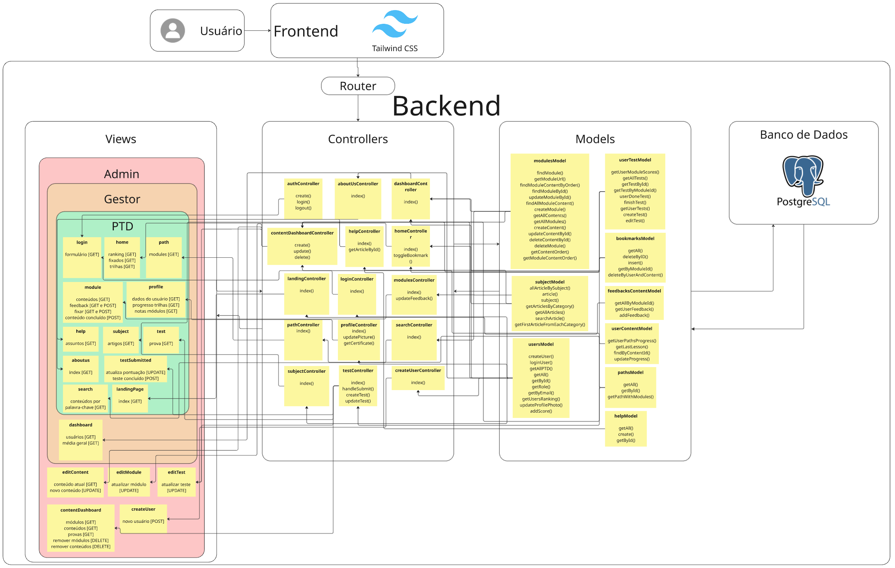<br>

<sub>Fonte: Material produzido pelos autores (2025). </sub><br>
[Link para o diagrama ](https://lucid.app/lucidchart/ef436dae-d492-4850-bd35-57e03da84208/edit?viewport_loc=-1299%2C554%2C5469%2C2390%2C0_0&invitationId=inv_1f28fcee-e5dc-496d-bdfa-a919c8171a3b) <br>
</div>

O diagrama de arquitetura desenvolvido está dividido em três grandes áreas: **Cliente (Front-End)**, **Servidor (Back-End)** e **Servidor de Banco de Dados**.<br>

#### Cliente (Front-End) <br>

A camada de cliente representa a interface que o usuário acessa diretamente. Ela foi construída utilizando **HTML, Tailwind CSS** e **Vue.js**, permitindo a criação de uma interface responsiva, moderna e interativa. Essa camada se comunica com o servidor através de requisições HTTP, roteadas por um **Router**, que direciona as ações ao controlador correspondente.<br>

#### Servidor (Back-End) <br>

- **Views:** são representadas com blocos separados para os três perfis de usuário:
- **PTD (usuário comum):** possui acesso a funcionalidades como visualização de tribunas, envio de provas e feedbacks.
- **Gestor:** visualiza o progresso dos usuários e pode emitir certificados.
- **Admin:** possui permissões de gerenciamento total do sistema, podendo criar conteúdos, provas, módulos e usuários.<br>

- **Controllers:** cada controlador está responsável por um conjunto específico de ações:
  - `AuthController`: login e logout.
  - `UserController`: informações do usuário.
  - `ExamController`, `HelpController`, `ArticleController`: lidam com envio e gestão de provas, perguntas e artigos.
  - `ModuleController`, `PathController`, `ContentController`: controlam a criação e edição de módulos, trilhas e conteúdos educacionais.<br>

- **Models:** os modelos representam as entidades do banco de dados. Entre os principais estão:
  - `users`, `contents`, `exams`, `feedbacks`, `modules`, `paths` e `certificates`.
  - Também existem modelos relacionais como `user_content_progress`, `user_exam_score`, `feedbacks_content_module`, que tratam o progresso e desempenho dos usuários. <br>


#### Banco de Dados <br>
O **Servidor de Banco de Dados** é o repositório central das informações manipuladas pela aplicação. Através dos modelos definidos no back-end, o sistema realiza operações de leitura e escrita nos dados, garantindo persistência e integridade das informações.<br>

## 3.2. Wireframes 

Wireframe [[18](#c22)] é um rascunho visual que mostra a estrutura básica de uma interface, focando na organização dos elementos e na navegação, sem detalhar o design final.
Para alinhar os componentes de forma clara e responsiva, foi utilizada a seguinte estrutura de grid abaixo (figura 13):

<div align = "center">

<sup>Quadro 13: Grid utilizada</sup><br>

| Desktop                                                           | Mobile                                                            |
| ----------------------------------------------------------------- | ----------------------------------------------------------------- |
|  |  |

[Link dos wireframes](https://www.figma.com/design/bOsRfHBpYqRksHS4GiNW74/bayer-project?node-id=0-1&p=f&t=S55FkKepuUIl5D6k-11) <br>

As imagens e figuras abaixo representam os wireframes construídos para a aplicação Web.

<sup>Fonte: Material produzido pelos autores (2025).</sup><br>

</div>

### Versão PTD

<div align = "center">

<sup>Quadro 14: Wireframes da plataforma para o PTD - Desktop</sup><br>

| Tela                                                                                                                        | Recursos                                                                                                                                                                                                                 | User Story                                   |
| --------------------------------------------------------------------------------------------------------------------------- | ------------------------------------------------------------------------------------------------------------------------------------------------------------------------------------------------------------------------ | -------------------------------------------- |
| 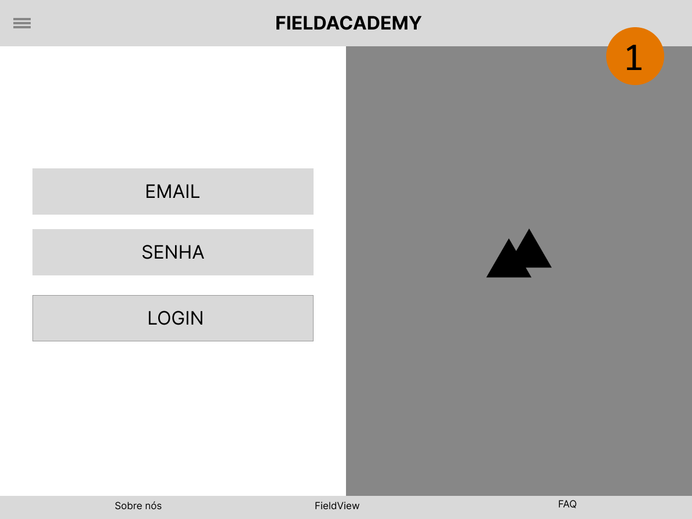                                                                    | **Tela de Login:** <br> - Campo de Email <br> - Campo para a senha <br>- Botão de confirmação de login                                                                                                                   | <div align = "center"> 1<br></div>           |
| 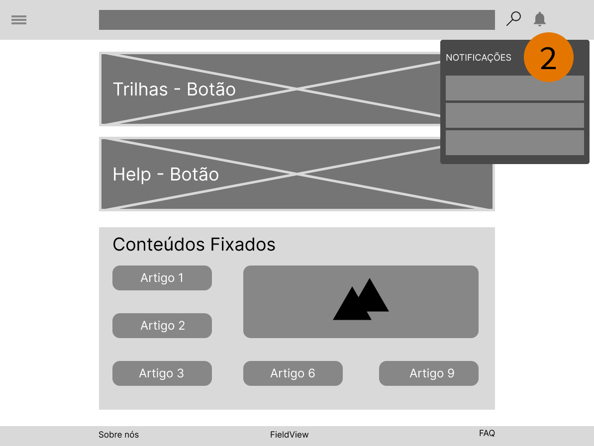 <br> 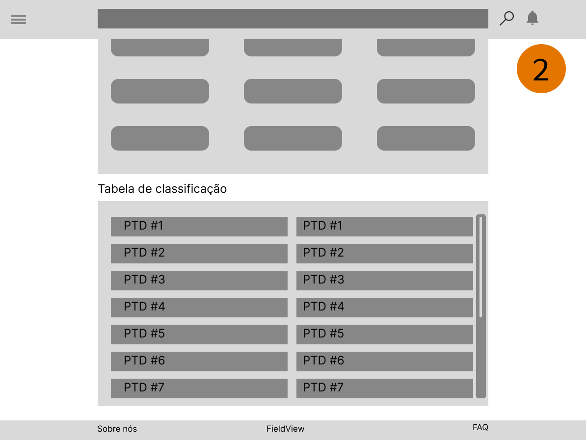       | **Tela Home:** <br> - Aba de buscas rápidas <br> - Direcionamento para tela de trilhas <br> - Direcionamento para tela de help <br> - Artigos que podem ser fixados pelo PTD para acesso rápido. - Sino de notificações. | <div align = "center"> 1<br>2<br>3 </div>    |
| 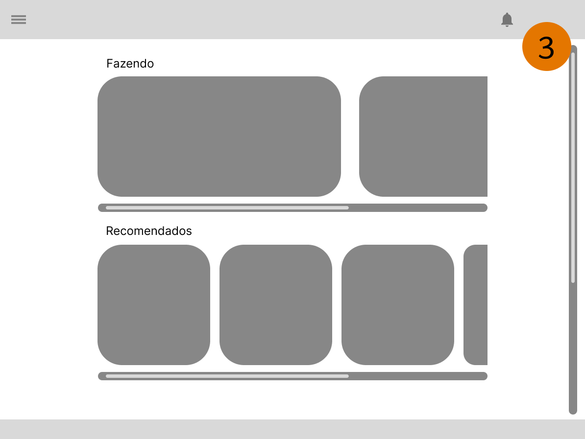 <br> 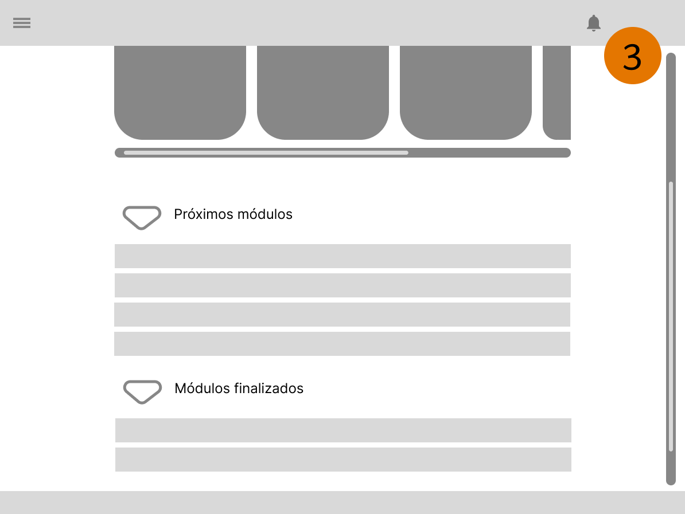 | **Tela Trilhas:** <br> - Progesso atual <br> - Histórico de trilhas <br> - Recomendações de tilhas <br> - Base de conteúdos gerais e opcionais.                                                                          | <div align = "center"> 1<br>2<br>3<br></div> |
| 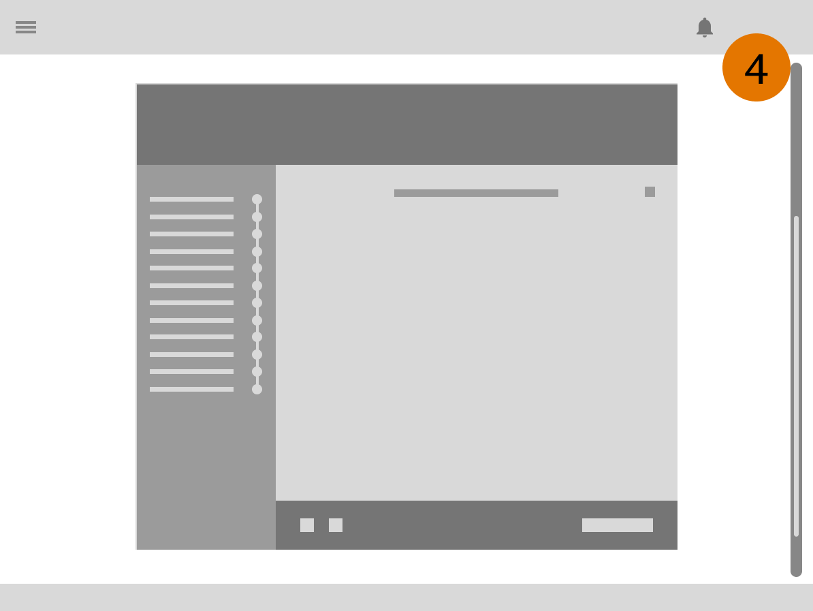                                                                | **Tela Dashboard:** <br> - Conteúdo sequêncial <br> - Informações laterais <br> - Material espeífico <br> - Avaliação dos assuntos.                                                                                      | <div align = "center"> 4<br></div>           |
| 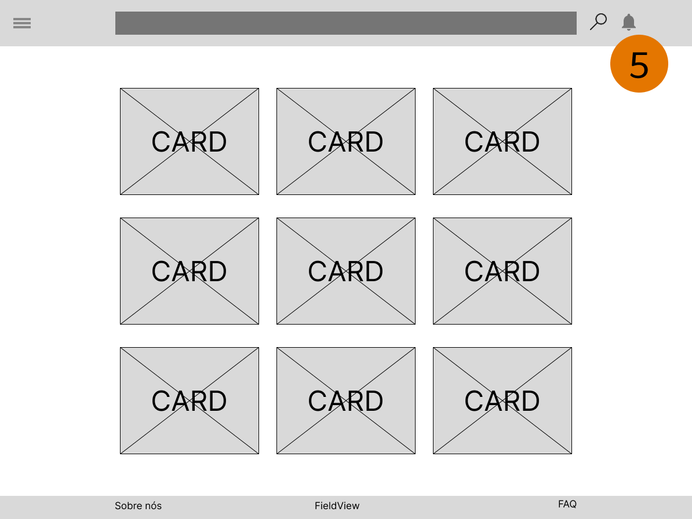                                                                     | **Tela Help:** <br> - Aba de buscas rápidas <br> - Cards de assuntos e temas recorrentes.                                                                                                                                | <div align = "center"> 1<br></div>           |
| 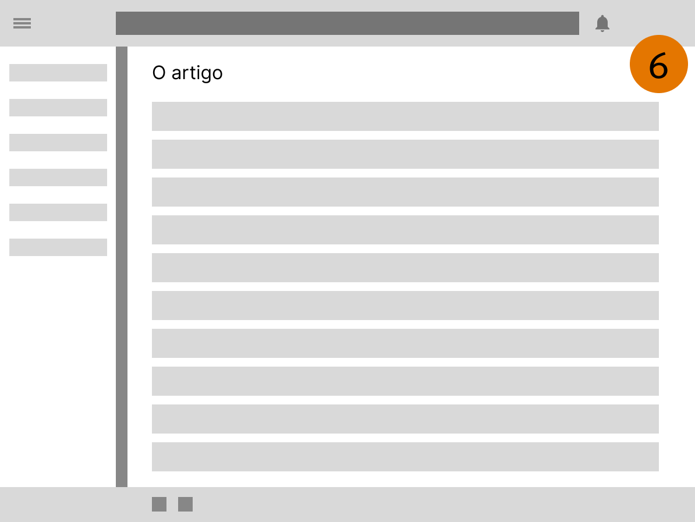                                                                    | **Tela do artigo:** <br> - Aba de buscas rápidas <br> - Lado direito: artigo <br> - Lado esquerdo: lista de artigos da mesma categoria.                                                                                  | <div align = "center"> 1<br></div>           |

<sup>Fonte: Material produzido pelos autores (2025).</sup><br>

</div>

#### Versão Mobile

<div align = "center">
<sup>Figura 8: Wireframes da plataforma para o PTD - Mobile </sup><br>
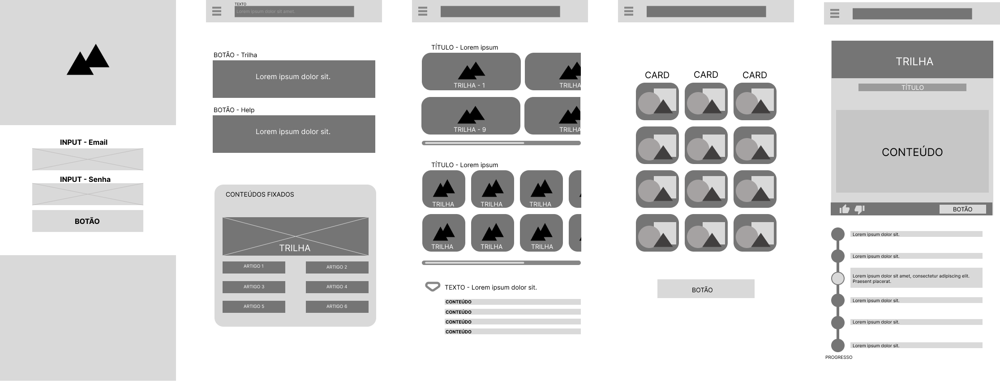

<sup>Fonte: Material produzido pelos autores (2025).</sup><br>

</div>

### Versão Gestor

<div align = "center">
<sup>Quadro 15: Wireframes da plataforma para o Gestor - Desktop </sup><br>

| Tela                                                                                                                  | Recursos                                                                                                                             | User Story                               |
| --------------------------------------------------------------------------------------------------------------------- | ------------------------------------------------------------------------------------------------------------------------------------ | ---------------------------------------- |
|                                                               | **Tela de Login:** <br> - Mesmas funcionalidades do PTD                                                                              | <div align = "center"> 7<br></div>       |
|  <br>  | **Tela Home:** <br> - Mesmas funcionalidades do PTD                                                                                  | <div align = "center"> 7<br></div>       |
| 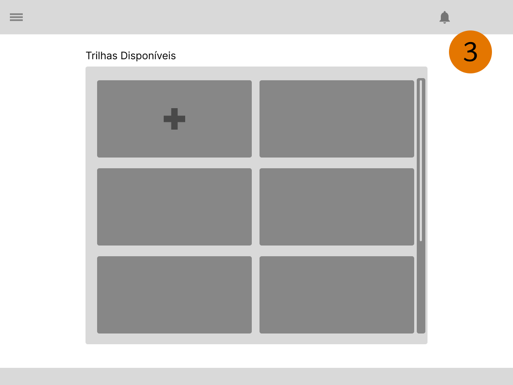                                                         | **Tela Trilhas:** <br> - Cards de trilhas gerais <br> - Botão de adicionar nova trilha                                               | <div align = "center"> 6<br>7</div>      |
| <br> 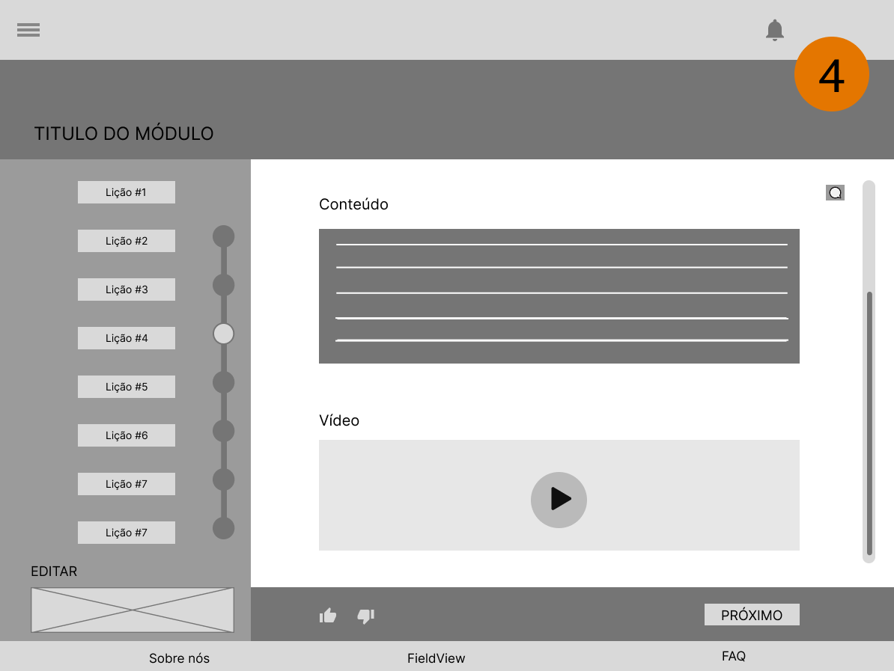                                                   | **Tela Dashboard:** <br> - Conteúdo sequêncial <br> - Observar avaliação dos assuntos <br> - Adição de novos conteúdos para usuários | <div align = "center"> 7<br>8</div>      |
| 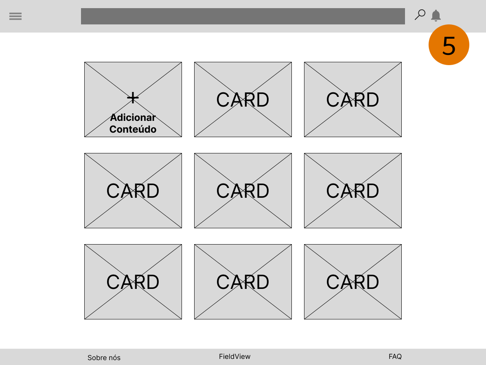                                                            | **Tela Help:** <br> - Aba de buscas rápidas <br> - Funcionalidade de adição de novos cards.                                          | <div align = "center"> 7<br></div>       |
| 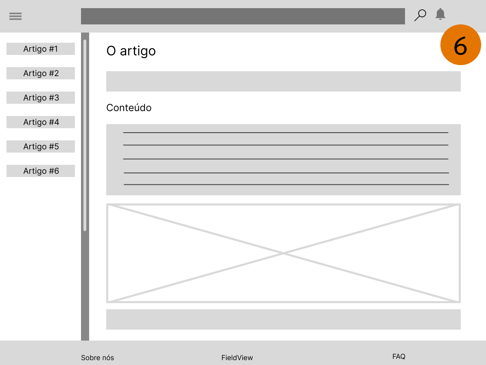                                                          | **Tela do artigo:** <br> - Aba de buscas rápidas <br> - Lado direito: artigo <br> - Lado esquerdo: Adição de novos artigos.          | <div align = "center"> 8<br></div>       |
| 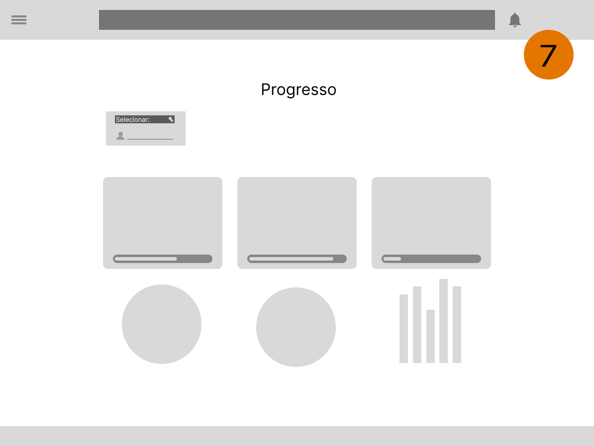                                                       | **Tela de progresso:** <br> - Seleção de usuário <br> - Dados do progresso do usuário.                                               | <div align = "center"> 6<br>7<br>8</div> |

<sup>Fonte: Material produzido pelos autores (2025).</sup><br>

</div>

#### Versão Mobile

<div align = "center">
<sup>Figura 9: Wireframes da plataforma para o Gestor - Mobile </sup><br>
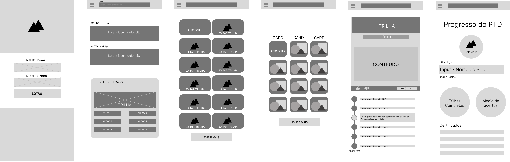

<sup>Fonte: Material produzido pelos autores (2025).</sup><br>

</div>

## 3.3. Guia de estilos

&nbsp;&nbsp;&nbsp;&nbsp; O Guia de Estilos [[19](#c23)] serve como referência oficial para todos os envolvidos no projeto, garantindo consistência visual, clareza de comunicação e aplicação correta dos elementos da marca.<br>

&nbsp;&nbsp;&nbsp;&nbsp; Em suma, o Guia de Estilos serve como referência oficial para todos os envolvidos no projeto, garantindo consistência visual, clareza de comunicação e aplicação correta dos elementos da marca. A imagem abaixo retrata o guia de Grid que foi utilizado <br>

<div align = "center">
<sup>Figura 10: Grid </sup><br>


<sup>Fonte: Material produzido pelos autores (2025).</sup><br>

</div>

### 3.3.1 Cores
A figura abaixo representa a paleta de cores utilizadas na aplicação Web.
<div align = "center">
<sup>Figura 11: Cores </sup><br>
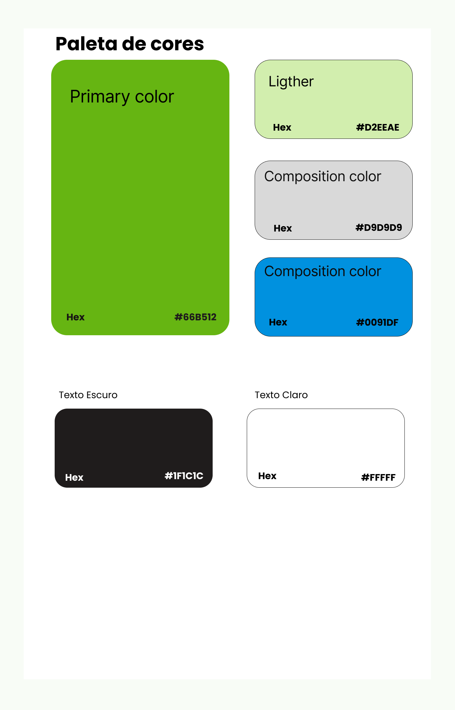 

<sup>Fonte: Material produzido pelos autores (2025).</sup><br>
</div>

<div align = "center">
<sup>Quadro 16: Cores </sup><br>

Recomendação Aplicada| Nome da cor | Hex | Função | 
--- | --- | --- | ---|
Cor primária | Verde | #66B512 | Cor para destacar tanto fundo, quanto botões principais, destaques, header, ícones |
Cor priméria mais clara| Verde claro | #D2EEAE | Cor para destacar fundo de cards e botões secundários. |
Cor de composição | Azul | #0091DF | Cor ultilizada para barra de progresso, botões secundárias, caixa de notificações, perfil do ranking, o rodapé da página do FieldAcaemy. |
Cor de composição | Cinza | #D9D9D9 | undo de cards, divisores, bordas. | Fundo de cards, divisores, bordas |
Cor Texto primária| Texto escuro | #1F1C1C| Texto principal sobre fundos claros|
Cor Texto secundário| Texto claro | #FFFFFF| Texto para fundos escuros ou botões coloridos fortes|

<sup>Fonte: Material produzido pelos autores (2025).</sup><br>
</div>

&nbsp;&nbsp;&nbsp;&nbsp; A paleta de cores de um projeto consiste no conjunto de cores previamente selecionadas para representar visualmente a identidade do produto digital em todos os seus elementos gráficos e funcionais. Essa paleta inclui cores primárias, secundárias, de destaque e de fundo, que devem ser utilizadas de forma sistemática em interfaces, componentes, textos e elementos de navegação. Seu propósito é assegurar uniformidade visual, fortalecer a comunicação da marca e facilitar a percepção do usuário ao interagir com o sistema. <br>

&nbsp;&nbsp;&nbsp;&nbsp; A adoção de uma paleta de cores bem estruturada e alinhada entre os designers e a equipe de desenvolvimento front-end é essencial para garantir coerência estética e funcionalidade técnica. Em ambientes colaborativos, especialmente no contexto de projetos acadêmicos baseados em metodologias ágeis, essa padronização contribui para a consistência visual entre protótipos e implementações, reduz retrabalho, otimiza a comunicação entre os membros da equipe e assegura a acessibilidade por meio de contrastes adequados. A padronização cromática ainda reforça a identidade do produto, tornando-o mais reconhecível e profissional perante os usuários. <br>

### 3.3.2 Tipografia

&nbsp;&nbsp;&nbsp;&nbsp; A tipografia [[20](#c24)] padroniza a leitura e reforça a identidade da marca. Especifique fontes, tamanhos, pesos, espaçamentos e exemplos de uso. Ela  define as fontes, tamanhos, pesos e estilos utilizados em todos os textos da interface. Ela estabelece uma hierarquia visual clara, facilita a leitura e reforça a identidade da marca. <br>

&nbsp;&nbsp;&nbsp;&nbsp; A tipografia é um elemento essencial na construção da identidade visual de uma interface. Ela influencia diretamente na legibilidade e na percepção da marca. Em um guia de estilos, a definição tipográfica deve incluir as famílias tipográficas utilizadas (ex: sans-serif ou serif), tamanhos, pesos (light, regular, bold), espaçamentos (entre letras e linhas) e hierarquia de títulos (H1, H2, H3 etc.) e parágrafos. <br>

<div align = "center">
<sup>Figura 12: Tipografia </sup><br>
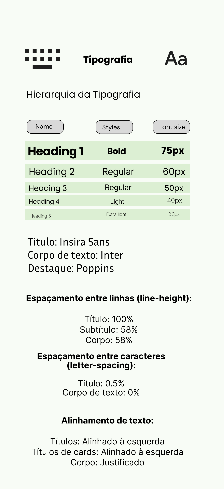

<sup>Fonte: Material produzido pelos autores (2025).</sup><br>

</div>

&nbsp;&nbsp;&nbsp;&nbsp; É fundamental garantir contraste suficiente entre texto e fundo para atender critérios de acessibilidade. A padronização tipográfica no guia de estilos contribui para a coesão visual em todos os materiais da marca ou produto digital. <br>

### 3.3.3 Iconografia e imagens

&nbsp;&nbsp;&nbsp;&nbsp; A iconografia reúne todos os ícones utilizados na interface, padronizando seu estilo, tamanho, cor e aplicação. Os ícones devem ser facilmente reconhecíveis, reforçando ações e informações sem gerar ambiguidade. <br>

<div align = "center">
<sup>Figura 13: Iconografia </sup><br>
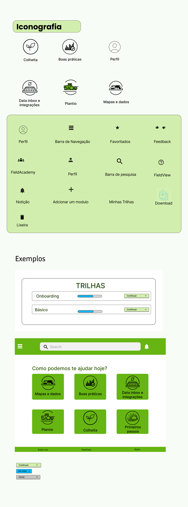

<sup>Fonte: Material produzido pelos autores (2025).</sup><br>

</div>

#### Icons Mobile

<div align = "center">
<sup>Quadro 17: Iconografia Mobile</sup><br>

| Icone                   | Funcionalidade                                                                                 |
| ----------------------- | ---------------------------------------------------------------------------------------------- |
| Colheita                | Acessa informações e registros sobre colheitas realizadas, facilitando o controle de produção. |
| Boas Práticas           | Exibe dicas, orientações e conteúdos educativos para melhorar processos e resultados.          |
| Perfil                  | Permite visualizar e editar dados pessoais e preferências do usuário.                          |
| Plantio                 | Gerencia informações sobre o plantio, como datas, áreas e culturas cultivadas.                 |
| Mapas e dados           | Mostra mapas interativos e dados georreferenciados para análise e tomada de decisão.           |
| Data inbox e integração | Centraliza dados recebidos e integrações com outros sistemas ou dispositivos.                  |

<sup>Fonte: Material produzido pelos autores (2025).</sup><br>
</div>

#### Icons Desktop

<div align = "center">
<sup>Quadro 18: Iconografia Desktop </sup><br>

 Icone | Funcionalidade | 
 --- | ---|
Perfil | Visualiza e edita dados do usuário, foto e configurações pessoais.|
Barra de Navegação | Abre/fecha o menu lateral de navegação do sistema. | 
Favoritados | 	Acessa rapidamente itens ou conteúdos marcados como favoritos.|
Feedback | Permite enviar opiniões, sugestões ou avaliações sobre o sistema ou conteúdos. |
FieldAcademy | Direciona para área de cursos, treinamentos ou materiais educativos.|
Barra de pesquisa | Visualiza e edita dados do usuário (atalho extra).|
FieldView | Exibe visualizações detalhadas do campo, mapas ou dashboards de monitoramento. |
Notificação | 	Mostra alertas, lembretes ou mensagens importantes para o usuário.|
Adicionar um módulo| 	Permite criar um novo módulo, etapa ou item dentro do sistema.|
Minhas trilhas | 	Exibe os percursos, trilhas de aprendizagem ou fluxos personalizados do usuário.|
Download | 	Realiza o download de arquivos, relatórios ou dados da plataforma.| 
Lixeira | Acessa itens excluídos, permitindo restaurar ou excluir definitivamente conteúdos.|

<sup>Fonte: Material produzido pelos autores (2025).</sup><br>
</div>

<div align = "center">
<sup>Quadro 19: Iconografia Geral</sup><br>

Icone | Funcionalidade | 
--- | ---|
Adicionar | Cria ou cadastra um novo item, pedido ou módulo. |
Boas práticas (botão)|	Acesso rápido ao conteúdo de boas práticas, dicas e recomendações.|
Continuar|Avança, visualiza detalhes ou inicia uma ação/tarefa.|
Ver mais|Avança, visualiza detalhes ou inicia uma ação/tarefa.|
Curtir/Descurtir (like/dislike)|Avalia conteúdos, módulos ou funcionalidades com feedback positivo ou negativo.|

<sup>Fonte: Material produzido pelos autores (2025).</sup><br>
</div>

## 3.4 Protótipo de alta fidelidade

&nbsp;&nbsp;&nbsp;&nbsp; Protótipos de alta fidelidade [[21](#c25)] são representações visuais altamente detalhadas de um produto digital, como aplicativos, sites ou sistemas. Eles imitam com grande precisão a aparência final da interface e, muitas vezes, simulam também interações, transições e fluxos de navegação. Esses protótipos incluem cores, tipografias, imagens, ícones e elementos gráficos que corresponde a basicamente todo o front-end do projeto, onde trabalhamos para manter a identidade visual do parceiro. <br>

&nbsp;&nbsp;&nbsp;&nbsp; Dessa forma, foi desenvolvida a prototipação de quatro versões do website FieldAcademy: duas versões são voltadas aos **PTDs** (Promotores Técnicos Digitais), sendo elas as versões desktop e mobile, e duas versões que desenvolvidas para o **Gestor**, tendo funcionalidades mais abrangentes como a de editar e adicionar novas trilhas e módulos.
Logo abaixo estão diponíveis algumas telas da prototipação de alta fidelidade.
<br>

#### Protótipo da tela de home, versão Gestor - desktop:

<div align = "center">
<sup>Figura 14: Protótipo tela Home Desktop - Gestor.</sup><br>


<sup>Fonte: Material produzido pelos autores (2025).</sup><br>

</div>

Esta tela representa a tela inicial do site, a tela de home para gestores, no formato desktop. No topo, há um menu de navegação com ícone de menu lateral, barra de busca e ícone de notificações, que exibe uma lista suspensa de avisos. A tela oferece uma visão clara e funcional para que o gestor acompanhe a evolução da equipe e acesse rapidamente as principais funcionalidades. <div>

#### Protótipo da tela de home, versão PTD - desktop:

<div align = "center">
<sup>Figura 15: Protótipo tela Home Desktop - PTD.</sup><br>


<sup>Fonte: Material produzido pelos autores (2025).</sup><br>
</div>

Esta tela corresponde a tela de Home para usuários PTD, na versão desktop. No topo, há um menu lateral, barra de busca e ícone de notificações com lista suspensa. A identidade visual mantém a imagem temática de plantação e o logotipo FieldAcademy. Abaixo, há o botão "Help" para suporte ao usuário.
Em seguida, a seção "Trilhas" apresenta quatro categorias (Onboarding, Básico, Intermediário e Avançado), cada uma com barra de progresso indicando o avanço e o botão "Continuar" para seguir o conteúdo.
A tela oferece uma navegação clara para o usuário acompanhar o progresso nas trilhas, acessar conteúdos fixos e visualizar os destaques de performance da equipe. <br>

#### Protótipo da tela de login, versão PTD e Gestor - desktop:

<div align = "center">
<sup>Figura 16: Protótipo tela Login Desktop - PTD e Gestor.</sup><br>
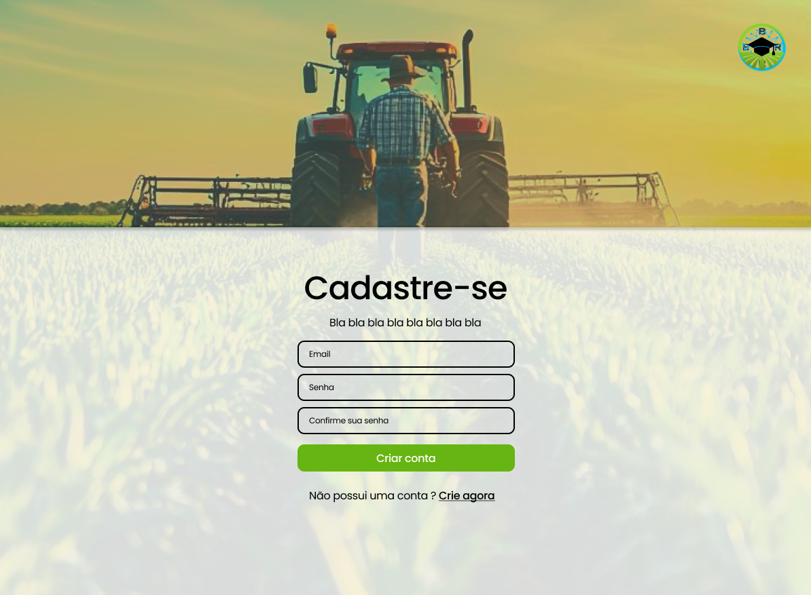

<sup>Fonte: Material produzido pelos autores (2025).</sup><br>
</div>

A tela de login apresenta uma imagem de fundo relacionada ao setor agrícola. No centro, há o título “Cadastre-se” seguido de uma breve descrição. Abaixo, localizam-se três campos para preenchimento: email, senha e confirmação de senha. Logo em seguida, há um botão verde com a inscrição “Criar conta”. Ao final da interface, há uma opção de link convidando o usuário a criar uma conta, caso ainda não possua. O logotipo da empresa está posicionado no canto superior direito. O design é limpo e direto, com foco na funcionalidade e clareza para o usuário.<br>


#### Protótipo da tela de login, versão PTD e Gestor - mobile:

<div align = "center">
<sup>Figura 17: Protótipo tela Login Mobile - PTD e Gestor.</sup><br>
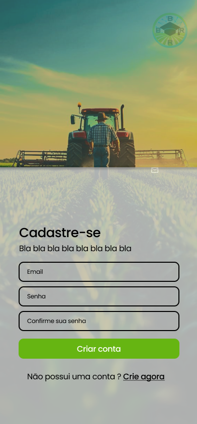

<sup>Fonte: Material produzido pelos autores (2025).</sup><br>
</div>

A tela de cadastro possui um design com tema agrícola e foco na simplicidade. Exibe um formulário com campos para **email**, **senha** e **confirmação de senha**, além de um botão “Criar conta”. Há também um link para usuários que ainda não possuem conta. O layout é limpo, com fundo semi-transparente e destaque para os elementos principais, facilitando a navegação e compreensão da interface.

#### Protótipo da tela de progresso  - Gestor - desktop:

<div align = "center">
<sup>Figura 18: Protótipo tela de Progresso Desktop - Gestor.</sup><br>
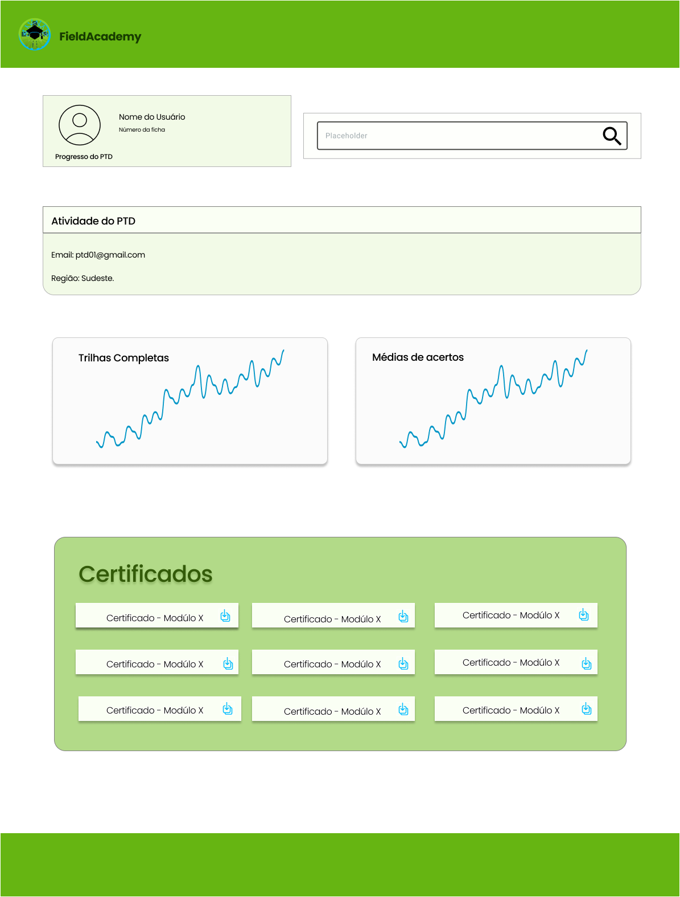

<sup>Fonte: Material produzido pelos autores (2025).</sup><br>
</div>

A tela de **progresso do gestor** da plataforma apresenta um cabeçalho verde com o logotipo e o nome da plataforma. Exibe um card com as informações do PTD (nome, número da ficha e progresso), uma barra de busca, e um card com a atividade do usuário (e-mail e região). Abaixo, são mostrados dois gráficos: **“Trilhas Completas”** e **“Médias de acertos”**, ambos em azul. Ao final, há a seção **“Certificados”**, com botões organizados em linhas, cada um identificado como “Certificado - Módulo X”. A função principal dessa tela é voltada para que o Gestor possa acompanhar o progresso de cada PTD na plataforma FIeldAcademy, de forma detalhada.<br>

#### Protótipo da tela de conteúdo, versão gestor - desktop:

<div align = "center">
<sup>Figura 19: Protótipo tela de Conteúdo Desktop - Gestor.</sup><br>
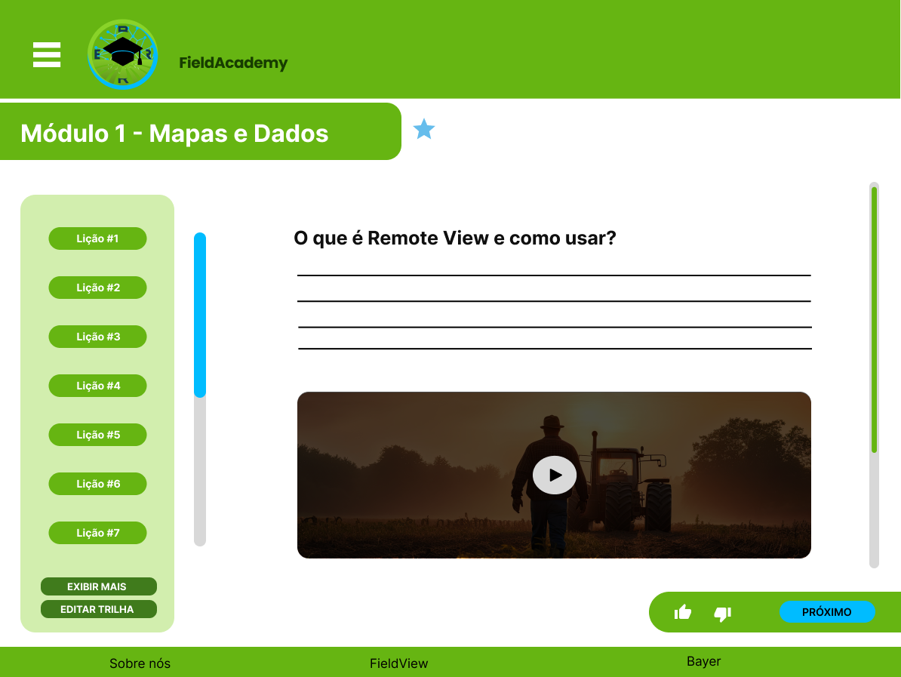

<sup>Fonte: Material produzido pelos autores (2025).</sup><br>
</div>

A interface do módulo apresenta uma barra superior com logo e menu, um menu lateral com lições e opções administrativas, e no centro a lição atual sobre “Remote View” com texto e vídeo. Há botões de interação (curtir, não curtir) e um botão “PRÓXIMO” para avançar. A paleta verde e branca reforça a identidade visual agrícola. O diferencial dessa tela para a do PTD está na possibilidade de edição de trilhas, exclusiva do Gestor.<br>

[Link para acessar o protótipo completo das versões PTD e Gestor, ambos em mobile e desktop.](https://www.figma.com/design/bOsRfHBpYqRksHS4GiNW74/bayer-project?node-id=3664-2&t=75lexEkyPQQWuFiA-1)

## 3.5. Modelagem do banco de dados 

### 3.5.1. Modelo relacional

&nbsp;&nbsp;&nbsp;&nbsp; O banco de dados mostrado adere aos fundamentos da modelagem relacional, como explicado por Heuser [[9](#c16)], organizando a informação em tabelas que simbolizam entidades do campo educacional, tais como usuários, módulos, conteúdos, trilhas, certificados, avaliações e permissões. Cada tabela é formada por linhas (tuplas) e colunas (atributos), assegurando a integridade dos dados através de restrições como chaves primárias - que identificam cada registro de maneira exclusiva - e chaves estrangeiras, encarregadas de criar conexões entre as tabelas, como a conexão entre usuários e suas funções, conteúdos e módulos, ou certificados e trilhas. Esta metodologia possibilita a representação clara e organizada dos componentes do mundo real, simplificando a implementação, conservação e ampliação do sistema de informação. <br>

&nbsp;&nbsp;&nbsp;&nbsp; No contexto da aplicação, tabelas como Users, module, content, path e certificate organizam o fluxo de aprendizagem, enquanto tabelas auxiliares como feedbacks_modulo, score_test, bookmarks e emphasis ampliam as funcionalidades ao permitir avaliações, acompanhamento de progresso, personalização e destaque de conteúdos. A tabela role_permissions define os diferentes perfis de acesso e suas permissões, promovendo segurança e flexibilidade na gestão do sistema. Assim, o modelo relacional adotado oferece uma base sólida para o desenvolvimento de uma plataforma educacional, garantindo integridade, clareza e escalabilidade. <br>

<div align = "center">

<sup>Figura 20: Diagrama Modelo Relacional.</sup><br>

<br>

<sub>Fonte: Material produzido pelos autores (2025). </sub><br>

</div>

---

&nbsp;&nbsp;&nbsp;&nbsp; A tabela Users é crucial para a experiência do utilizador, uma vez que guarda todas as informações pessoais e de acesso de cada indivíduo registrado na plataforma. Ela gerencia informações como nome, e-mail, senha, perfil (função ou cargo), região, pontuação, imagem de perfil, data do último acesso e conexão com certificados obtidos. <br>
Em termos práticos, essa tabela possibilita que cada usuário possua uma conta exclusiva, com um histórico individual de progresso, resultados e realizações. A atribuição do papel (id_role) estabelece as funções e permissões que o usuário terá no sistema (por exemplo: estudante, docente, gestor). Adicionalmente, a área de pontuação pode ser utilizada para a gamificação, incentivando o usuário a se envolver mais. O histórico do último acesso e a imagem do perfil enriquecem a experiência. Assim, a tabela Users garante o acesso individualizado, a segurança das informações e a personalização da navegação e dos recursos disponíveis para cada pessoa na plataforma. <br>

```sql
CREATE TABLE IF NOT EXISTS users (
  id SERIAL PRIMARY KEY,
  id_role INTEGER NOT NULL REFERENCES roles(id) ON DELETE CASCADE,
  name VARCHAR(255),
  region VARCHAR(255),
  email VARCHAR(255),
  password VARCHAR(255),
  score INTEGER NOT NULL,
  last_login TIMESTAMP,
  profile_photo_path VARCHAR(255)
);
```

#### Users

**_Finalidade:_** Armazena informações dos usuários cadastrados na plataforma.<br>

**Campos:**

1. id: Identificador único do usuário (chave primária).
2. id_role: Chave estrangeira para a entidade `role_permissions`
3. Name: Nome do usuário.
4. Region: Localidade do usuário.
5. Email: E-mail do usuário (único).
6. Password: Senha.
7. Score: Pontuação do usuário.
8. last_login: Data e hora do último acesso.
9. Profile_photo: Caminho ou URL da foto de perfil.
10. id_certificate: Chave estrangeira para a entidade `certificate`.

---

&nbsp;&nbsp;&nbsp;&nbsp; A tabela role_permissions estabelece os diversos papéis (ou funções) que um usuário pode exercer na plataforma, tais como estudante, monitor, docente, coordenador ou administrador, e detalha quais permissões cada um desses papéis tem. Os campos can_create, can_read, can_update e can_delete indicam claramente se um papel tem permissão para criar, visualizar, alterar ou apagar dados no sistema. <br>

&nbsp;&nbsp;&nbsp;&nbsp; Em termos práticos, essa tabela afeta diretamente o que cada usuário tem permissão ou não para realizar ao utilizar a plataforma. Por exemplo, um estudante só tem a capacidade de visualizar materiais, enquanto um administrador tem a capacidade de criar e modificar módulos, usuários e materiais. Isso assegura proteção, organização e customização do acesso, adequando a experiência do usuário ao seu perfil e prevenindo ações não autorizadas. <br>

```sql
CREATE TABLE IF NOT EXISTS roles (
  id SERIAL PRIMARY KEY,
  name_role VARCHAR(50),
  can_create BOOLEAN,
  can_read BOOLEAN,
  can_update BOOLEAN,
  can_delete BOOLEAN
);
```

#### Role_permissions

**Finalidade:** Define os diferentes papéis (roles) do sistema, como PTD, gestor ou administrador, e as permissões associadas a cada um. <br>

**Campos:**

1. id: Identificador único do papel (chave primária).
2. nome_role: Nome do papel.
3. can_create, can_read, can_update, can_delete: Permissões booleanas que determinam o que cada papel pode fazer no sistema.

---

&nbsp;&nbsp;&nbsp;&nbsp; A tabela User_content_progress é fundamental para a experiência do usuário em plataformas de e-learning, pois registra o progresso individual de cada pessoa em cada conteúdo e módulo do curso. Sempre que o usuário acessa ou conclui um conteúdo, essa tabela armazena se aquele material já foi finalizado (is_completed), vinculando sempre o usuário, o módulo e o conteúdo específico. Isso permite um acompanhamento personalizado, onde o usuário pode visualizar facilmente quais conteúdos já estudou e quais ainda faltam, permitindo um aprendizado no seu próprio ritmo e de acordo com suas necessidades. Além disso, caso precise interromper os estudos, ele pode retornar exatamente de onde parou, sem perder tempo procurando o que já foi feito.

```sql
CREATE TABLE IF NOT EXISTS user_content_progress (
  id SERIAL PRIMARY KEY,
  user_id INTEGER NOT NULL REFERENCES users(id) ON DELETE CASCADE,
  module_id INTEGER NOT NULL REFERENCES module(id) ON DELETE CASCADE,
  content_id INTEGER NOT NULL REFERENCES content(id) ON DELETE CASCADE,
  completed_at TIMESTAMP
);

```

#### User_content_progress

**Finalidade:** Registra o progresso do usuário em cada conteúdo e módulo. <br>

**Campos:**

1. id: Identificador único do progresso (chave primária).
2. user_id: Chave estrangeira para Users.
3. module_id: Chave estrangeira para module.
4. content_id: Chave estrangeira para content.
5. is_completed: Indica se o usuário concluiu o conteúdo (booleano).

---

&nbsp;&nbsp;&nbsp;&nbsp; A tabela content é crucial para a experiência do utilizador, uma vez que guarda todos os recursos de estudo (vídeos, textos, PDFs e imagens) associados a cada módulo da plataforma. Ela estrutura o material em uma sequência lógica (order), estabelece datas limite para acesso (due_time) e possibilita realçar materiais relevantes (id_emphasis).
Em termos práticos, isso implica que o usuário pode facilmente localizar todos os recursos necessários para progredir em sua jornada de aprendizado, sabendo exatamente o que precisa ser estudado em cada fase. O acesso a diversos formatos (vídeo, texto, imagem) torna a aprendizagem mais interativa e ajustável a variados métodos de estudo.<br>

```sql
CREATE TABLE IF NOT EXISTS content (
  id SERIAL PRIMARY KEY,
  id_module INTEGER NOT NULL REFERENCES module(id) ON DELETE CASCADE,
  doc_path VARCHAR(255),
  video_path VARCHAR(255),
  img_path VARCHAR(255),
  "order" INTEGER NOT NULL,
  highlight BOOLEAN
);
```

#### Content

**Finalidade:** Armazena os conteúdos (aulas,pdfs, vídeos, textos) de cada módulo. <br>

**Campos:**

1. id: Identificador único do conteúdo (chave primária).
2. id_modulo: Chave estrangeira para module.
3. id_emphasis: Indica se o conteúdo é um destaque. (booleano).
4. doc_path: Caminho para material textual.
5. video_path: Caminho para vídeo.
6. img_path: Caminho para imagem.
7. order: Ordem do conteúdo dentro do módulo.
8. due_time: Prazo ou data limite para acessar o conteúdo.

---

&nbsp;&nbsp;&nbsp;&nbsp; A tabela emphasis influencia diretamente a experiência do usuário em uma plataforma de e-learning ou sistema educacional ao permitir que determinados conteúdos ou módulos sejam destacados ou priorizados para cada pessoa. Na prática, ela possibilita que o sistema marque quais materiais são mais importantes, urgentes ou recomendados para um usuário específico, geralmente com uma data limite para conclusão (due_date). Assim, o usuário pode visualizar facilmente o que deve focar primeiro em sua trilha de aprendizagem, facilitando o acompanhamento do progresso, a organização dos estudos e a priorização de tarefas. Esse tipo de funcionalidade é comum em sistemas de gestão de aprendizagem (LMS), pois ajuda a tornar o aprendizado mais personalizado, eficiente e alinhado às necessidades individuais de cada estudante. <br>

```javascript
CREATE TABLE emphasis (
  id SERIAL PRIMARY KEY,
  id_user INTEGER NOT NULL REFERENCES Users(id),
  id_modulo INTEGER NOT NULL REFERENCES module(id),
  id_content INTEGER NOT NULL REFERENCES content(id),
  due_date TIMESTAMP
);

```

#### Emphasis

**Finalidade:** Marca conteúdos ou módulos como "em destaque" para um usuário, ou para fins de priorização.<br>

**Campos:**

1. id: Identificador único (chave primária).
2. id_user: Chave estrangeira para Users.
3. id_modulo: Chave estrangeira para module.
4. id_content: Chave estrangeira para content.
5. due_date: Data limite para o destaque.

---

&nbsp;&nbsp;&nbsp;&nbsp; A tabela module afeta a experiência do usuário ao organizar e estruturar o conteúdo em módulos em uma plataforma de aprendizado ou sistema de ensino. Cada entrada nesta tabela simboliza um módulo, que consiste numa unidade temática ou fase de um percurso de aprendizado. O campo id_path indica a trilha (ou curso) à qual o módulo está associado, enquanto o campo title define o nome do módulo e "order" determina a ordem na qual os módulos serão exibidos ao utilizador.<br>

```sql
CREATE TABLE IF NOT EXISTS module (
  id SERIAL PRIMARY KEY,
  id_path INTEGER NOT NULL REFERENCES path(id),
  title VARCHAR(255),
  "order" INTEGER NOT NULL
);
```

#### Module

**Finalidade:** Representa os módulos que compõem uma trilha de aprendizagem.<br>
**Campos:**

1. id: Identificador único (chave primária).
2. id_path: Chave estrangeira para path.
3. title: Título do módulo.
4. order: Ordem do módulo dentro da trilha.

---

&nbsp;&nbsp;&nbsp;&nbsp; A tabela certificate guarda dados referentes aos certificados concedidos a usuários que finalizam trilhas na plataforma. Esta tabela é crucial para o usuário, pois possibilita o registro, a validação e o acesso simplificado aos certificados digitais, que atestam a conclusão de cursos, treinamentos ou percursos de aprendizagem. O campo id_path associa o certificado à trilha finalizada, a data de emissão e o hash_code asseguram a autenticidade e simplificam a verificação online do documento, pois diversos sistemas possibilitam a verificação da validade do certificado através deste código único. <br>

&nbsp;&nbsp;&nbsp;&nbsp; Em termos práticos, isso implica que o usuário tem a capacidade de acessar, baixar, compartilhar e validar seus certificados a qualquer instante, de maneira ágil e segura, sem a necessidade de procedimentos manuais ou impressos. Isso valoriza a experiência do estudante, simplifica a validação de habilidades em processos de seleção, avanços na carreira e expande as chances de reconhecimento acadêmico e profissional. <br>

```sql
CREATE TABLE IF NOT EXISTS certificate (
  id SERIAL PRIMARY KEY,
  id_path INTEGER NOT NULL REFERENCES path(id),
  hash_code VARCHAR(100)
);
```

#### Certificate

**Finalidade:** Registra os certificados emitidos para usuários que concluem trilhas. <br>

**Campos:**

1. id: Identificador único do certificado (chave primária).
2. id_path: Chave estrangeira para path, indicando a trilha concluída.
3. issue_date: Data de emissão do certificado.
4. hash_code: Código único para validação do certificado.

---

```sql
CREATE TABLE IF NOT EXISTS user_certificate_progress (
  id SERIAL PRIMARY KEY,
  id_user INTEGER NOT NULL REFERENCES users(id) ON DELETE CASCADE,
  id_certificate INTEGER NOT NULL REFERENCES certificate(id) ON DELETE CASCADE,
  completed_at DATE
);
```

---

&nbsp;&nbsp;&nbsp;&nbsp; O usuário é impactado pela tabela feedbacks_content_modulo, que possibilita o registro de comentários e avaliações sobre conteúdos e módulos específicos na plataforma de aprendizado. Esta funcionalidade proporciona ao usuário um meio direto para expressar opiniões, propor melhorias e trocar experiências, tornando o processo de aprendizagem mais interativo e individualizado.
O retorno imediato e estruturado auxilia o usuário a ponderar sobre seu avanço, reconhecer suas habilidades e áreas que necessitam de aprimoramento, além de incentivar a participação constante no curso. Ademais, ao perceber que seus pontos de vista são levados em conta, o usuário se sente apreciado e mais integrado à comunidade de aprendizado25. <br>

```sql
CREATE TABLE IF NOT EXISTS feedbacks_content_module (
  id SERIAL PRIMARY KEY,
  id_content INTEGER NOT NULL REFERENCES content(id) ON DELETE CASCADE,
  id_module INTEGER NOT NULL REFERENCES module(id) ON DELETE CASCADE,
  id_user INTEGER NOT NULL REFERENCES users(id),
  message TEXT,
  rating SMALLINT,
  created_at TIMESTAMP
);
```

#### Feedbacks_content_module

**Finalidade:** Armazena feedbacks e avaliações que usuários deixam sobre os módulos e conteúdos.<br>
**Campos:**

1. id: Identificador único (chave primária).
2. id_content: Chave estrangeira para a entidade `content`.
3. id_modulo: Chave estrangeira para a entidade `module`.
4. id_user: Chave estrangeira para a entidade `users`.
5. message: Comentário do usuário.
6. rating: Avaliação numérica (ex: 1 a 5).
7. created_at: Data/hora do feedback.

---

&nbsp;&nbsp;&nbsp;&nbsp; A tabela path auxilia o usuário na organização e estruturação das rotas de aprendizado disponíveis na plataforma. Cada entrada nesta tabela simboliza uma "rota" ou "caminho" de aprendizagem, formada por módulos e materiais sequenciais, contendo dados como título, descrição, categoria e relação com certificações.<br>

&nbsp;&nbsp;&nbsp;&nbsp; Em termos práticos, isso implica que o usuário consegue visualizar sua trajetória educacional de maneira nítida, compreendendo exatamente quais passos precisa percorrer para atingir um objetivo ou obter um certificado. As trilhas tornam o processo de aprendizado mais organizado, individualizado e estimulante, uma vez que possibilitam que cada indivíduo rastreie seu avanço, selecione rotas adequadas aos seus interesses ou necessidades, e progrida no seu próprio tempo. <br>

```sql
CREATE TABLE IF NOT EXISTS path (
  id SERIAL PRIMARY KEY,
  title VARCHAR(255),
  description TEXT
);
```

#### Path

**Finalidade:** Representa as trilhas disponíveis na plataforma. <br>
**Campos:**

1. id: Identificador único (chave primária).
2. id_certification: Chave estrangeira para a entidade `certificate`.
3. title: Título da trilha.
4. description: Descrição da trilha.
5. category: Categoria da trilha (ex: programação, design, etc).

---

&nbsp;&nbsp;&nbsp;&nbsp; A tabela bookmarks influencia a experiência do usuário ao permitir que ele salve conteúdos e módulos como favoritos ou atalhos para acesso rápido dentro da plataforma. Na prática, isso significa que o usuário pode marcar materiais importantes, revisitar facilmente aulas, vídeos ou documentos que deseja estudar novamente, e organizar melhor sua rotina de aprendizagem.
Assim como bookmarks em navegadores e leitores de PDF facilitam a navegação e o retorno a pontos relevantes, a funcionalidade de bookmarks em plataformas de e-learning torna o acesso ao conteúdo mais prático e personalizado. <br>

&nbsp;&nbsp;&nbsp;&nbsp;
Em resumo, a tabela bookmarks melhora a navegação, aumenta a eficiência e torna a experiência do usuário mais personalizada e motivadora dentro da plataforma de aprendizagem. <br>

```sql
CREATE TABLE IF NOT EXISTS bookmarks (
  id SERIAL PRIMARY KEY,
  id_user INTEGER NOT NULL REFERENCES users(id) ON DELETE CASCADE,
  id_content INTEGER NOT NULL REFERENCES content(id) ON DELETE CASCADE,
  saved_at TIMESTAMP
);

```

#### Bookmarks

**Finalidade:** Permite que usuários salvem conteúdos ou módulos como favoritos e como atalhos para acesso rápido. <br>

**Campos:**

1. id: Identificador único (chave primária).
2. id_user: Chave estrangeira para Users.
3. id_content: Chave estrangeira para content.
4. id_module: Chave estrangeira para module.
5. saved_at: Data e hora em que o conteúdo foi salvo.

---

&nbsp;&nbsp;&nbsp;&nbsp; A tabela tests influencia a experiência do usuário ao estruturar e disponibilizar avaliações dentro da plataforma de aprendizagem. Ela armazena informações sobre cada teste associado a um módulo, incluindo as perguntas e o número total de questões. Para o usuário, isso significa que ele pode ser avaliado de forma prática e organizada ao final de cada módulo, recebendo feedback imediato sobre seu desempenho. <br>

&nbsp;&nbsp;&nbsp;&nbsp; Essas avaliações medem o progresso e o conhecimento adquirido permitindo que o usuário pode acompanhar sua evolução, identificar pontos fortes e áreas que precisam de reforço, e consolidar o que aprendeu ao longo do curso.
Motivam e engajam: Testes bem estruturados criam um senso de desafio e realização, estimulando o usuário a continuar avançando e a buscar melhores resultados. <br>

```sql
CREATE TABLE IF NOT EXISTS tests (
  id SERIAL PRIMARY KEY,
  id_module INTEGER NOT NULL REFERENCES module(id) ON DELETE CASCADE,
  questions TEXT,
  num_questions INTEGER NOT NULL
);
```

#### Tests

**Finalidade:** Armazena testes associados a conclusão dos módulos. <br>
**Campos:**

1. id: Identificador único do teste (chave primária).
2. id_modulo: Chave estrangeira para module.
3. questions: Texto contendo as perguntas.
4. num_questions: Número de questões do teste.

---

&nbsp;&nbsp;&nbsp;&nbsp; A tabela score_test documenta o rendimento dos utilizadores em testes conduzidos na ferramenta. Quando um usuário realiza um teste, essa tabela registra o número do teste realizado (id_test), o nome do usuário responsável (id_user), a pontuação obtida (score) e as datas e horas de início e término (started_at, ended_at). <br>

&nbsp;&nbsp;&nbsp;&nbsp; Para o usuário, isso implica que seu avanço e desempenho nas avaliações são monitorados de maneira individual e clara. Ele tem a capacidade de analisar seu histórico de desempenho, determinar em quais testes se saiu melhor ou precisa aprimorar, e utilizar esses dados para acompanhar sua progressão ao longo dos anos. Ademais, a pontuação pode atuar como estímulo para alcançar melhores performances e pode ser empregada para liberar materiais, emitir certificados ou formar notas finais, tornando a experiência de aprendizado mais clara. <br>

```sql
CREATE TABLE IF NOT EXISTS user_test_score (
  id SERIAL PRIMARY KEY,
  id_test INTEGER NOT NULL REFERENCES tests(id) ON DELETE CASCADE,
  id_user INTEGER NOT NULL REFERENCES users(id) ON DELETE CASCADE,
  score INTEGER NOT NULL,
  started_at TIMESTAMP,
  ended_at TIMESTAMP
);
```

#### Score_test

**Finalidade:** Registra o desempenho do usuário em testes.<br>

**Campos:**

1. id: Identificador único (chave primária).
2. id_test: Chave estrangeira para tests.
3. id_user: Chave estrangeira para Users.
4. score: Pontuação obtida.
5. started_at: Data/hora de início do teste.
6. ended_at: Data/hora de término do teste.

---

#### Cardinalidade entre Tabelas

<div align = "center">

<sup>Quadro 20: Cardinalidades entre as tabelas do banco de dados.</sup><br>

| Entidade A             | Entidade B                  | Cardinalidade | Explicação                                                                    |
| ---------------------- | --------------------------- | ------------- | ----------------------------------------------------------------------------- |
| Users, Content, Module | feedbacks_modulo            | N:N           | Representa feedbacks deixados por usuários em conteúdos (tabela associativa)  |
| Users                  | User_certification_progress | N:N           | Um usuário pode ter muitos certificados                                       |
| Users, Content, Module | Emphasis                    | N:N           | Representa ênfase de usuários para conteúdos específicos (tabela associativa) |
| Users                  | User_content_progress       | 1:1           | Um usuário pode ter muitos registros de progresso                             |
| Role_permissions       | Users                       | 1:1           | Uma role pode estar associada a vários usuários                               |
| Certificate            | path                        | 1:1           | Um certificado pode estar ligado a várias trilhas                             |
| Path                   | Module                      | 1:N           | Uma trilha contém vários módulos                                              |
| Module                 | Content                     | 1:N           | Um módulo contém vários conteúdos                                             |
| Content                | User_content_progress       | N:N           | Um conteúdo pode estar em vários registros de progresso                       |
| Module                 | User_content_progress       | 1:N           | Um módulo pode estar em vários registros de progresso                         |
| Users                  | Bookmarks                   | 1:1           | Um usuário pode ter vários conteúdos fixados                                  |
| Content                | Bookmarks                   | 1:N           | Um conteúdo pode estar fixado por vários usuários                             |
| Module                 | Bookmarks                   | 1:N           | Um módulo pode estar em vários registros de fixação                           |
| Module                 | Tests                       | 1 :N          | Um módulo pode ter vários testes                                              |
| Tests                  | User_test_score             | N :N          | Um teste pode gerar vários registros de pontuação                             |

<sub>Fonte: Material produzido pelos autores (2025). </sub><br>

</div>

### 3.5.2. Consultas SQL e lógica proposicional 

&nbsp;&nbsp;&nbsp;&nbsp; Para a construção desse projeto, as consultas SQL foram desenvolvidas com base nos princípios da lógica proposicional, a fim de garantir precisão e coerência na recuperação das informações armazenadas. A lógica proposicional foi utilizada para estruturar as condições lógicas por meio de operadores como AND, OR e NOT, os quais foram aplicados nas cláusulas WHERE das consultas.

#### **Expressão SQL - 1:**
**Expressão SQL** | SELECT

```sql
SELECT
  u.name,
  m.title AS module_title,
  c.title AS content_title,
  ucp.completed_at
FROM user_content_progress ucp
JOIN users u ON ucp.user_id = u.id
JOIN module m ON ucp.module_id = m.id
JOIN content c ON ucp.content_id = c.id
JOIN roles rp ON u.id_role = rp.id
WHERE rp.name_role = 'PTD'
  AND m.id = 1;
```

**Proposições lógicas** | $A$: O usuário é PTD (`name_role = 'PTD'`) <br> $B$: O ID do módulo é igual a 1 (`m.id = 1`) <br>
**Expressão lógica proposicional** | $(A \land B)$
**Tabela Verdade:**
<div align = "center">
<sup>Quadro 21: Tabela verdade da expressão SQL 1</sup><br>

| $A$ | $B$ | $(A \land B)$ |
| --- | --- | ------------- |
| F   | F   | F             |
| F   | V   | F             |
| V   | F   | F             |
| V   | V   | V             |

<sup>Fonte: Material produzido pelos autores (2025).</sup><br>
</div>

Interpretando a tabela em conjunto com o código, é possível depreender que se o usuário não for um PTD, não será retornada nenhuma informação. Ademais, o código só retorna informações se as duas proposições forem verdadeiras, ou seja: se o usuário for um PTD e se houver um módulo de ID igual a 1, afinal, as consultas são restritivas.

#### **Expressão SQL - 2:**

```sql
UPDATE content
SET title = 'Novo Titulo'
WHERE id = 3 AND id_module = 3;
```

**Proposições lógicas** | $A$: O ID do conteúdo é igual a 3 (`id = 3`) <br> $B$: O ID do módulo é igual a 3 (`m.id = 3`) <br>
**Expressão lógica proposicional** | $(A \land B)$
**Tabela Verdade:**

<div align = "center">
<sup>Quadro 22: Tabela verdade da expressão SQL 2</sup><br>

| $A$ | $B$ | $(A \land B)$ |
| --- | --- | ------------- |
| F   | F   | F             |
| F   | V   | F             |
| V   | F   | F             |
| V   | V   | V             |

<sup>Fonte: Material produzido pelos autores (2025).</sup><br>
</div>

Da mesma forma que a consulta anterior, esta consulta é restritiva. Assim, só haverá retorno de informações se as preposições A e B forem simultaneamente verdadeiras.

#### **Expressão SQL - 3:**

```sql
DELETE FROM users
WHERE email = 'ptd@exemplo.com' AND id_role = (
  SELECT id FROM roles WHERE name_role = 'PTD'
);
```

**Proposições lógicas** | $A$: O email do usuário é `'ptd@exemplo.com'` <br> $B$: O O usuário é um PTD (`m.id = 3`) <br>
**Expressão lógica proposicional** | $(A \land B)$
**Tabela Verdade:**

<div align = "center">
<sup>Quadro 23: Tabela verdade da expressão SQL 3</sup><br>

| $A$ | $B$ | $(A \land B)$ |
| --- | --- | ------------- |
| F   | F   | F             |
| F   | V   | F             |
| V   | F   | F             |
| V   | V   | V             |

<sup>Fonte: Material produzido pelos autores (2025).</sup><br>
</div>

Novamente, a consulta só será executada com êxito se ambas as proposições A e B forem simultaneamente verdadeiras, ou seja: se houver um usuário com o cargo PTD e com o email "ptd@exemplo.com".

## 3.6. WebAPI e endpoints

Uma WebAPI (Interface de Programação de Aplicações Web) [22](#c26) permite que o frontend (interface visual do usuário) e o backend (servidor e banco de dados) se comuniquem de forma estruturada e segura. Através de endpoints, que são os caminhos definidos no servidor, é possível requisitar, enviar ou modificar dados da aplicação.

Um endpoint é uma URL que representa uma funcionalidade específica do sistema. Por exemplo, um endpoint pode ser usado para buscar todas as trilhas de aprendizagem ou salvar os conteúdos favoritos de um usuário. No projeto, utilizamos dois tipos principais de endpoints:

 * Endpoints HTML (servidor renderiza páginas com EJS): utilizados quando o backend devolve páginas completas já com os dados embutidos (renderização no servidor).

 * Endpoints REST (API JSON): utilizados quando o backend devolve apenas os dados em JSON para que o frontend os exiba dinamicamente.

Essa documentação apresenta todos os endpoints implementados até o momento, organizados entre rotas HTML e rotas REST, conforme seus respectivos papéis no sistema.

### Inicialização das rotas (app.js)
```javascript
const express = require('express');
require('dotenv').config();
const app = express();
const path = require('path');
const cookieParser = require('cookie-parser');

const homeRoutes = require('./routes/homeRoutes');
const authRoutes = require('./routes/authRoutes');
const helpRoutes = require('./routes/helpRoutes');
const loginRoutes = require('./routes/loginRoutes');
const pathRoutes = require('./routes/pathRoutes');
const aboutUsRoutes = require('./routes/aboutUs');
const dashboardRoutes = require('./routes/dashboardRoutes');
const moduleRoutes = require('./routes/modulesRoutes');
const cookieParser = require('cookie-parser');

const homeRoutes = require('./routes/homeRoutes');
const authRoutes = require('./routes/authRoutes');
const helpRoutes = require('./routes/helpRoutes');
const loginRoutes = require('./routes/loginRoutes');
const pathRoutes = require('./routes/pathRoutes');
const aboutUsRoutes = require('./routes/aboutUs');
const dashboardRoutes = require('./routes/dashboardRoutes');
const moduleRoutes = require('./routes/modulesRoutes');
const cookieParser = require('cookie-parser');

const homeRoutes = require('./routes/homeRoutes');
const authRoutes = require('./routes/authRoutes');
const helpRoutes = require('./routes/helpRoutes');
const loginRoutes = require('./routes/loginRoutes');
const pathRoutes = require('./routes/pathRoutes');
const aboutUsRoutes = require('./routes/aboutUs');
const dashboardRoutes = require('./routes/dashboardRoutes');
const moduleRoutes = require('./routes/modulesRoutes');

// Configura EJS
app.set('view engine', 'ejs');
app.set('views', path.join(__dirname, 'views'));
app.use(cookieParser());
app.use(cookieParser());
app.use(cookieParser());

app.use(express.urlencoded({ extended: true }));

// Torna a pasta 'assets' pública
app.use(express.urlencoded({ extended: true }));

// Torna a pasta 'assets' pública
app.use(express.urlencoded({ extended: true }));

// Torna a pasta 'assets' pública
app.use('/assets', express.static(path.join(__dirname, 'assets')));
app.use(express.static('public')); // <-- Define a pasta public como estática
app.use(express.static('public')); // <-- Define a pasta public como estática
app.use(express.static('public')); // <-- Define a pasta public como estática

// Usa as rotas principais
app.use('/', homeRoutes);
app.use('/', authRoutes);
app.use('/', helpRoutes);
app.use('/', pathRoutes);
app.use('/', loginRoutes);
app.use('/', aboutUsRoutes);
app.use('/', dashboardRoutes);
app.use('/', moduleRoutes)
// Usa as rotas principais
app.use('/', homeRoutes);
app.use('/', authRoutes);
app.use('/', helpRoutes);
app.use('/', pathRoutes);
app.use('/', loginRoutes);
app.use('/', aboutUsRoutes);
app.use('/', dashboardRoutes);
app.use('/', moduleRoutes)
// Usa as rotas principais
app.use('/', homeRoutes);
app.use('/', authRoutes);
app.use('/', helpRoutes);
app.use('/', pathRoutes);
app.use('/', loginRoutes);
app.use('/', aboutUsRoutes);
app.use('/', dashboardRoutes);
app.use('/', moduleRoutes)

// Inicia o servidor
app.listen(3000, () => {
  console.log('Servidor rodando em http://localhost:3000');
});

```
### Rotas da Home (homeRoutes)

#### Trilhas (`/`)

* **URL:** `/`
* **Método:** GET
* **Descrição:** Pega todas as trilhas, bookmarks e ranking do banco de dados e mostra na página home.
* **Headers:**
  - `Content-Type: text/html`
  - `Cookie:` `token=<JWT>`
* **Body:** (não se aplica)<br>
**Response**
- **Status:** `200 OK`
- **Body:**  
  HTML renderizado contendo:
  - Lista de trilhas
  - Bookmarks do usuário
  - Ranking de usuários

---

#### Deletar bookmark
* **User Story:** 1
* **URL:** `/bookmarks/delete/:id`
* **Método:** POST
* **Descrição:** Apaga o bookmark referente ao módulo e a trilha na qual ele está. <br>
* **Header:** `Content-Type: application/json`
**Response**
- **Status:** 200 OK
- **Body (sucesso)**
```
{
  "message": "Bookmark deletado com sucesso"
}
```
- **Body (erro)**
```
{
  "error": "Bookmark não encontrado ou falha na exclusão"
}
```
<br>

#### Adicionar ao bookmarks
* **User Story** 1
* **URL:** `/bookmarks/add`
* **Método:** POST
* **Descrição:** Seleciona um conteúdo e clica em favoritar, salavando então o conteúdo na tela de home <br>
**Request**
- **Headers:**
  - `Content-Type: application/json` <br>
**Response**
* **Status:** 201 Created
* **Body** (sucesso):
```
{
  "message": "Bookmark adicionado com sucesso",
  "bookmark": {
    "id": "789",
    "id_usuario": "123",
    "titulo": "Nome do conteúdo"
  }
}
```
### Tela de login (authRoutes)
* **User Story** 1, 6 e 8

#### Login usuário
* **URL:** `/api/login-user`
* **Método:** POST
* **Descrição:** Usuário entra na plataforma através do login.
**Status:** `200 OK`  

#### Criar usuário
* **URL:** `/api/create-user`
* **Método:** POST
* **Descrição:** Permite que o adiministrador possa criar usuários.<br>
 Request
- **Headers:**
  - `Content-Type: application/json`

- **Body:**
```json
{
  "email": "usuario@email.com",
  "senha": "123456"
}
```
**Response**
* **Status:** 201 Created
* **Body** (sucesso):
```
{
  "message": "Bookmark adicionado com sucesso",
  "bookmark": {
    "id": "789",
    "id_usuario": "123",
    "titulo": "Nome do conteúdo"
  }
}
```

##### Logout usuário
* **URL:** `/api/logout-user`
* **Método:** GET
* **Descrição:** Permite sair da conta logada.
**Request**
- **Headers:**
  - `Cookie: token=<JWT>` <br>
- **Status:** `200 OK`
- **Body:** não se aplica
- **Response**
* **Status:** 201 Created
* **Body** (sucesso):
```
{
  "message": "Logout realizado com sucesso"
}
```

### Tela de trilhas (pathRoutes)
**User Story:** 2 e 3

#### Direciona para os módulo da trilha
* **URL:** `/paths/:id`
* **Método:** GET
* **Descrição:** Rendezira todos os módulos da trilha selecionada.
* **Descrição:** Pega todas as trilhas, bookmarks e ranking do banco de dados.
* **Exemplo de resposta:**
  ```
  [
    {
    "id": 1,
    "title": "Path to Certification",
    "description": "This path leads to various certification modules."
    }
  ]

  ```
  
* **URL:** `/bookmarks/delete/:id`
* **Método:** POST
* **Descrição:** Pega as informações de uma trilha específica pelo ID
* **Header:** `Content-Type: text/html`
* **Parâmetros de rota:** `id`: ID da trilha (número inteiro)
* **Corpo da requisição:** Não se aplica
* **Exemplo de resposta:** 
  ```
  [
    {
    "id": 2,
    "title": "Path to Content Creation",
    "description": "This path includes modules for content creation."
    }
  ]
  ```

* **URL:** `GET /paths/:id`
* **Método:** GET
* **Descrição:** Pega as informações de uma trilha específica pelo ID
* **Header:** `Content-Type: text/html`
* **Parâmetros de rota:** `id`: ID da trilha (número inteiro)
* **Corpo da requisição:** Não se aplica
* **Exemplo de resposta:** 
  ```
  [
    {
    "id": 2,
    "title": "Path to Content Creation",
    "description": "This path includes modules for content creation."
    }
  ]
  ```
---------------------


#### Rotas para conteúdos dos módulos (`/module/:id/page/:page_id`)
**Método:** GET

### Headers de resposta
<div align = "center">
<sup>Quadro 24: Headers de resposta ao endpoint.</sup><br>

| Header         | Value                              |
| -------------- | ---------------------------------- |
| X-Powered-By   | Express                            |
| Content-Type   | text/html; charset=utf-8           |
| Content-Length | 4265                               |
| ETag           | WTToBe-JBfKHabc0R8fKVx6ewG7vsa.R\* |
| Date           | Fri, 30 May 2025 19:15:24 GMT      |
| Connection     | keep-alive                         |
| Keep-Alive     | timeout=5                          |

<sup>Fonte: Material produzido pelos autores (2025).</sup><br>
</div>

#### Response

**Status:** `200 OK`  
**Body:**  
Página HTML renderizada contendo os dados da lição:
```javascript
<!DOCTYPE html>
<html>
  <!-- Head content -->
  <body>
    <!-- Header do site -->
    <div class="bg-mainGreen h-20 rounded-e-xl w-3/6 flex items-center mb-8">
      <h1 class="text-white ms-8 text-3xl font-bold">
        Título do módulo
      </h1>
    </div>
    <!-- Outras lições do módulo -->
     <div class="rounded-lg w-1/2 grid gap-6 justify-items-center">
        <div class="rounded-lg bg-mainGreen w-full">
        <a href="/module/1/page/1">
          <p class="text-white p-2 text-center font-semibold text-xl">
            Lição #1 (ATUAL)
          </p>
```
### Tela de módulos (moduleRoutes)
**User Story:** 2, 3, 4 e 6
##### Conteúdo do módulo
* **URL:** `/path/:id_path/module/:id/page/:id_order`
* **Método:** GET
* **Descrição:** Mostra todos os módulos de uma trilha e seus conteúdos.
**Status:** `200 OK` <br>
Request

- **Headers:**
  - `Content-Type: text/html`
  - `Cookie: token=<JWT>`

- **Body:** (não se aplica) <br>
Response

- **Status:** `200 OK`
- Body (HTML renderizado)

### Tela de Help (helpRoutes)
**User Story:** 1
##### Temas do Help
* **URL:** `/help`
* **Método:** GET
* **Descrição:** Mostra todos os conteúdos do help. <br>
Request
- **Headers:**
  - `Content-Type: text/html`
  - `Cookie: token=<JWT>`

- **Body:** (não se aplica)<br>
Response

- **Status:** `200 OK`

- Body (HTML renderizado)
### Tela de dashboard (dashboardRoutes)
**User Story:** 6, 7 e 8<br>
Request
- **Headers:**
  - `Content-Type: text/html`
  - `Cookie: token=<JWT>`

- **Body:** (não se aplica)<br>
Response

- **Status:** `200 OK`

- **Body (HTML renderizado)**
##### Tela de dashboard
* **URL:** `/dashboard`
* **Método:** GET
* **Descrição:** Mostra as informações dos PTDs de acordo com userId.
**Status:** `200 OK` 

##### Tela de perfil (profileRoutes)
* **URL:** `/profile`
* **Método:** GET
* **Descrição:** Mostra o perfil dos PTDs.
**Status:** `200 OK`  
**Content-Type:** `text/html`

##### Tela de perfil (profileRoutes)
* **URL:** `/profile/uploadPicture`
* **Método:** POST
* **Descrição:** Editar o perfil dos PTDs.
**Status:** `200 OK`

# <a name="c4"></a>4. Desenvolvimento da Aplicação Web
## 4.1. Primeira versão da aplicação web

&nbsp;&nbsp;&nbsp;&nbsp;Inicialmente, na Sprint 1, foi feita a análise do mercado e o entendimento do negócio no qual a Bayer está inserida, visando explorar vulnerabilidades e oportunidades da empresa. Além disso, também foi realizado um aprofundamento no tema trazido pelo parceiro, identificando os riscos possíveis durante o desenvolvimento do projeto. <br>
&nbsp;&nbsp;&nbsp;&nbsp;Na Sprint 2, foi iniciado o desenvolvimento do banco de dados, com as funcionalidades necessárias para o funcionamento do website. Essa etapa foi importante para um entendimento mais aprofundado de banco de dados e consultas SQL. Paralelamente, aprofundamo-nos no modelo MVC, necessário para a estruturação do código do projeto.<br>
&nbsp;&nbsp;&nbsp;&nbsp;Na Sprint 3, antes da prototipação inicial, foi criado o guia de estilos (seção 3.3 do WAD), importante para que toda a equipe seguisse um mesmo padrão de UX Design durante o desenvolvimento do projeto. No guia foram definidas as cores principais, a tipografia a ser utilizada, a iconografia e as imagens, padronizando os elementos visuais que serão seguidos ao longo do desenvolvimento. <br> 
Com o guia de estilos definido, para facilitar o desenvolvimento de cada funcionalidade do website, foi feita a prototipação de alta fidelidade das telas que seriam desenvolvidas. Para mais detalhes do protótipo, acesse este [link](https://www.figma.com/design/bOsRfHBpYqRksHS4GiNW74/bayer-project?node-id=3664-2&t=BTBf5Vqe9DNHOrw0-1) no Figma.  
&nbsp;&nbsp;&nbsp;&nbsp; A partir da prototipação, foi iniciado o desenvolvimento em código do site, seguindo o padrão MVC (Models, Views e Controllers). Para a entrega da Sprint 3, foram desenvolvidas cinco telas principais:<br>

**Tela de login**: Onde o usuário faz seu cadastro na plataforma ou entra diretamente através de sua conta.
<div align = "center">

<sup>Figura 21: Tela de login.</sup><br>

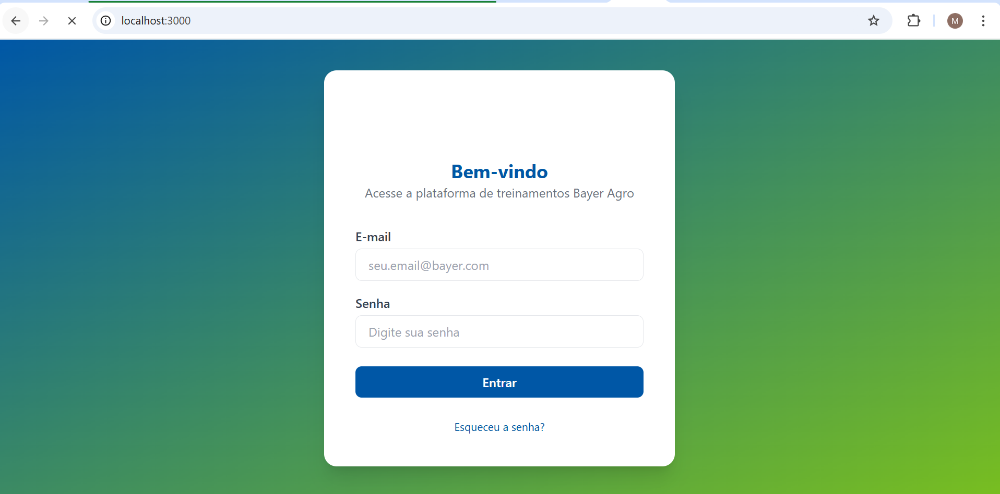<br>

<sub>Fonte: Material produzido pelos autores (2025). </sub><br>

</div>

**Tela de Home**: Onde o usuário terá acesso à busca rápida, help (onde ele encontra conteúdos por tópicos), trilhas e conteúdos favoritados.

<div align = "center">

<sup>Figura 22: Tela de Home.</sup><br>

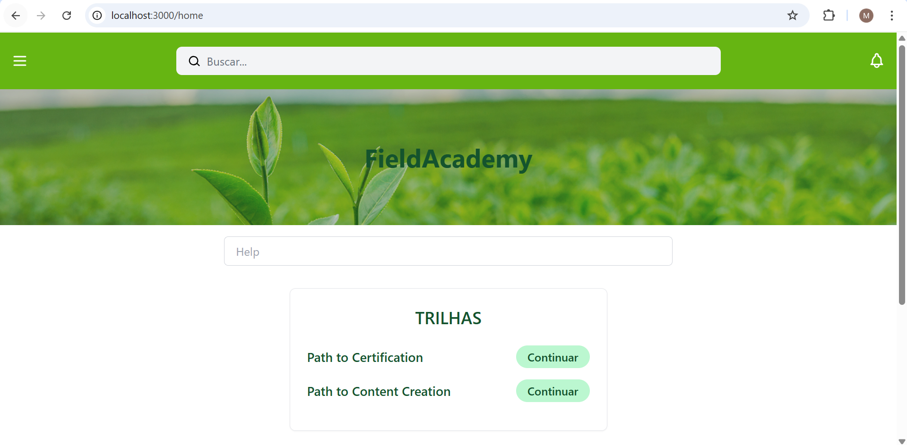<br>
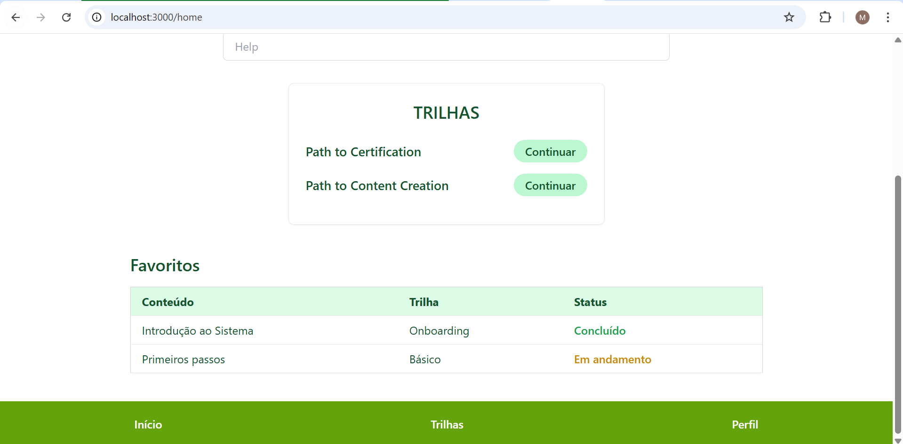<br>

<sub>Fonte: Material produzido pelos autores (2025). </sub><br>

</div>

**Tela de Trilhas**: Onde o usuário terá acesso aos módulos de cada trilha.

<div align = "center">

<sup>Figura 23: Tela de Trilhas.</sup><br>

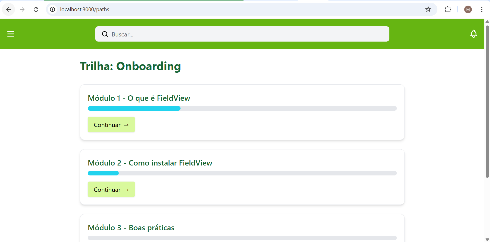<br>

<sub>Fonte: Material produzido pelos autores (2025). </sub><br>

</div>

**Tela de Conteúdos**: Onde o usuário terá acesso aos conteúdos de cada módulo, sendo em textos, vídeos ou em ambos.

<div align = "center">

<sup>Figura 24: Tela de Conteudos.</sup><br>

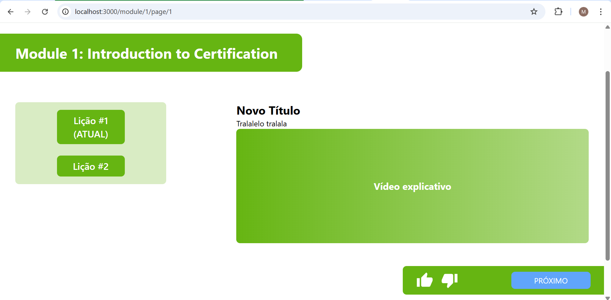<br>

<sub>Fonte: Material produzido pelos autores (2025). </sub><br>

</div>

**Tela de Help**: Onde o usuário terá acesso a cards com temas específicos e perguntas frequentes.

<div align = "center">

<sup>Figura 25: Tela de Help.</sup><br>

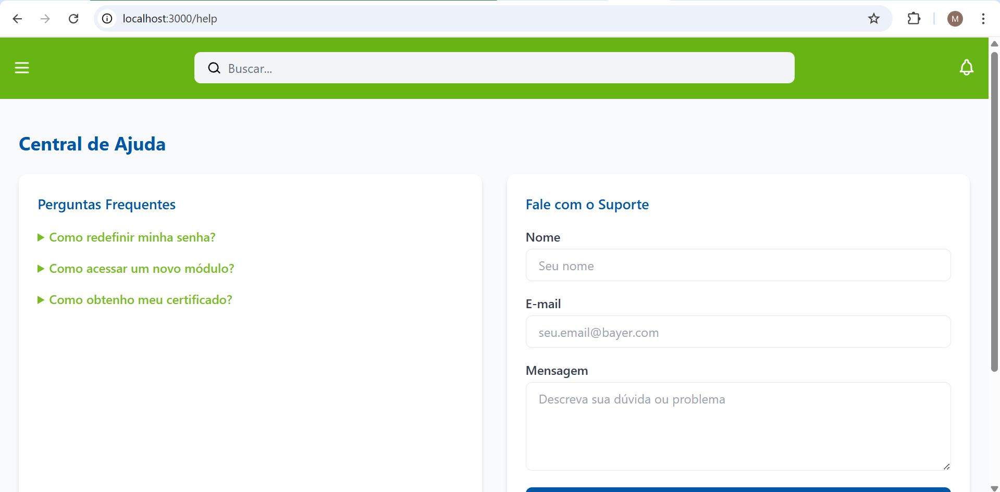<br>

<sub>Fonte: Material produzido pelos autores (2025). </sub><br>

</div>

&nbsp;&nbsp;&nbsp;&nbsp; Essas foram as telas desenvolvidas até o momento, todas seguindo o padrão de estrutura MVC, com rotas já conectadas. No entanto, a conexão com o banco de dados ainda não está completa, visto que, nesta sprint, a equipe concentrou esforços no entendimento e aplicação da estrutura de código exigida, que envolve a divisão em diferentes funcionalidades — um processo que demandou tempo. Assim, como próximos passos, estão previstos a integração completa e funcional do banco de dados, bem como o aprimoramento e a criação de novas telas.<br>

## 4.2. Segunda versão da aplicação web

&nbsp;&nbsp;&nbsp;&nbsp; Nas etapas anteriores do projeto, adotamos uma abordagem incremental para garantir uma base robusta e alinhada às demandas do público-alvo da Bayer. Na Sprint 1, concentramos esforços na análise de mercado e na compreensão aprofundada do contexto do negócio, mapeando oportunidades, vulnerabilidades e riscos que nortearam o desenvolvimento da solução. Na Sprint 2, avançamos para a estruturação do banco de dados e implementação das funcionalidades essenciais do site, além de consolidar o domínio sobre o padrão MVC, fundamental para a organização, manutenção e escalabilidade do código <br>

&nbsp;&nbsp;&nbsp;&nbsp; Na Sprint 3, o trabalho concentrou-se na padronização visual e na experiência do usuário. Criamos um guia de estilos detalhado, definindo cores, tipografia, iconografia e imagens, o que garantiu consistência no design. Em seguida, desenvolvemos protótipos de alta fidelidade das principais telas, facilitando o alinhamento da equipe e a visualização do produto final. Com o protótipo validado, iniciamos o desenvolvimento em código, seguindo o padrão MVC, e entregamos as primeiras telas funcionais do sistema, estabelecendo as bases para as evoluções das próximas sprints. <br>

&nbsp;&nbsp;&nbsp;&nbsp; Na Sprint 4, nosso foco foi consolidar e aprimorar a plataforma web de capacitação técnica desenvolvida para o time agro da Bayer. Após a entrega da primeira versão na Sprint 3 — quando estruturamos o banco de dados, definimos a identidade visual e lançamos o sistema inicial —, avançamos para uma segunda versão mais robusta e alinhada às necessidades do público-alvo, formado principalmente por Promotores Técnicos Digitais (PTDs), técnicos agrícolas e engenheiros agrônomos. Implementamos trilhas de aprendizado personalizadas, aprimoramos a busca inteligente por palavras-chave, ampliamos os recursos de gamificação e incluímos funcionalidades essenciais como o acesso offline e uma aba de “help” dedicada, facilitando o suporte imediato em campo. <br>

&nbsp;&nbsp;&nbsp;&nbsp; Além das melhorias técnicas e de usabilidade, estruturamos um plano de marketing digital integrado para garantir ampla adesão e engajamento dos profissionais. As estratégias envolveram divulgação em portais internos, redes sociais, e-mail marketing, webinars e parcerias com instituições como o Senar, além de campanhas pagas e marketing de conteúdo voltado para boas práticas e inovações do setor. O objetivo foi comunicar com clareza os diferenciais da plataforma — centralização do conhecimento, personalização das trilhas e facilidade de acesso —, consolidando a solução como referência em capacitação técnica digital no agronegócio e fortalecendo a liderança da Bayer em inovação e sustentabilidade. <br>

&nbsp;&nbsp;&nbsp;&nbsp;  **Tela de Login**: A tela de login apresentada permite a autenticação de três tipos de usuários: o usuário comum (PTD), o gestor e o administrador. Cada um deles acessa a plataforma inserindo seu email e senha, com validação dos campos antes do envio das informações. Após a autenticação, o sistema direciona cada perfil para funcionalidades específicas: o usuário comum acessa apenas recursos básicos e informações pertinentes ao seu perfil; o gestor tem acesso a ferramentas de administração de equipes, relatórios e acompanhamento de desempenho; já o administrador possui permissões totais, podendo gerenciar todos os dados, usuários e configurações da aplicação web. A interface é intuitiva e responsiva, com campos claros e botão de ação destacado, garantindo acessibilidade e segurança para todos os perfis, além de reforçar a identidade institucional com a mensagem “Se é bayer, é bom” (Figura 26).<br>

<div align = "center">

<sup>Figura 26: Tela de login.</sup><br>

<br>

<sub>Fonte: Material produzido pelos autores (2025). </sub><br>

</div>


&nbsp;&nbsp;&nbsp;&nbsp;  **Tela de Home**: A página apresentada na imagem da plataforma FieldAcademy oferece uma navegação centralizada em trilhas de aprendizagem, permitindo ao usuário acessar diferentes níveis de conteúdo, como Onboarding, Intermediário, Básico, Avançado e Help, por meio de botões de "Continuar" para cada trilha. Além disso, a interface conta com um campo de busca no topo para facilitar o acesso rápido a conteúdos específicos, um menu lateral para navegação geral e um botão destacado de "Acessar Ajuda", promovendo suporte imediato ao usuário. O layout é limpo, com elementos visuais que remetem ao contexto agrícola, reforçando a identidade da plataforma educacional e proporcionando uma experiência intuitiva e acessível para diferentes perfis de usuários(Figura 27). <br>

<div align = "center">

<sup>Figura 27: Tela de Home.</sup><br>

<br>

<sub>Fonte: Material produzido pelos autores (2025). </sub><br>

</div>


&nbsp;&nbsp;&nbsp;&nbsp;  **Tela de Trilhas**: A tela apresentada exibe a trilha de onboarding da plataforma FieldAcademy, organizada em módulos temáticos como Plantio, Máquinas e Introdução ao FieldView. Cada módulo é apresentado em um card individual, contendo o nome do módulo, uma barra de progresso visual que indica o avanço do usuário e um botão destacado para iniciar o conteúdo(Figura 28). <br>

<sup>Figura 28: Tela de Trilhas.</sup><br>

<br>

<sub>Fonte: Material produzido pelos autores (2025). </sub><br>

</div>


&nbsp;&nbsp;&nbsp;&nbsp;  **Tela de Conteúdos**:  No lado esquerdo, há um painel com botões para cada lição, permitindo ao usuário navegar facilmente entre os módulos e visualizar qual está em andamento. Ao centro, a tela destaca o conteúdo principal da lição atual, incluindo uma explicação detalhada sobre o FieldView™ e um vídeo explicativo integrado, tornando o aprendizado mais dinâmico e acessível. Na parte inferior, botões de interação permitem que o usuário avance para a próxima lição, avalie o conteúdo com “curtir” ou “não curtir” e adicione a lição aos favoritos, promovendo engajamento, personalização da experiência e acompanhamento do progresso individual dentro da plataforma(Figura 29). <br>

<div align = "center">

<sup>Figura 29: Tela de Conteudos.</sup><br>

<br>

<sub>Fonte: Material produzido pelos autores (2025). </sub><br>

</div>

&nbsp;&nbsp;&nbsp;&nbsp;  **Tela de Help**: A tela de Help da plataforma FieldAcademy foi desenvolvida para oferecer suporte rápido e eficiente ao usuário, reunindo cards temáticos que abrangem os principais tópicos e dúvidas frequentes relacionadas ao uso do sistema. Cada card direciona para conteúdos específicos, como “Mapas e dados”, “Boas práticas”, “Data inbox e integrações”, “Plantio”, “Colheita” e “Primeiros passos”, facilitando a navegação e a busca por informações relevantes. Essa abordagem visual e segmentada permite que o usuário encontre respostas de forma intuitiva, reduzindo o tempo de resolução de dúvidas e promovendo uma experiência mais autônoma e satisfatória dentro da plataforma(Figura 30). <br>

<div align = "center">

<sup>Figura 30: Tela de Help.</sup><br>

<br>

<sub>Fonte: Material produzido pelos autores (2025). </sub><br>

</div>

&nbsp;&nbsp;&nbsp;&nbsp;  **Tela de Dashboard**: A tela de Dashboard apresenta uma visão consolidada do perfil do usuário, exibindo informações essenciais como nome, email, localização, data do último acesso, módulo mais recente concluído, média de desempenho e posição no ranking geral. A interface conta ainda com uma barra de busca para localizar rapidamente outros usuários (PTD) e destaca o progresso individual nas trilhas de aprendizagem, com indicadores percentuais e opções para baixar materiais relacionados. É importante ressaltar que o acesso a essa página é exclusivo para o perfil ADMIN, permitindo que apenas administradores acompanhem o desempenho dos usuários, identifiquem módulos pendentes e gerenciem conteúdos relevantes, promovendo engajamento e facilitando a gestão do aprendizado dentro da plataforma(Figura 31). <br>

<div align = "center">

<sup>Figura 31: Tela de Dashboard.</sup><br>

<br>

<sub>Fonte: Material produzido pelos autores (2025). </sub><br>

</div>

&nbsp;&nbsp;&nbsp;&nbsp;  **Tela de Perfil**: A tela de perfil da plataforma FieldAcademy exibe de forma clara e organizada as principais informações do usuário, como nome, email, localização, data do último acesso, módulo mais recente concluído, média de desempenho e posição no ranking geral. Além disso, a interface apresenta o progresso individual em diferentes trilhas de aprendizagem, mostrando percentuais de conclusão e oferecendo a opção de baixar materiais relacionados a cada trilha. A barra de busca no topo facilita a localização de outros usuários ou conteúdos, tornando a navegação mais eficiente. Essas funcionalidades permitem ao usuário acompanhar seu desempenho, identificar facilmente módulos pendentes e acessar recursos relevantes para seu desenvolvimento dentro da plataforma, promovendo uma experiência do usuário(Figura 32). <br>

<div align = "center">

<sup>Figura 32: Tela de Dashboard.</sup><br>

<br>

<sub>Fonte: Material produzido pelos autores (2025). </sub><br>

</div>

&nbsp;&nbsp;&nbsp;&nbsp;  A estrutura das telas da plataforma FieldAcademy foi cuidadosamente planejada para proporcionar uma experiência completa, intuitiva e eficiente aos diferentes perfis de usuários do agronegócio. A tela de login garante segurança e acessibilidade no acesso à plataforma, enquanto a tela de dashboard — exclusiva para administradores — oferece uma visão estratégica do desempenho e progresso dos usuários, facilitando a gestão e o acompanhamento dos resultados. Já a tela de perfil permite que cada usuário visualize e gerencie suas informações, acompanhe seu desenvolvimento e tenha acesso rápido a conteúdos relevantes e personalizados. Por fim, a página principal de trilhas de aprendizagem organiza o conteúdo de forma clara, promovendo o engajamento e a evolução contínua dos profissionais. Juntas, essas telas atendem às necessidades práticas e estratégicas da AgroBayer, promovendo capacitação, inovação e eficiência para todos os envolvidos, desde os promotores técnicos até os gestores e administradores da plataforma. <br>

## 4.3. Versão final da aplicação web

&nbsp;&nbsp;&nbsp;&nbsp; Durante o desenvolvimento da última versão do sistema web FieldAcademy, a equipe concentrou esforços na entrega de funcionalidades essenciais para a experiência dos usuários e na melhoria da estabilidade e usabilidade da plataforma. O código entregue contemplou a implementação completa das trilhas de conhecimento, com módulos organizados, barra de progresso visual, sistema de avaliações, painel de controle para gestores e suporte ao acesso offline. Além disso, foram aprimorados o sistema de busca, a categorização de conteúdos e a interface responsiva, garantindo navegação eficiente em diferentes dispositivos.<br>

&nbsp;&nbsp;&nbsp;&nbsp;  **Tela de Login**:
A tela de login da aplicação FieldAcademy foi projetada para garantir segurança, acessibilidade e usabilidade já no primeiro contato do usuário com a plataforma. O sistema de autenticação valida as credenciais em tempo real, permitindo apenas o acesso de usuários autorizados, enquanto o layout responsivo e os campos destacados facilitam o uso em qualquer dispositivo. Mensagens de feedback orientam rapidamente em caso de erro, tornando a experiência clara e intuitiva. A autenticação contempla três perfis — usuário comum (PTD), gestor e administrador — e direciona cada um automaticamente para áreas e funcionalidades específicas conforme suas permissões. Dessa forma, a tela reforça o compromisso do FieldAcademy com a proteção dos dados e a inclusão de todos os perfis de usuários(Figura 33).<br>

**Tela de Login**: Onde o usuário faz seu cadastro na plataforma ou entra diretamente através de sua conta.

<div align = "center">

<sup>Figura 33: Tela de login.</sup><br>

<br>

<sub>Fonte: Material produzido pelos autores (2025). </sub><br>

</div>

&nbsp;&nbsp;&nbsp;&nbsp;  **Tela de Perfil**:
A aplicação web Field Academy oferece um painel de perfil completo e intuitivo, permitindo ao usuário visualizar rapidamente suas principais informações, como nome, e-mail, localização e data do último acesso. Entre as funcionalidades de destaque estão o acompanhamento da última lição em andamento, a visualização da pontuação total acumulada e a posição atual no ranking entre todos os usuários, promovendo engajamento e senso de progresso. A interface apresenta uma navegação clara e organizada, com acesso facilitado à Central de Ajuda e busca eficiente de conteúdos, proporcionando uma experiência personalizada e dinâmica. Esses recursos tornam a plataforma não apenas uma ferramenta de capacitação, mas também um ambiente que valoriza o desenvolvimento individual e a competitividade saudável, alinhando-se às melhores práticas de aplicações web modernas ao centralizar informações relevantes e facilitar o acompanhamento do desempenho do usuário(Figura 34). <br>

<div align = "center">

<sup>Figura 34: Tela de Perfil</sup><br>

<br>

<sub>Fonte: Material produzido pelos autores (2025). </sub><br>

</div>

&nbsp;&nbsp;&nbsp;&nbsp;  **Tela Sobre Nós*:
A aplicação web FieldAcademy se destaca por oferecer uma experiência intuitiva e eficiente de capacitação técnica para Promotores Técnicos Digitais do agronegócio. Entre suas principais funcionalidades estão a centralização e atualização de conteúdos em um ambiente digital acessível, a personalização de trilhas de conhecimento de acordo com o perfil do usuário, a visualização clara do progresso nas lições e módulos, além de recursos de gamificação e avaliações para engajar e acompanhar o desenvolvimento dos participantes. A plataforma também proporciona suporte dedicado, busca rápida de conteúdos, acesso offline para regiões com baixa conectividade e uma interface responsiva, garantindo facilidade de uso tanto para gestores quanto para aprendizes. Essas funcionalidades promovem autonomia, padronização do atendimento e maior retenção de talentos, tornando a FieldAcademy uma solução completa para o desenvolvimento profissional no campo(Figura 33).<br>

<div align = "center">
<sup>Figura 34: Tela de Perfil</sup><br>
<br>
<sub>Fonte: Material produzido pelos autores (2025). </sub><br>
</div>

<div align = "center">
<sup>Figura 35: Tela de Perfil</sup><br>
<br>
<sub>Fonte: Material produzido pelos autores (2025). </sub><br>
</div>

<div align = "center">
<sup>Figura 36: Tela de Perfil</sup><br>
<br>
<sub>Fonte: Material produzido pelos autores (2025). </sub><br>
</div>

<div align = "center">
<sup>Figura 37: Tela de Perfil</sup><br>
<br>
<sub>Fonte: Material produzido pelos autores (2025). </sub><br>
</div>

<div align = "center">
<sup>Figura 38: Tela de Perfil</sup><br>
<br>
<sub>Fonte: Material produzido pelos autores (2025). </sub><br>
</div>

&nbsp;&nbsp;&nbsp;&nbsp;  **Tela de Gestão**:

A aplicação web FieldAcademy oferece uma gestão de conteúdo eficiente e intuitiva, permitindo a criação, organização e atualização de lições, módulos e provas de forma centralizada. Entre as principais funcionalidades destacam-se o painel de controle com busca rápida de conteúdos, a visualização do progresso das lições, a categorização clara entre diferentes tipos de materiais e a possibilidade de adicionar novas lições facilmente. Os usuários podem acompanhar a última atualização de cada conteúdo, acessar materiais multimídia e utilizar filtros para navegar entre lições, módulos e avaliações. A interface amigável e responsiva facilita tanto o trabalho dos gestores de conteúdo quanto a experiência dos aprendizes, promovendo autonomia, engajamento e atualização contínua dos materiais disponibilizados na plataforma.<br>

A aplicação web FieldAcademy oferece trilhas de aprendizado organizadas por níveis, sistema de ranking gamificado, acompanhamento detalhado do progresso, possibilidade de favoritar conteúdos e uma central de ajuda acessível. Sua interface é intuitiva e responsiva, promovendo navegação eficiente e aprendizado personalizado, o que incentiva o engajamento e facilita a evolução dos usuários na plataforma.<br>

<div align = "center">
<sup>Figura 39: Tela de Gestão módulo. </sup><br>
<br>
<sub>Fonte: Material produzido pelos autores (2025). </sub><br>
</div>

<div align = "center">
<sup>Figura 40: Tela de Gestão lições. </sup><br>
<br>
<sub>Fonte: Material produzido pelos autores (2025). </sub><br>
</div>

<div align = "center">
<sup>Figura 41: Tela de Gestão lições. </sup><br>
<br>
<sub>Fonte: Material produzido pelos autores (2025). </sub><br>
</div>

&nbsp;&nbsp;&nbsp;&nbsp;  **Tela de Help*:
A aplicação web destaca-se por oferecer uma experiência acessível, interativa e organizada para seus usuários, centralizando informações e recursos em um ambiente intuitivo e responsivo. Entre as principais funcionalidades está a Central de Ajuda, ilustrada na imagem acima1, que permite ao usuário navegar facilmente por categorias como importação de dados, análise de mapas e primeiros passos na plataforma. A interface clara facilita o acesso rápido a tutoriais, guias e suporte, promovendo autonomia e reduzindo a necessidade de auxílio técnico. Dessa forma, a aplicação garante usabilidade em diferentes dispositivos, atualização contínua de conteúdos e escalabilidade, adaptando-se às demandas de cada usuário e proporcionando uma jornada digital eficiente e personalizada. <br>

<div align = "center">
<sup>Figura 42: Tela de Help. </sup><br>
<br>
<sub>Fonte: Material produzido pelos autores (2025). </sub><br>
</div>

&nbsp;&nbsp;&nbsp;&nbsp;  **Tela de Dashboard*:
A aplicação web FieldAcademy apresenta um painel de usuários intuitivo, que permite a visualização e o gerenciamento detalhado de informações como nome, e-mail, região, pontuação média e data do último login de cada participante. Entre as principais funcionalidades destacam-se os filtros avançados, que possibilitam ordenar os usuários por nome, pontuação, login recente e região, além de aplicar múltiplos critérios de busca de forma rápida e eficiente. O dashboard centraliza indicadores relevantes, como a pontuação média dos usuários, e oferece uma interface de pesquisa dinâmica para localizar rapidamente qualquer participante. Essas ferramentas promovem uma gestão facilitada, maior transparência nos dados e uma experiência de navegação ágil, contribuindo para o acompanhamento do desempenho e o engajamento dos usuários na plataforma. <br>

<div align = "center">
<sup>Figura 42: Tela de Help. </sup><br>
<br>
<sub>Fonte: Material produzido pelos autores (2025). </sub><br>
</div>

&nbsp;&nbsp;&nbsp;&nbsp; Como próximos passos, o time pretende aprimorar ainda mais o carregamento offline e o armazenamento local de conteúdo, assegurando uma experiência mais suave, mesmo em locais com conexão limitada. Também está nos planos a expansão das funcionalidades de acessibilidade, que inclui a introdução de softwares de leitura de tela e navegação por teclado, para tornar a plataforma mais abrangente e atender a diferentes necessidades dos usuários. Ademais, o trabalho em integrações com APIs de sistemas de gestão do agronegócio facilitará uma melhor interação com plataformas já utilizadas, aumentando a eficácia da aplicação. O grupo começará também a criação de um aplicativo nativo para dispositivos móveis, com o objetivo de estender o alcance e facilitar o acesso em ambientes externos. Finalmente, serão criados painéis analíticos para gestores, que permitirão um acompanhamento minucioso do desempenho e do envolvimento, além de fóruns colaborativos para incentivar a troca de experiências entre os usuários. Essas iniciativas visam estabelecer a FieldAcademy como uma plataforma sólida, inclusiva e adaptada às exigências do setor, promovendo treinamento digital e inovação no campo.<br>


# <a name="c5"></a>5. Testes

## 5.1. Relatório de testes de integração de endpoints automatizados
&nbsp;&nbsp;&nbsp;&nbsp; Nesta seção, são apresentados os testes de integração realizados nos endpoints da aplicação. Endpoints são os pontos de entrada da API, responsáveis por receber e responder às requisições feitas pelos usuários ou por outros sistemas. Cada endpoint representa uma rota definida no backend que executa determinada funcionalidade, como criar, buscar, atualizar ou deletar dados [[27](#c31)].

<div align = "center">

<sup>Figura 33: Teste de deleção de conteúdos fixados.</sup><br>

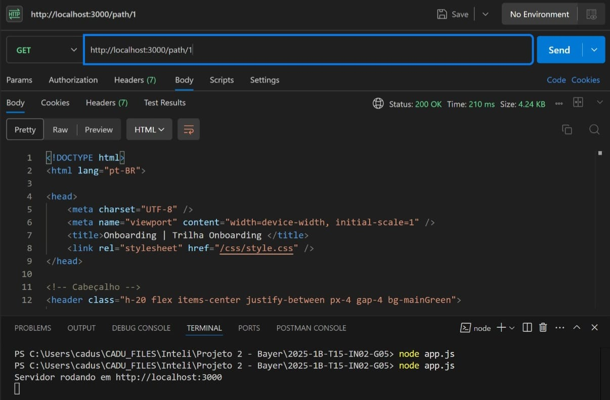<br>

<sub>Fonte: Material produzido pelos autores (2025). </sub><br>
</div>

**Teste:** GET /path/:id<br>
**Descrição:** Teste da rota para renderizar a página de trilha.<br>
**Status:** 200 OK<br>
**Resposta**: HTML da trilha<br><br>


<div align = "center">
<sup>Figura 34: Teste de deleção de conteúdos fixados.</sup><br>
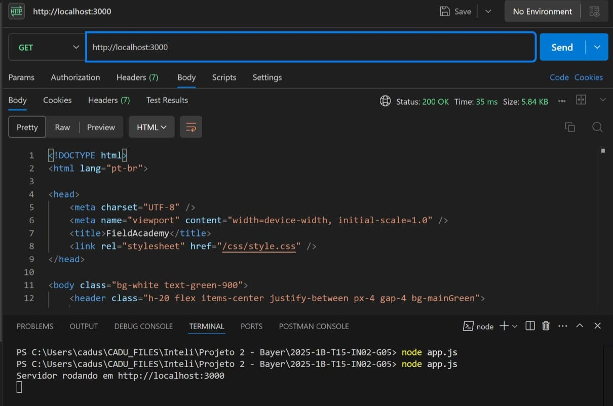<br>
<sub>Fonte: Material produzido pelos autores (2025). </sub><br>
</div>

**Teste:** GET /<br>
**Descrição**: Teste da rota para renderizar a página de home<br>
**Status**: 200 OK<br>
**Resposta**: HTML da home<br><br>

<div align = "center">
<sup>Figura 35: Teste de deleção de conteúdos fixados.</sup><br>
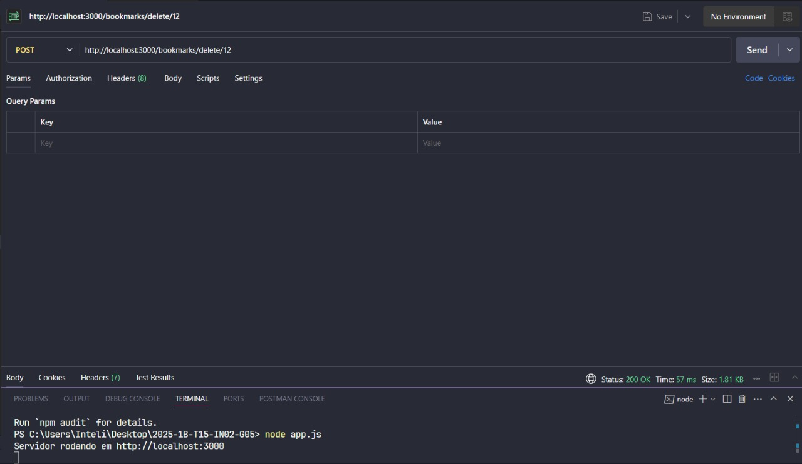<br>
<sub>Fonte: Material produzido pelos autores (2025). </sub><br>
</div>

**Teste**: POST /bookmarks/delete/:id<br>
**Descrição**: Teste da rota para remover conteúdo fixado<br>
**Status**: 200 OK<br>
**Requisição**: Deletar linha da tabela bookmarks no banco de dados <br>

<div align = "center">
<sup>Figura 36: Teste de deleção de conteúdos fixados.</sup><br>
<br>
<sub>Fonte: Material produzido pelos autores (2025). </sub><br>
</div>

**Teste**: POST /api/create-user<br>
**Descrição**: Teste da rota para criar novo usuário<br>
**Status**: 202 OK<br>
**Requisição**: Adicionar linha de usuário na tabela users<br><br>

## 5.2. Testes de usabilidade

Os testes de usabilidade são fundamentais no processo de desenvolvimento de sistemas, pois permitem avaliar como usuários reais interagem com uma interface e identificar possíveis obstáculos que dificultam a navegação ou a realização de tarefas. Através desses testes, é possível coletar dados qualitativos e quantitativos sobre a experiência do usuário, contribuindo para a criação de produtos mais intuitivos e eficientes.<br>

No contexto dos testes realizados no sistema de trilhas de onboarding para Promotores Técnicos Digitais, os participantes foram convidados a executar tarefas como acessar conteúdos, visualizar perfis, favoritar módulos, obter informações sobre usuários e criar novos cadastros. Os resultados apontaram que, de modo geral, os usuários conseguiram completar as tarefas propostas, embora algumas dificuldades tenham sido observadas, como a localização de botões específicos e a navegação em menus pouco intuitivos. Além disso, foram identificados pequenos bugs e inconsistências, como problemas na pesquisa de usuários e diferenças entre o ranking e o dashboard, que impactaram a experiência de uso (Quadro 25, Quadro 26, Quadro 27).<br>

link: https://docs.google.com/spreadsheets/d/1VYUdAKp0DE_P0YspgSDdkwPbT5AG3ZVa_J8FvR557PM/edit?gid=1898951488#gid=1898951488 

### Acessar um conteúdo

<div align = "center">
<sup>Quadro 25: Acessar um conteúdo.</sup><br>

| # | Nome           | Resultado da tarefa | Etapa 1                | Etapa 2                   | Etapa 3         | Etapa 4             |
|---|----------------|--------------------|------------------------|---------------------------|-----------------|---------------------|
| 1 | Lavina         | sucesso            | Fez o login com sucesso| Página de trilhas com sucesso | Página de módulo | Clicou com sucesso  |
| 2 | Alex           | sucesso            | Fez o login com sucesso| Página de trilhas com sucesso | Página de módulo | Clicou com sucesso  |
| 3 | Daniel         | sucesso            | Fez o login com sucesso| Página de trilhas com sucesso | Página de módulo | Clicou com sucesso  |
| 4 | Rafael Gomes   | sucesso            | Fez o login com sucesso| Página de trilhas com sucesso | Página de módulo | Clicou com sucesso  |
| 5 | Marcela        | sucesso            | busca de pesquisa      | acessou o side bar        | pagina de perfil | dashboard           |

<sub>Fonte: Material produzido pelos autores (2025). </sub><br>
</div>
<br>

### Acessar o perfil

<div align = "center">
<sup>Quadro 26: Acessar o perfil.</sup><br>


| # | Nome           | Resultado da tarefa | Etapa 1          | Etapa 2              | Etapa 3                |
|---|----------------|--------------------|------------------|----------------------|------------------------|
| 1 | Lavina         | sucesso            | Acessou a home   | Acessou a página de perfil | Acessou a página de perfil |
| 2 | Alex           | sucesso            | Acessou a home   | Acessou a página de perfil | Acessou a página de perfil |
| 3 | Daniel         | sucesso            | Acessou a home   | Acessou a página de perfil | Acessou a página de perfil |
| 4 | Rafael Gomes   | sucesso            | Acessou a home   | Acessou a página de perfil | Acessou a página de perfil |
| 5 | Marcela        | sucesso            | Acessou a home   | Acessou a página de perfil | Acessou a página de perfil |

<sub>Fonte: Material produzido pelos autores (2025). </sub><br>
</div>
<br>

### Favoritar conteúdo

<div align = "center">
<sup>Quadro 27: Favoritar conteúdo.</sup><br>


| # | Nome           | Resultado da tarefa             | Etapa 1      | Etapa 2                | Etapa 3         | Etapa 4                  |
|---|----------------|--------------------------------|--------------|------------------------|-----------------|--------------------------|
| 1 | Lavina         | sucesso                        | Fez o login  | Acessou a página de trilhas | Acessou a página de módulo | Clicou no botão com sucesso |
| 2 | Alex           | conseguiu com dificuldade       | Fez o login  | Acessou a página de trilhas | Acessou a página de módulo | Dificuldade em achar o botão |
| 3 | Daniel         | sucesso                        | Fez o login  | Acessou a página de trilhas | Acessou a página de módulo | Clicou no botão com sucesso |
| 4 | Rafael Gomes   | sucesso                        | Fez o login  | Acessou a página de trilhas | Acessou a página de módulo | Clicou no botão com sucesso |
| 5 | Marcela        | sucesso                        | Fez o login  | Acessou a página de trilhas | Acessou a página de módulo | Clicou no botão com sucesso |

<sub>Fonte: Material produzido pelos autores (2025). </sub><br>
</div>

<br>

### Obter informações sobre os PTDs

<div align = "center">
<sup>Quadro 28: Obter informações sobre os PTDs.</sup><br>

| # | Nome           | Resultado da tarefa             | Etapa 1                | Etapa 2                | Etapa 3                        | Etapa 4              |
|---|----------------|--------------------------------|------------------------|------------------------|-------------------------------|----------------------|
| 1 | Arthur Marques | conseguiu com dificuldade       | Fez o login com sucesso| Não encontrou facilmente| Teve dificuldade              | Visualizou com sucesso|
| 2 | Luiza          | sucesso                        | Fez o login com sucesso| Acessou dashboard      | Pesquisou sem dificuldades    | Visualizou com sucesso|
| 3 | Leunan         | sucesso                        | Fez o login com sucesso| Procurou no perfil e outras telas | Pesquisou com a barra do header | Visualizou com sucesso|
| 4 | Anne Esther    | conseguiu com dificuldade       | Fez o login com sucesso| Procurou no perfil e outras telas | Pesquisou com a barra do header | Visualizou com sucesso|
| 5 | Marcela        | sucesso                        | Fez o login com sucesso| Acessou dashboard      | Pesquisou sem dificuldades    | Visualizou com sucesso|

<sub>Fonte: Material produzido pelos autores (2025). </sub><br>
</div>
<br>

### Criar usuário

<div align = "center">
<sup>Quadro 29: Criar usuário.</sup><br>


| # | Nome           | Resultado da tarefa | Etapa 1                | Etapa 2                | Etapa 3              |
|---|----------------|--------------------|------------------------|------------------------|----------------------|
| 1 | Arthur Marques | sucesso            | Fez login com sucesso  | Acessou a página de criação | Preencheu com sucesso|
| 2 | Luiza          | sucesso            | Fez login com sucesso  | Acessou a página de criação | Preencheu com sucesso|
| 3 | Leunan         | sucesso            | Fez login com sucesso  | Acessou a página de criação | Preencheu com sucesso|
| 4 | Anne Esther    | sucesso            | Fez login com sucesso  | Acessou a página de criação | Preencheu com sucesso|
| 5 | Marcela        | sucesso            | Fez login com sucesso  | Foi ver a dashboard primeiro | Preencheu com sucesso|

<sub>Fonte: Material produzido pelos autores (2025). </sub><br>
</div>
<br>

Em conclusão, os testes de usabilidade revelam pontos fortes e oportunidades de melhoria em sistemas digitais, sendo essenciais para orientar ajustes que aprimorem a experiência do usuário. A análise dos resultados permite que equipes de desenvolvimento priorizem correções e implementem soluções mais alinhadas às necessidades dos usuários, promovendo maior satisfação e engajamento com a plataforma.<br> 

# <a name="c6"></a>6. Estudo de Mercado e Plano de Marketing

## 6.1 Resumo Executivo
&nbsp;&nbsp;&nbsp;&nbsp; A última versão do FieldAcademy propõe uma aplicação web de capacitação inovadora, desenvolvida para auxiliar promotores e clientes da Bayer. Entre as principais oportunidades de mercado estão a necessidade de treinamento estruturado para novos colaboradores, a alta rotatividade de profissionais e a dificuldade de acesso a informações em campo, especialmente em regiões com baixa conectividade. O avanço da agricultura digital e a busca por maior produtividade e redução de custos operacionais reforçam o potencial da solução [[28](#c32)]. Os objetivos estratégicos do projeto incluem a redução do turnover dos PTDs, o aumento da autonomia e eficiência dos profissionais em campo, a padronização do atendimento ao produtor rural e a diminuição dos chamados ao suporte técnico, que estava saturado com o tanto de vezes que eram acionados pelos promotores. Destaca-se também o esforço conjunto da equipe com especialistas em programação para implementar funcionalidades offline, essenciais para o contexto rural. Além disso, a plataforma busca alinhar a operação de campo com as estratégias de inovação da empresa, promovendo capacitação contínua, avaliações, certificações e melhoria do desempenho dos colaboradores. Entre os diferenciais competitivos, destacam-se as trilhas de conhecimento personalizadas e atualizáveis, a centralização das informações, a interface intuitiva, a busca rápida por palavras-chave, além da gamificação no design e mecanismos de feedback e avaliação dos conteúdos, também implementamos a aba de “help” uma das prioridades apontadas pelo parceiro. A gestão do progresso dos colaboradores permite maior controle e   acompanhamento por parte dos gestores, facilitando a atualização constante dos materiais. Assim, a aplicação contribui de forma significativa para a transformação digital do agronegócio, fortalecendo a competitividade, a sustentabilidade e a capacidade de inovação da Bayer e de seus parceiros.

## 6.2 Análise de Mercado
**a) Visão Geral do Setor**
&nbsp;&nbsp;&nbsp;&nbsp; O setor do agronegócio no Brasil representa grande parte do PIB e das exportações do país, além de ser um dos pilares econômicos. Nos últimos anos, o avanço da agricultura digital tem transformado o setor, impulsionando a adoção de tecnologias como agricultura de precisão, monitoramento por satélite, inteligência artificial e plataformas digitais de gestão agrícola. Essas inovações visam reduzir custos operacionais, aumentar a produtividade e promover a sustentabilidade ambiental. Empresas líderes, como a Bayer, investem fortemente em pesquisa, tanto que a Bayer registrou vendas totais de 46,6 bilhões de euros, com a divisão Crop Science, divisão que inclui a agricultura, defensivos e a seção de pesquisa, faturando 22,3 bilhões de euros, uma queda em relação a 2023. A Bayer também investe em desenvolvimento para oferecer soluções integradas que atendam às demandas de grandes produtores e cooperativas, que buscam eficiência e previsibilidade na produção. A digitalização do campo também enfrenta desafios, como a baixa conectividade em áreas rurais e a necessidade de capacitação técnica dos profissionais que atuam diretamente no campo, como os Promotores Técnicos Digitais (PTDs). Além disso, a crescente demanda por práticas sustentáveis e produtos orgânicos cria espaço para alternativas sustentáveis como biopesticidas, embora os produtos tradicionais ainda dominem o mercado pela escala e eficácia. Assim, o setor se caracteriza por alta competitividade, forte investimento em inovação tecnológica e um ambiente regulatório complexo, que juntos moldam as estratégias das empresas para manter a liderança e atender às necessidades do mercado[[23](#c27)].

**b) Tamanho e Crescimento do Mercado**
&nbsp;&nbsp;&nbsp;&nbsp; O agronegócio brasileiro é um dos maiores do mundo, respondendo por cerca de 25% do PIB nacional e mais de 40% das exportações totais do país [24](#c28). O mercado de tecnologias digitais para o agronegócio, que inclui agricultura de precisão, plataformas de gestão e capacitação digital, tem apresentado crescimento acelerado, impulsionado pela demanda por maior eficiência, sustentabilidade e inovação. Em 2024, o mercado global de agricultura digital foi estimado em aproximadamente 12 bilhões de dólares, com projeção de crescimento anual composto (CAGR) superior a 12% até 2030. No Brasil, esse crescimento é ainda mais expressivo, devido à importância do setor agrícola na economia e à crescente adoção de tecnologias digitais em propriedades rurais de todos os portes. A divisão Crop Science da Bayer, que engloba defensivos agrícolas, sementes e soluções digitais, faturou 22,3 bilhões de euros em 2024, demonstrando a relevância econômica do segmento. Além disso, o investimento em capacitação digital para profissionais do agronegócio, como os Promotores Técnicos Digitais (PTDs), cresce em paralelo, refletindo a necessidade de qualificação para operar tecnologias avançadas. O mercado de educação corporativa digital no agronegócio também acompanha essa tendência, com plataformas especializadas e soluções customizadas ganhando espaço. A expectativa é que a digitalização e a capacitação continuem a impulsionar a produtividade e a competitividade do setor, consolidando o agronegócio brasileiro como referência global em inovação [[25](#c29)].

**c) Tendências de Mercado**<br>
&nbsp;&nbsp;&nbsp;&nbsp; O agronegócio brasileiro está em plena metamorfose digital [[26](#c30)], impulsionada pelo  grande avanço tecnológico, novas dinâmicas de mercado que moldam o setor para 2025 e mudanças comportamentais. Um dos avanços tecnológicos que mais se destaca no cenário atual é a adoção crescente das inteligências artificiais (IAs), big data e internet das coisas (IoT), que possibilitam análises preditivas, monitoramento em tempo real e otimização das operações agrícolas. A conectividade rural, embora ainda limitada em muitas regiões, é fundamental para viabilizar essas inovações, com iniciativas como parcerias entre empresas e programas governamentais buscando ampliar o acesso à internet no campo. No mercado atual foi criada uma nova tendência mais conhecida como agricultura 5.0, conceito que integra tecnologias embarcadas em máquinas, drones, sensores avançados e biotecnologia, está revolucionando o campo ao promover maior precisão, sustentabilidade e eficiência. Drones equipados com câmeras multiespectrais e sensores permitem o monitoramento detalhado das  lavouras, enquanto a edição genética e o uso de bioinsumos contribuem para práticas agrícolas mais sustentáveis e produtivas. No aspecto comportamental, cresce a demanda por produtos agrícolas sustentáveis , rastreáveis e com menor impacto ambiental. Isso impulsiona o uso de tecnologias como blockchain para garantir transparência e autenticidade na cadeia produtiva, atendendo a consumidores cada vez mais conscientes e exigentes. É possível observar a expansão de plataformas digitais para compras e pagamentos online de insumos, facilitando a gestão financeira dos produtores.A tokenização de commodities usando blockchain é uma inovação que está mudando a forma como os produtos agrícolas são negociados, facilitando o acesso a novos mercados e oportunidades de investimento. Essas tendências reforçam a importância da capacitação digital dos profissionais do agronegócio, como os Promotores Técnicos Digitais, para garantir adaptação para o uso dessas tecnologias e práticas inovadoras, destacando a relevância de soluções especializadas como a FieldAcademy para o setor.

## 6.3 Análise da Concorrência
#### a) Principais concorrentes
&nbsp;&nbsp;&nbsp;&nbsp; No mercado de capacitação digital para o agronegócio, obtemos tanto a concorrência indireta quanto a concorrência direta. Entre os concorrentes diretos, estão plataformas especializadas em treinamento e capacitação para o suporte técnico, como a AgriLearning e a AgTech Academy. Essas interfaces oferecem cursos online, trilhas de aprendizagem e certificações voltadas para o setor agrícola, com conteúdos atualizados sobre tecnologias, boas práticas e uso de ferramentas digitais. A AgriLearning se diferencia pelo foco em conteúdos multimídia e avaliações interativas, enquanto a AgTech Academy aposta em parcerias com grandes empresas do setor para garantir atualização constante dos materiais.
Entre os concorrentes indiretos, destacam-se plataformas de educação corporativa de uso geral, como Udemy for Business, Coursera for Teams e LinkedIn Learning, que, embora não sejam focadas exclusivamente no agronegócio, oferecem cursos sobre inovação aplicável ao setor, tecnologia e gestão. Essas plataformas possuem grande variedade de recursos de gamificação, conteúdos, e ferramentas de acompanhamento de progresso, além de forte presença de mercado e reconhecimento de marca. Além disso, algumas empresas do agronegócio desenvolvem soluções internas de capacitação, como a Syngenta Digital e a Corteva Agriscience, que investem em plataformas de treinamento autônomas para equipes e parceiros. Essas iniciativas costumam ser altamente customizadas, mas nem sempre oferecem a flexibilidade e a atualização contínua de plataformas abertas. O FieldAcademy se posiciona como uma solução especializada, flexível e alinhada às necessidades específicas dos promotores técnicos digitais, buscando se diferenciar pela personalização, interface intuitiva e integração com as demandas do campo.

#### b) Vantagens Competitivas da Aplicação Web 
&nbsp;&nbsp;&nbsp;&nbsp; A aplicação web apresenta vantagens competitivas claras em relação aos concorrentes do setor de capacitação digital para o agronegócio. O principal diferencial está na personalização das trilhas de conhecimento, que são adaptadas conforme as necessidades dos Promotores Técnicos Digitais (PTDs) e podem ser facilmente atualizadas pelos gestores e administradas pelos administradores da empresa, garantindo alinhamento contínuo com as demandas do campo e as inovações da empresa. A plataforma também se destaca pela possível funcionalidade de acesso offline, novidade no mercado, além de ser essencial para profissionais que atuam em regiões com baixa conectividade, permitindo que o aprendizado e a consulta de informações ocorram a qualquer momento, sem depender de internet.
Outro ponto forte é a centralização de conteúdos em um único ambiente, facilitando o acesso rápido a materiais, manuais, vídeos e artigos, além de oferecer uma barra de busca eficiente por palavras-chave. A interface intuitiva foi projetada para maximizar a autonomia dos usuários, tornando a navegação simples e agradável. A presença de uma aba de “help” dedicada, desenvolvida a partir das prioridades do parceiro, garante suporte imediato para dúvidas recorrentes, reduzindo a dependência do suporte técnico tradicional.
Além disso, a plataforma incorpora elementos de gamificação, como rankings, conquistas e certificados digitais, que aumentam o engajamento e motivam o usuário a obter mais conhecimento para subir no ranking ou ganhar uma recompensa, por exemplo. Os mecanismos de feedback e avaliação contínua dos conteúdos permitem melhorias constantes e maior aderência às necessidades dos PTDs. Por fim, a gestão do progresso dos colaboradores oferece aos gestores uma visão detalhada do desenvolvimento das equipes, facilitando a tomada de decisão e o direcionamento de treinamentos futuros.
 
## 6.4 Público-Alvo
**a) Segmentação de Mercado**
&nbsp;&nbsp;&nbsp;&nbsp; Nossa plataforma de capacitação técnica da Agro Bayer é feita para quem está na linha de frente do agronegócio: os profissionais que ajudam o produtor rural a usar tecnologias como o Climate FieldView. Isso inclui principalmente os Promotores Técnicos Digitais (PTDs), técnicos agrícolas e engenheiros agrônomos, que levam inovação e eficiência para o campo. <br>

&nbsp;&nbsp;&nbsp;&nbsp; Para entender melhor esse público, dividimos ele em alguns grupos principais. Temos os próprios profissionais técnicos que trabalham diretamente com o produtor, seja em empresas, cooperativas ou órgãos públicos. Há também as instituições que treinam e coordenam essas equipes, espalhando conhecimento. Não podemos esquecer dos gestores que planejam e acompanham o trabalho dos promotores. E, claro, os produtores rurais, que são os maiores beneficiados quando recebem um suporte técnico de qualidade[9]. <br>

&nbsp;&nbsp;&nbsp;&nbsp; Ao definir esses grupos, levamos em conta onde eles atuam, o quanto já usam tecnologia e os desafios específicos que enfrentam no dia a dia, como o tipo de cultura ou o tamanho da propriedade. Isso nos ajuda a oferecer uma capacitação que realmente faz a diferença para esses profissionais tão importantes para o agronegócio brasileiro[10].<br>


**b) Perfil do Público-Alvo**
&nbsp;&nbsp;&nbsp;&nbsp;  O público principal da nossa plataforma de capacitação AgroBayer são os profissionais que estão na linha de frente do agronegócio, como Promotores Técnicos Digitais (PTDs), técnicos agrícolas e engenheiros agrônomos. Eles são os responsáveis por levar tecnologias como o Climate FieldView aos produtores rurais. Em geral, são profissionais com formação na área agrária, entre 22 e 45 anos, atuando em todo o Brasil, especialmente nas grandes regiões produtoras. Embora a maioria seja homem, a presença feminina está crescendo.<br>

&nbsp;&nbsp;&nbsp;&nbsp;  Esses profissionais valorizam resultados, inovação e agilidade para resolver problemas no campo. Estão sempre buscando se atualizar e demonstram grande interesse por ferramentas digitais que facilitem seu dia a dia e aumentem sua eficiência no atendimento ao produtor. Além disso, buscam reconhecimento, estabilidade e crescimento na carreira, mostrando grande disposição para aprender e adotar novas tecnologias que agreguem valor ao seu trabalho e ao negócio do produtor [[11](#c16)].<br>

&nbsp;&nbsp;&nbsp;&nbsp;  Suas necessidades práticas incluem acesso rápido a informações técnicas, mesmo offline, e uma plataforma fácil de usar, com busca eficiente. Eles precisam de conteúdo sempre atualizado sobre as plataformas digitais e o agronegócio. Para mantê-los engajados, a plataforma oferece feedback, desafios (gamificação) e trilhas de aprendizado personalizadas. Esses profissionais são a ponte entre a tecnologia e o campo, essenciais para a produtividade e sustentabilidade do agronegócio[12].<br>

## 6.5 Posicionamento

**a) Proposta de Valor Única**
&nbsp;&nbsp;&nbsp;&nbsp; A proposta de valor única da aplicação é: Unificar, personalizar e facilitar o acesso ao conhecimento técnico dos promotores agro, promovendo excelência, autonomia e inovação no campo, com impacto direto na produtividade e na satisfação dos clientes AgroBayer. Assim, a AgroBayer potencializa a experiência do produtor rural e fortalece sua liderança em inovação e sustentabilidade no setor agro. <br>

&nbsp;&nbsp;&nbsp;&nbsp; A plataforma permite busca inteligente por palavras-chave, recomendações automáticas de trilhas baseadas em necessidades individuais e acompanhamento do progresso, promovendo engajamento por meio de gamificação e feedbacks imediatos. Gestores podem atualizar conteúdos de forma ágil, garantindo que as informações estejam sempre alinhadas com as últimas inovações do agronegócio. O grande diferencial está na capacidade de transformar o processo de capacitação em um ciclo virtuoso de aprendizado, certificação e melhoria contínua, reduzindo custos operacionais, padronizando o atendimento e elevando a eficiência dos promotores. Organizamos o aprendizado em trilhas personalizadas, com módulos que vão do básico à atualização contínua, facilitando o desenvolvimento de cada profissional. O acesso é fácil e intuitivo, funcionando perfeitamente online e também offline – um diferencial crucial para quem atua em áreas rurais com conectividade limitada. Recursos como busca inteligente por palavras-chave, acompanhamento individual do progresso e elementos de gamificação mantêm a equipe engajada e motivada. <br>

&nbsp;&nbsp;&nbsp;&nbsp; O grande benefício é transformar a capacitação em um processo eficiente que reduz custos operacionais, padroniza a qualidade do atendimento e eleva a autonomia e a eficiência dos promotores. Isso impacta diretamente na melhoria da experiência do produtor rural e fortalece a posição da AgroBayer como líder em inovação no agronegócio. Em essência, nossa plataforma unifica, personaliza e facilita o acesso ao conhecimento técnico, impulsionando a excelência no campo. Nossa plataforma de capacitação técnica para promotores agro da AgroBayer oferece um valor único ao resolver desafios reais do campo, como a rotatividade e a falta de conhecimento técnico centralizado. Diferente de treinamentos genéricos, reunimos todo o conteúdo essencial sobre o sistema FieldView em um só lugar, criando uma solução sob medida para a equipe Bayer. <br>

**b) Estratégia de Diferenciação**
&nbsp;&nbsp;&nbsp;&nbsp;  A aplicação web de capacitação técnica para promotores agro da AgroBayer se diferencia da concorrência ao oferecer uma solução altamente personalizada, centrada nas reais dores e necessidades do campo, com foco em nivelamento do conhecimento, redução do turnover e suporte técnico eficiente. <br>

&nbsp;&nbsp;&nbsp;&nbsp;  Enquanto plataformas tradicionais do agronegócio, como Senar, Embrapa e iniciativas privadas, oferecem cursos generalistas e conteúdos dispersos, nossa solução unifica todo o conhecimento necessário sobre o sistema FieldView em um único ambiente digital, acessível por desktop, mobile e offline, o que é fundamental para quem atua em regiões rurais com baixa conectividade. <br>

&nbsp;&nbsp;&nbsp;&nbsp;  O design da aplicação prioriza a experiência do usuário: busca inteligente por palavras-chave, trilhas de aprendizagem adaptativas, módulos de onboarding e nivelamento, avaliações com feedback imediato e gamificação para engajamento contínuo. Gestores podem atualizar conteúdos em tempo real, garantindo que a plataforma acompanhe as constantes inovações do agronegócio e as necessidades do time em campo. Esse dinamismo é um diferencial frente a concorrentes que dependem de ciclos longos de atualização ou formatos pouco flexíveis. <br>

&nbsp;&nbsp;&nbsp;&nbsp;  Desse modo, a lógica de diferenciação está em alinhar a plataforma à cultura de inovação da Bayer, promovendo autonomia, eficiência e padronização do atendimento, com impacto direto na satisfação do produtor rural e na redução de custos operacionais. O ciclo virtuoso de capacitação, certificação e acompanhamento contínuo posiciona a solução como referência em educação digital personalizada para o agro, indo além do ensino tradicional ao entregar valor prático e mensurável para a operação e para o negócio. <br>

## 6.6 Estratégia de Marketing

#### Produto/Serviço
&nbsp;&nbsp;&nbsp;&nbsp; Nossa plataforma web de capacitação técnica foi criada pensando em você, promotor agro da AgroBayer. Ela oferece uma experiência completa para aprimorar seu conhecimento e facilitar seu trabalho no campo. Explore trilhas de aprendizado organizadas, acompanhe seu progresso com avaliações e receba sugestões personalizadas. Encontre informações rapidamente com a busca por palavras-chave e acesse materiais essenciais mesmo offline, com conteúdo sempre atualizado pelos gestores. <br>

&nbsp;&nbsp;&nbsp;&nbsp; Com a plataforma, você ganha mais autonomia e eficiência, reduz a necessidade de contatar o suporte e padroniza seu atendimento, melhorando a experiência do produtor rural. Mantenha-se engajado com gamificação e feedback, acompanhando seu desenvolvimento. Nosso diferencial é unificar todo o conhecimento sobre FieldView em um portal intuitivo e acessível, mesmo com baixa conectividade. O foco na personalização e atualização constante garante que a ferramenta atenda suas necessidades e acompanhe as inovações do agronegócio. <br>

## 6.2 Preço
 &nbsp;&nbsp;&nbsp;&nbsp; O modelo de precificação adotado para a plataforma de capacitação técnica da AgroBayer é o de assinatura corporativa, com valores ajustados conforme o número de usuários, o grau de personalização e as funcionalidades contratadas. Essa escolha se baseia na análise do mercado de plataformas de educação para o agronegócio, onde a assinatura mensal por usuário ou pacotes customizados são práticas comuns, partindo de valores em torno de R$ 79,90 mensais. O modelo de assinatura é especialmente adequado ao contexto dinâmico do agronegócio, pois permite atualização contínua dos conteúdos, flexibilidade de acesso para os profissionais – inclusive offline – e facilita a gestão centralizada dos acessos pela empresa. Além disso, proporciona previsibilidade de receita e incentiva o uso constante da plataforma, promovendo o engajamento dos usuários e facilitando o acompanhamento dos resultados da capacitação. Esse formato está alinhado com as tendências do setor, que valoriza soluções digitais flexíveis e escaláveis para formação e qualificação de equipes técnicas, respondendo à crescente demanda por mão de obra especializada e atualização tecnológica no campo.<br>

 &nbsp;&nbsp;&nbsp;&nbsp; Para a AgroBayer, facilita enormemente a gestão dos acessos e o acompanhamento do progresso da equipe. Adicionalmente, este formato proporciona previsibilidade de receita para nós, enquanto incentiva o uso contínuo e o engajamento dos usuários com a plataforma. Por fim, favorece a mensuração clara dos resultados da capacitação, permitindo avaliar o retorno sobre o investimento em termos de aquisição e retenção de conhecimento pela equipe, alinhando-se perfeitamente às melhores práticas de precificação no setor de educação corporativa, especialmente no contexto do agronegócio. <br>

### 6.3 Praça
&nbsp;&nbsp;&nbsp;&nbsp; Levamos nossa plataforma de capacitação técnica diretamente até você, promotor agro da AgroBayer, usando principalmente canais digitais. O acesso principal é pela própria aplicação web, que funciona perfeitamente em computadores, tablets e celulares. Pensando na realidade do campo, incluímos a função de acesso offline, permitindo que você consulte materiais importantes mesmo sem internet. <br>

&nbsp;&nbsp;&nbsp;&nbsp; Para garantir que todos conheçam e saibam usar a plataforma, utilizamos diversos meios de comunicação digital. Divulgamos através dos portais internos da Bayer, redes sociais como LinkedIn e Instagram, e-mail marketing e grupos de WhatsApp, que já são familiares para muitos. Além disso, promovemos webinars e eventos online para apresentar novidades e manter todos engajados. <br>

&nbsp;&nbsp;&nbsp;&nbsp; Também contamos com parcerias importantes, como a do Senar, para ampliar o alcance da ferramenta. Essa estratégia digital integrada não só facilita o acesso à plataforma em todo o Brasil, mas também nos permite acompanhar o uso, atualizar conteúdos rapidamente e receber seu feedback, tornando a capacitação cada vez mais eficaz e alinhada às suas necessidades no agronegócio moderno. <br>


### 6.4 Promoção
&nbsp;&nbsp;&nbsp;&nbsp; Para divulgar nossa plataforma de capacitação aos promotores agro da AgroBayer, usaremos uma estratégia digital completa e integrada. O objetivo é garantir que todos conheçam a ferramenta e seus benefícios. Vamos otimizar nosso site e conteúdos (SEO) para que profissionais do agro nos encontrem facilmente em buscas online. Criaremos materiais úteis como artigos, vídeos e webinars (Marketing de Conteúdo) sobre o FieldView e boas práticas, posicionando a Bayer como referência em conhecimento. Estaremos ativos nas redes sociais (LinkedIn, Instagram, etc.), compartilhando conteúdos educativos, histórias de sucesso e interagindo com a comunidade agro. Usaremos anúncios pagos segmentados (Campanhas Pagas) para alcançar mais profissionais em momentos chave, como lançamentos de novos módulos. <br>

&nbsp;&nbsp;&nbsp;&nbsp; Manteremos os promotores informados sobre novidades através de e-mails (E-mail Marketing) e colaboraremos com influenciadores do setor para ampliar nosso alcance. Essa combinação de ações garantirá visibilidade e engajamento, consolidando a plataforma como a principal ferramenta de capacitação técnica para o time AgroBayer. <br>

# <a name="c7"></a>7. Conclusões e trabalhos futuros 

A aplicação web FieldAcademy atingiu de forma significativa os objetivos propostos, centralizando conteúdos, personalizando trilhas de aprendizado, facilitando o acompanhamento do progresso dos usuários e promovendo maior autonomia e eficiência para profissionais do agronegócio, especialmente em regiões com baixa conectividade. Entre os pontos fortes, destacam-se a interface intuitiva, o acesso offline, a gamificação e o suporte dedicado, que juntos aumentaram o engajamento e a padronização do atendimento técnico.

Os principais pontos a melhorar incluem a performance em conexões muito instáveis, a ampliação da acessibilidade, a integração com sistemas externos e a personalização de notificações. Para cada um desses desafios, foram definidos planos de ação, como otimização de cache, desenvolvimento de APIs, implementação de recursos de acessibilidade e criação de um painel de preferências para notificações.

Como ideias para o futuro, o grupo sugere a criação de dashboards analíticos para gestores, aplicativos mobile nativos, uma comunidade de usuários para troca de experiências, uso de inteligência artificial para recomendações personalizadas e novas mecânicas de gamificação. Essas melhorias visam consolidar a FieldAcademy como referência em capacitação digital no agronegócio, ampliando seu impacto e valor competitivo.


# <a name="c8"></a>8. Referências

<a name="c10">[1]</a> BAYER. Bayer Brasil. Disponível em: https://www.bayer.com.br/pt/​. Acesso: 25/04/2025.

<a name="c11">[2]</a> CLIMATE FIELDVIEW. Plataforma de agricultura digital. Disponível em: https://climatefieldview.com.br/. Acesso: 20/04/2025.

<a name="c17">[3]</a> LUCK, Heloisa. Liderança em gestão escolar. 4. ed. Petrópolis: Vozes, 2010. Acesso: 24/02/2025. <br>

<a name="c12">[4]</a> ENGENHARIA 360. Explorando a evolução do FieldView: Agricultura Digital. Disponível em: https://engenharia360.com/agricultura-digital-com-climate-fieldview/. Acesso: 25/04/2025.

<a name="c13">[5]</a> PAES, Ashley. Agtechs: entenda o panorama das startups latino-americanas do agronegócio. Distrito, 19 dez. 2023. Disponível em: https://distrito.me/blog/panorama-agtech-brasil/​. Acesso em: 22/04/2025.​

<a name="c14">[6]</a> GUSMÃO, Ana. Agronegócio se rende à tecnologia e aposta em soluções criadas por startups. CompreRural, 2 out. 2023. Disponível em: https://www.comprerural.com/agronegocio-se-rende-a-tecnologia-e-aposta-em-solucoes-criadas-por-startups​. Acesso: 22/04/2025.

<a name="c15">[7]</a> PEREA, Ernesto. 4 transnacionales concentran 50% del mercado global de plaguicidas. Imagen Agropecuaria, 11 jun. 2024. Disponível em: https://imagenagropecuaria.com/2024/4-transnacionales-concentran-50-del-mercado-global-de-plaguicidas/​. Acesso em: 22/04/2025.

<a name="c16">[8]</a> FERRAMENTAS DA QUALIDADE. Matriz de Riscos – Matriz de Probabilidade e Impacto. Disponível em: https://ferramentasdaqualidade.org/matriz-de-riscos-matriz-de-probabilidade-e-impacto/. Acesso em: 20/04/25.

<a name="c16">[9]</a>HEUSER, C. A. Projeto de Banco de Dados. 6. ed. Porto Alegre: Bookman, 2009.

<a name="c16">[10] </a> NORMAN, Donald A. O design do dia a dia. 2. ed. Rio de Janeiro: Rocco, 2016

<a name="c16">[8]</a> LIDWELL, William; HOLDEN, Kritina; BUTLER, Jill. Princípios universais do design. 2. ed. Rio de Janeiro: Gustavo Gili, 2019. //griddesktop// paleta de cores

<a name="c16">[8]</a> BRINGHURST, Robert. Os elementos do estilo tipográfico. São Paulo: Cosac Naify, 2005.

<a name="c16"> [9]</a> BRASIL. Ministério da Agricultura e Pecuária. Normas Técnicas — Ministério da Agricultura e Pecuária. Brasília: MAPA, 2025. Disponível em: https://www.gov.br/agricultura/pt-br/assuntos/sustentabilidade/producao-integrada/normas-tecnicas.

<a name="c16"> [10]</a>IFRS. Manual do Profissional Técnico Agrícola. Bento Gonçalves: IFRS, 2019. Disponível em: https://ifrs.edu.br/bento/wp-content/uploads/sites/13/2019/11/Manual-profissional-tecnico-agricola-sintargs-1.pdf. 

<a name="c16"> [11]</a> CLIMATE FIELDVIEW. Cursos - Universidade FieldView™. 2022. Disponível em: https://www.climatefieldview.com.br/universidadefv/cursos.

<a name="c16"> [12]</a> IFRS. Manual do Profissional Técnico Agrícola. Bento Gonçalves: IFRS, 2019. Disponível em: https://ifrs.edu.br/bento/wp-content/uploads/sites/13/2019/11/Manual-profissional-tecnico-agricola-sintargs-1.pdf.

<a name="c17">[13]</a> ROCK CONTENT. As 5 forças de Porter: o que são, como funcionam e como aplicar no seu negócio. Disponível em: https://rockcontent.com/br/blog/5-forcas-de-porter/. Acesso em: 24/04/2025.

<a name="c18">[14]</a> DOURADO, Bruna. Análise SWOT ou FOFA: confira o passo a passo completo. RD Station, 21 ago. 2024. Disponível em: https://www.rdstation.com/blog/marketing/analise-swot/. Acesso em: 20/04/2025

<a name="c19">[15]</a> SOMOSTERA. Canvas de proposta de valor: para que serve e como preencher. Blog SomosTera, s.d. Disponível em: https://blog.somostera.com/product-management/canvas-de-proposta-de-valor. Acesso em: 20/04/2025.

<a name="c20">[16]</a> ATTRI. Persona e UX: qual a relação e por que são essenciais? Blog Attri, s.d. Disponível em: https://www.attri.com.br/blog/persona-e-ux-qual-a-relacao-e-por-que-sao-essenciais/. Acesso em: 24 jun. 2025.

<a name="c21">[17]</a> ATLASSIAN. User stories [s.d.]. Disponível em: https://www.atlassian.com/agile/project-management/user-stories. Acesso em: 24 jun. 2025.

<a name="c22">[18]</a> MIRO. Ferramenta para criar wireframes online. Disponível em: https://miro.com/pt/wireframe/. Acesso em: 24 jun. 2025.

<a name="c23">[19]</a> PM3. Style guide: o que é, benefícios e como criar um do zero. Equipe de Conteúdo PM3, 11 jan. 2024. Disponível em: https://pm3.com.br/blog/style-guide/. Acesso em: 20/05/2025.

<a name="c24">[20]</a> GOVERNO DO BRASIL – Padrão Digital de Governo. Fundamentos – Tipografia. Versão 4 [s.d.]. Disponível em: https://next-ds.estaleiro.serpro.gov.br/fundamentos/tipografia. Acesso em: 24/05/2025.

<a name="c25">[21]</a> INTERACTION DESIGN FOUNDATION. What Are High‑Fidelity Prototypes? [s.l.], s.d. Disponível em: https://www.interaction‑design.org/literature/topics/high‑fidelity‑prototypes. Acesso em: 20/05/2025. 

<a name="c26">[22]</a> AMAZON WEB SERVICES (AWS). O que é uma API (interface de programação de aplicações)? [s.l.], s.d. Disponível em: https://aws.amazon.com/pt/what-is/api/. Acesso em: 15/05/2025.

<a name="c27">[23]</a> LUÍZ, Joseandro. A engenharia em Climate FieldView™: inovação no coração da agricultura digital. Climate FieldView (Bayer), 5 abr. 2018. Disponível em: https://blog.climatefieldview.com.br/inovacao-no-coracao-da-agricultura-digital. Acesso em: 15/06/2025.

<a name="c28">[24]</a> MUNDOCOOP. MundoCoop – O Portal de Notícias do Cooperativismo. [s.l.], 1999–2025. Disponível em: https://mundocoop.com.br/. Acesso em: 10/06/2025. 

<a name="c29">[25]</a> PRICEWATERHOUSECOOPERS BRASIL (PwC). Agtech Innovation. [s.l.], s.d. Disponível em: https://www.pwc.com.br/pt/consultoria/agtech-innovation.html. Acesso em: 10/06/2025.

<a name="c30">[26]</a> BEMAGRO. BemAgro – Soluções em Agricultura Inteligente. [s.l.], [s.d.]. Disponível em: https://www.bemagro.com/. Acesso em: 10/06/2025. 

<a name="c31">[27]</a> IBM. (2024). O que é um endpoint de API? Disponível em: https://www.ibm.com/br-pt/think/topics/api-endpoint. Acesso em:  20/05/2025.

<a name="c32">[28]</a> CLIMATE. Página oficial da Climate FieldView Brasil. Disponível em: https://climate.com/pt-br.html. Acesso em: 20/05/2025.

INTELI. Adalove. Disponível em: https://adalove.inteli.edu.br/feed. Acesso em: 15/04/2025. <br>

# <a name="c9"></a>Anexos